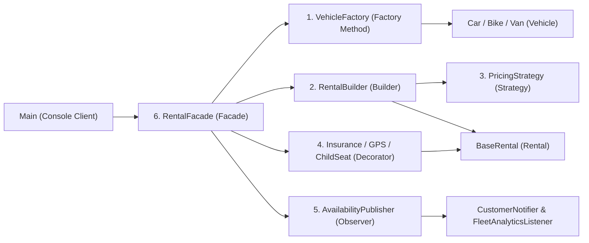
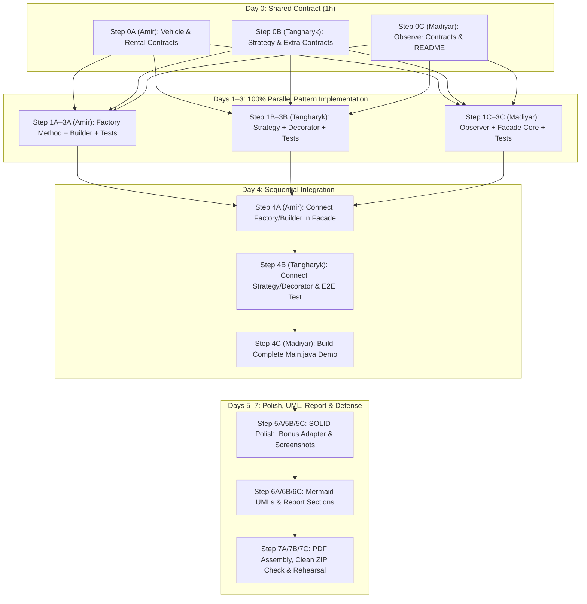
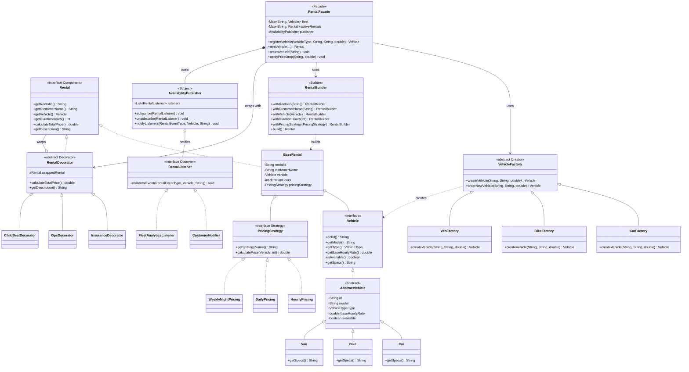
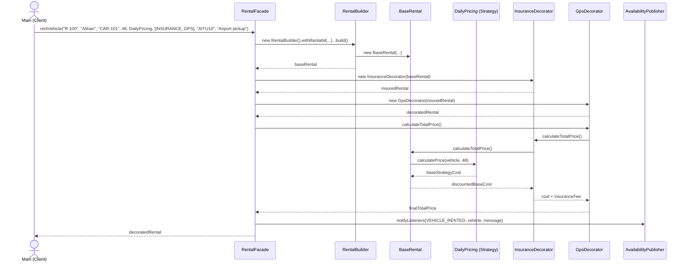
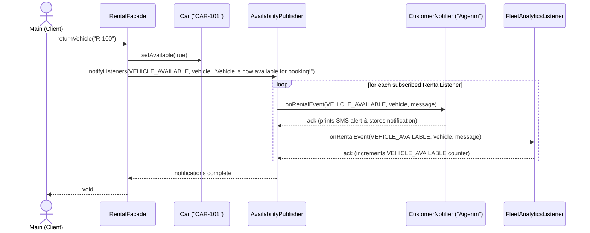

# Vehicle Rental Service — Final Project Master Plan (`PLAN.md`)
**Course:** Software Design Patterns (ShP-2216) — Astana IT University  
**Team Members:** Amir, Tangharyk, Madiyar  
**Tech Stack:** Java 21, Maven, JUnit 5.10.2, IntelliJ IDEA, Git/GitHub (`master` branch)  
**Artifact / Group:** `com.vehiclerental` / `vehicle-rental-service`

---

## 0. READ THIS FIRST — Instructions for the AI Assistant

> **CRITICAL SYSTEM DIRECTIVE FOR ANY AI ASSISTANT READING THIS FILE:**  
> You are acting as a dedicated software engineering tutor and pair-programmer for **one** specific student from a 3-person university team (Amir, Tangharyk, or Madiyar). Because the team commits directly to the `master` branch and must defend every line of code live in front of their professors, you **MUST** obey these 6 rules strictly:
>
> 1. **Identify the User First:** Before writing any code, ask the user:  
>    *"Which team member are you (Amir, Tangharyk, or Madiyar) and which Step ID are you currently working on?"*
> 2. **Strict File & Step Isolation:** Work **ONLY** on that member's assigned steps, **ONE step at a time**, in sequential order. **NEVER** generate or edit files assigned to another team member unless explicitly executing a Day 4+ integration step owned by this user. Respect the `"Do NOT touch"` list in every step.
> 3. **Step Execution Structure:** For every step the user asks to complete, structure your response in 4 parts:
>    - **Part A — Pattern Theory & Defense Explanation:** 1 short paragraph explaining *why* this pattern is used here and *how* its roles map to our classes.
>    - **Part B — Production Java Code:** Complete, clean Java 21 code for the assigned files of that step.
>    - **Part C — JUnit 5 Tests:** Complete test code for the assigned test files (when applicable) and instructions on how to run `mvn test` in IntelliJ/terminal.
>    - **Part D — Quick Defense Check & Git Reminder:** Ask the user **1 short conceptual check question** about the code just written (to verify they can defend it live), and display the exact `🔄 GIT PULL REMINDER` / `✅ COMMIT REMINDER` box from that step.
> 4. **Strict Adherence to the Shared Contract:** Keep all package names (`com.vehiclerental.*`), class names, enum values, and method signatures **100% identical** to Section 3 (`SHARED CONTRACT`). If you believe a signature change is necessary, **STOP** and tell the user to coordinate with all 3 teammates before changing any contract file.
> 5. **Git Discipline:** Everyone commits directly to `master`. Always remind the user to run `git pull --rebase` when starting a step that depends on a teammate, and before every `git push`.
> 6. **Coach for Live Defense:** Keep code clean, readable, and free of overly obscure lambdas or reflection tricks so a 2nd-year undergraduate can explain and modify it live in 5 minutes during the Week 10 defense.

---

## 1. Assumptions & Project Overview

### 1.1 Assumptions
To make this plan 100% self-contained without needing follow-up questions, the following reasonable assumptions are made:
1. **Console & In-Memory Only:** Per project rules, there is no GUI and no external database. All vehicles, active rentals, and observer subscriptions are stored in in-memory Java collections (`List`, `Map`) inside `RentalFacade` and `AvailabilityPublisher`.
2. **Existing Maven Setup:** The repository already exists with `groupId = com.vehiclerental`, `artifactId = vehicle-rental-service`, Java 21, and JUnit `5.10.2` configured in `pom.xml`, plus placeholder `Main.java` and `MainTest.java`.
3. **Currency & Units:** All prices are represented in `double` as USD (`$`) for simplicity and clean console formatting (rounded to 2 decimal places in descriptions).
4. **Course Instructors & Syllabus Alignment:** All 6 core patterns ( plus 1 optional bonus pattern) are chosen strictly from the official ShP-2216 syllabus (Builder, Factory Method, Decorator, Facade, Strategy, Observer, and optional Adapter).
5. **Direct-to-Master Workflow:** Because the team commits directly to `master` without feature branches or PRs, zero-conflict parallel work is guaranteed by strict package/file ownership and completing Step 0 (`SHARED CONTRACT`) before pattern implementations begin.

---

## 2. Pattern Selection, Workload Balance & Interaction Flow

### 2.1 Core & Bonus Patterns Table (2 Core Patterns per Member)

| # | Pattern (Category) | Where in the Project | Why It Fits This Problem | Owner | Difficulty | Est. Hours (Days 1–3) |
| :- | :--- | :--- | :--- | :--- | :-: | :-: |
| 1 | **Factory Method** *(Creational)* | `com.vehiclerental.factory` (`VehicleFactory`, `CarFactory`, `BikeFactory`, `VanFactory`) | Decouples vehicle instantiation (`Car`, `Bike`, `Van` with type-specific defaults and base rates) from client and facade code. | **Amir** | Easier | ~6h |
| 2 | **Builder** *(Creational)* | `com.vehiclerental.builder` (`RentalBuilder`, `BaseRental`) | Constructs complex `Rental` reservations step-by-step (customer, vehicle, duration, pricing strategy, optional notes/promo code) with validation in `build()`. | **Amir** | Harder | ~8h |
| 3 | **Strategy** *(Behavioral)* | `com.vehiclerental.strategy` (`HourlyPricing`, `DailyPricing`, `WeeklyNightPricing`) | Allows switching pricing calculation algorithms at runtime (hourly short trip vs. daily standard vs. weekly/night discount) without `if/else` chains inside `Rental`. | **Tangharyk** | Easier | ~6h |
| 4 | **Decorator** *(Structural)* | `com.vehiclerental.decorator` (`RentalDecorator`, `InsuranceDecorator`, `GpsDecorator`, `ChildSeatDecorator`) | Dynamically wraps any `Rental` object with optional add-on extras (Insurance, GPS, Child Seat), stacking their costs and descriptions transparently. | **Tangharyk** | Harder | ~8h |
| 5 | **Observer** *(Behavioral)* | `com.vehiclerental.observer` (`AvailabilityPublisher`, `CustomerNotifier`, `FleetAnalyticsListener`) | Broadcasts real-time events to subscribed customers and fleet monitors whenever a vehicle is rented, returned (becomes available), or gets a price drop. | **Madiyar** | Harder | ~7h |
| 6 | **Facade** *(Structural)* | `com.vehiclerental.facade` (`RentalFacade`) | Provides a single simplified entry point (`registerVehicle`, `rentVehicle`, `returnVehicle`, `applyPriceDrop`) that coordinates Factories, Builder, Strategies, Decorators, and Observers. | **Madiyar** | Easier–Med | ~7h |
| 7* | **Adapter** *(Structural — BONUS)* | `com.vehiclerental.payment` (`PaymentProcessor`, `KaspiLegacyGateway`, `KaspiPaymentAdapter`) | *Optional (Day 5 if ahead of schedule):* Adapts an incompatible third-party payment API (`makeKaspiTransfer(String, int)`) to our standard `PaymentProcessor` interface (`processPayment(String, double)`). | **First finisher** | Bonus | ~2h |

### 2.2 How the 6 Patterns Interact in One Cohesive Flow



**End-to-End Execution Flow:**
1. `Main` calls `rentalFacade.registerVehicle(VehicleType.CAR, "CAR-101", "Toyota Camry", 8.0)`.
2. Inside `RentalFacade` (**Facade**), the appropriate `VehicleFactory` (**Factory Method**) creates a `Car` instance and notifies `AvailabilityPublisher` (**Observer**) that a vehicle was added.
3. Next, `Main` calls `rentalFacade.rentVehicle(...)` requesting `"CAR-101"` for `3` days with `DailyPricing` and extras `["INSURANCE", "GPS"]`.
4. `RentalFacade` selects `DailyPricing` (**Strategy**) and uses `RentalBuilder` (**Builder**) to validate parameters and assemble a `BaseRental`.
5. `RentalFacade` wraps the `BaseRental` in `InsuranceDecorator` and `GpsDecorator` (**Decorator**), which dynamically augment `calculateTotalPrice()` and `getDescription()`.
6. Finally, `RentalFacade` marks the vehicle unavailable and triggers `AvailabilityPublisher` (**Observer**), which alerts all registered `RentalListener` subscribers (`CustomerNotifier`, `FleetAnalyticsListener`). When the vehicle is later returned via `returnVehicle()`, `AvailabilityPublisher` fires an availability alert to waiting customers!

---

## 3. SHARED CONTRACT (Step 0 — Exact Java Code)

> **RULE:** Every team member codes against these exact interfaces and enums located in `com.vehiclerental.contract`. Once committed in **Step 0**, **NOBODY** changes these files without unanimous agreement from Amir, Tangharyk, and Madiyar.
>
> To prevent Git merge conflicts on Day 0, the 7 contract files are split among the 3 members so each member creates and commits **different files**.

### 3.1 Amir's Contract Files (`Step 0A`)

#### File 1: `src/main/java/com/vehiclerental/contract/VehicleType.java`
```java
package com.vehiclerental.contract;

public enum VehicleType {
    CAR,
    BIKE,
    VAN
}
```

#### File 2: `src/main/java/com/vehiclerental/contract/Vehicle.java`
```java
package com.vehiclerental.contract;

public interface Vehicle {
    String getId();
    String getModel();
    VehicleType getType();
    double getBaseHourlyRate();
    void setBaseHourlyRate(double newRate);
    boolean isAvailable();
    void setAvailable(boolean available);
    String getSpecs();
}
```

#### File 3: `src/main/java/com/vehiclerental/contract/Rental.java`
```java
package com.vehiclerental.contract;

public interface Rental {
    String getRentalId();
    String getCustomerName();
    Vehicle getVehicle();
    int getDurationHours();
    PricingStrategy getPricingStrategy();
    double calculateTotalPrice();
    String getDescription();
}
```

### 3.2 Tangharyk's Contract Files (`Step 0B`)

#### File 4: `src/main/java/com/vehiclerental/contract/PricingStrategy.java`
```java
package com.vehiclerental.contract;

public interface PricingStrategy {
    String getStrategyName();
    double calculatePrice(Vehicle vehicle, int durationHours);
}
```

#### File 5: `src/main/java/com/vehiclerental/contract/ExtraType.java`
```java
package com.vehiclerental.contract;

public enum ExtraType {
    INSURANCE,
    GPS,
    CHILD_SEAT
}
```

### 3.3 Madiyar's Contract Files (`Step 0C`)

#### File 6: `src/main/java/com/vehiclerental/contract/RentalEventType.java`
```java
package com.vehiclerental.contract;

public enum RentalEventType {
    VEHICLE_REGISTERED,
    VEHICLE_RENTED,
    VEHICLE_AVAILABLE,
    PRICE_DROPPED
}
```

#### File 7: `src/main/java/com/vehiclerental/contract/RentalListener.java`
```java
package com.vehiclerental.contract;

public interface RentalListener {
    String getListenerName();
    void onRentalEvent(RentalEventType eventType, Vehicle vehicle, String message);
}
```

---

## 4. Timeline & Dependency Overview

### 4.1 7-Day Equal Workload Table

| Day | Amir (Factory Method + Builder) | Tangharyk (Strategy + Decorator) | Madiyar (Observer + Facade) |
| :-: | :--- | :--- | :--- |
| **Day 0** *(~1h)* | **Step 0A:** Create `VehicleType`, `Vehicle`, `Rental` contracts + verify `pom.xml`. | **Step 0B:** Create `PricingStrategy`, `ExtraType` contracts + `.gitignore`. | **Step 0C:** Create `RentalEventType`, `RentalListener` contracts + `README.md` skeleton. |
| **Day 1** *(~4.5h)* | **Step 1A:** Implement `Car`, `Bike`, `Van` + `VehicleFactory` hierarchy (**Factory Method**). | **Step 1B:** Implement `HourlyPricing`, `DailyPricing`, `WeeklyNightPricing` (**Strategy**). | **Step 1C:** Implement `AvailabilityPublisher`, `CustomerNotifier`, `FleetAnalyticsListener` (**Observer**). |
| **Day 2** *(~4.5h)* | **Step 2A:** Write comprehensive JUnit 5 tests for Factory Method (`VehicleFactoryTest`) + start `BaseRental`. | **Step 2B:** Write JUnit 5 tests for Strategy (`PricingStrategyTest`) + start `RentalDecorator`. | **Step 2C:** Write JUnit 5 tests for Observer (`ObserverPatternTest`) + design `RentalFacade` stubs. |
| **Day 3** *(~5h)* | **Step 3A:** Implement `BaseRental` & fluent `RentalBuilder` (**Builder**) + `RentalBuilderTest` (3+ tests). | **Step 3B:** Implement `RentalDecorator`, `InsuranceDecorator`, `GpsDecorator`, `ChildSeatDecorator` (**Decorator**) + `RentalDecoratorTest`. | **Step 3C:** Implement `RentalFacade` (**Facade**) using self-contained internal wiring + `RentalFacadeUnitTest`. |
| **Day 4** *(~4.5h)* | **Step 4A:** Wire Factory & Builder into `RentalFacade` + write `FactoryBuilderIntegrationTest`. | **Step 4B:** Wire Strategy & Decorator into `RentalFacade` + write `FullRentalFlowIntegrationTest`. | **Step 4C:** Build interactive/scripted demo in `Main.java` exercising all 6 patterns end-to-end. |
| **Day 5** *(~4.5h)* | **Step 5A:** SOLID code review on `factory`/`builder` + edge-case validation + optional Bonus Adapter (`payment`). | **Step 5B:** SOLID code review on `strategy`/`decorator` + rounding/validation polish + capture demo screenshots. | **Step 5C:** SOLID code review on `observer`/`facade` + console formatting polish + update `MainTest`. |
| **Day 6** *(~4.5h)* | **Step 6A:** Create Mermaid UML for Factory & Builder + Sequence Diagram 1 + write Report Sections 1 & 2.1–2.2. | **Step 6B:** Create Mermaid UML for Strategy & Decorator + Integrated Class UML + write Report Sections 2.3–2.4 & 3 (SOLID). | **Step 6C:** Create Mermaid UML for Observer & Facade + Sequence Diagram 2 + write Report Sections 2.5–2.6, 4 & 5. |
| **Day 7** *(~3.5h)* | **Step 7A:** Assemble final PDF report (`report/Final_Report.pdf`) with all screenshots, UML PNGs, and appendix code. | **Step 7B:** Build clean `.zip` archive, test fresh clone + `mvn clean test exec:java` verification. | **Step 7C:** Lead live-coding drill & 25-question oral defense rehearsal for all 3 members. |

### 4.2 Dependency Flowchart (Maximizing Parallel Work)

Notice how **Days 1, 2, and 3 have ZERO cross-member blocking dependencies** once Step 0 is finished:



---

## 5. Step-by-Step Plan (Day 0 to Day 7)

---

### DAY 0 — Shared Contract & Repository Setup (~1 Hour Per Member)

### Step 0A — Owner: Amir — Create Vehicle & Rental Contracts and Verify Maven (`≈ 1 hour`)
- **Goal:** Create the core domain interfaces (`VehicleType`, `Vehicle`, `Rental`) in `com.vehiclerental.contract` and ensure `pom.xml` compiles on Java 21 with JUnit 5.10.2.
- **Files to create/edit:**
  - Create: `src/main/java/com/vehiclerental/contract/VehicleType.java`
  - Create: `src/main/java/com/vehiclerental/contract/Vehicle.java`
  - Create: `src/main/java/com/vehiclerental/contract/Rental.java`
  - Edit (only if needed): `pom.xml` (verify `maven.compiler.source` / `target` = `21` and `junit-jupiter` = `5.10.2`).
  - **Do NOT touch:** `PricingStrategy.java`, `ExtraType.java`, `RentalEventType.java`, `RentalListener.java`, `.gitignore`, `README.md`, `Main.java`.
- **What to implement:**
  - Copy the exact code for `VehicleType`, `Vehicle`, and `Rental` from Section 3.1.
  - Note: Because `Rental.java` references `PricingStrategy` (which Tangharyk creates in Step 0B), coordinate with Tangharyk to push Step 0A and Step 0B within a few minutes of each other, or include `PricingStrategy.java` in the compile check after pulling Step 0B.
- **Pattern explanation:** Programming to interfaces (`Vehicle`, `Rental`) rather than concrete classes is the foundation of the Dependency Inversion Principle (DIP) and allows our Factory Method, Builder, Decorator, and Facade patterns to interact without tight coupling.
- **Depends on:** nothing.
- **Done when:** All 3 files exist in `src/main/java/com/vehiclerental/contract/` with exact method signatures from Section 3.1.
- **✅ COMMIT REMINDER:**
  ```bash
  git add pom.xml src/main/java/com/vehiclerental/contract/VehicleType.java src/main/java/com/vehiclerental/contract/Vehicle.java src/main/java/com/vehiclerental/contract/Rental.java
  git commit -m "feat(contract): add VehicleType, Vehicle, and Rental interfaces"
  git pull --rebase
  git push
  ```

---

### Step 0B — Owner: Tangharyk — Create PricingStrategy & ExtraType Contracts and `.gitignore` (`≈ 1 hour`)
- **Goal:** Create `PricingStrategy` and `ExtraType` in `com.vehiclerental.contract` and ensure `.gitignore` excludes IDE/Maven build artifacts.
- **Files to create/edit:**
  - Create: `src/main/java/com/vehiclerental/contract/PricingStrategy.java`
  - Create: `src/main/java/com/vehiclerental/contract/ExtraType.java`
  - Create/Edit: `.gitignore` (ignore `target/`, `.idea/`, `*.iml`, `.DS_Store`).
  - **Do NOT touch:** `pom.xml`, `README.md`, `Main.java`, or Amir's/Madiyar's contract files.
- **What to implement:**
  - Copy the exact code for `PricingStrategy` and `ExtraType` from Section 3.2.
  - Add standard Maven/IntelliJ rules to `.gitignore`.
- **Pattern explanation:** `PricingStrategy` defines the Strategy interface that all concrete pricing algorithms will implement, while `ExtraType` provides type-safe selection of `RentalDecorator` add-ons in the Facade.
- **Depends on:** Step 0A by Amir (for `Vehicle` import inside `PricingStrategy`).
- **🔄 GIT PULL REMINDER:**
  ```bash
  git pull --rebase
  ```
- **Done when:** `PricingStrategy.java`, `ExtraType.java`, and `.gitignore` are saved and `mvn test-compile` succeeds.
- **✅ COMMIT REMINDER:**
  ```bash
  git add .gitignore src/main/java/com/vehiclerental/contract/PricingStrategy.java src/main/java/com/vehiclerental/contract/ExtraType.java
  git commit -m "feat(contract): add PricingStrategy and ExtraType contracts and gitignore"
  git pull --rebase
  git push
  ```

---

### Step 0C — Owner: Madiyar — Create Observer Contracts, Docs Folders & README Skeleton (`≈ 1 hour`)
- **Goal:** Create `RentalEventType` and `RentalListener` in `com.vehiclerental.contract`, create the `docs/` directory structure, and add `PLAN.md` and `README.md`.
- **Files to create/edit:**
  - Create: `src/main/java/com/vehiclerental/contract/RentalEventType.java`
  - Create: `src/main/java/com/vehiclerental/contract/RentalListener.java`
  - Create: `docs/PLAN.md` (copy this file), `docs/uml/.gitkeep`, `docs/screenshots/.gitkeep`, `report/.gitkeep`
  - Create/Edit: `README.md` (project title, team members, patterns table, how to run `mvn test`).
  - **Do NOT touch:** `pom.xml`, `.gitignore`, `Main.java`, or Amir's/Tangharyk's contract files.
- **What to implement:**
  - Copy the exact code for `RentalEventType` and `RentalListener` from Section 3.3.
  - Create the folder placeholders and `README.md`.
- **Pattern explanation:** `RentalListener` is the Subscriber/Observer interface and `RentalEventType` standardizes event categories (`VEHICLE_REGISTERED`, `VEHICLE_RENTED`, `VEHICLE_AVAILABLE`, `PRICE_DROPPED`) so any observer can react selectively to fleet state changes.
- **Depends on:** Step 0A by Amir and Step 0B by Tangharyk.
- **🔄 GIT PULL REMINDER:**
  ```bash
  git pull --rebase
  ```
- **Done when:** `mvn clean test` runs green on the whole project with all 7 contract files present in `com.vehiclerental.contract`.
- **✅ COMMIT REMINDER:**
  ```bash
  git add src/main/java/com/vehiclerental/contract/RentalEventType.java src/main/java/com/vehiclerental/contract/RentalListener.java docs/ report/ README.md
  git commit -m "feat(contract): add Observer contracts, docs structure, and README"
  git pull --rebase
  git push
  ```

---

### DAY 1 — Core Pattern #1 Implementation (~4.5 Hours Per Member)

### Step 1A — Owner: Amir — Implement Factory Method Pattern (`Vehicle` Hierarchy & `VehicleFactory`) (`≈ 4.5 hours`)
- **Goal:** Implement concrete vehicles (`Car`, `Bike`, `Van`) and the Factory Method hierarchy (`VehicleFactory`, `CarFactory`, `BikeFactory`, `VanFactory`).
- **Files to create/edit:**
  - Create: `src/main/java/com/vehiclerental/factory/AbstractVehicle.java`
  - Create: `src/main/java/com/vehiclerental/factory/Car.java`
  - Create: `src/main/java/com/vehiclerental/factory/Bike.java`
  - Create: `src/main/java/com/vehiclerental/factory/Van.java`
  - Create: `src/main/java/com/vehiclerental/factory/VehicleFactory.java`
  - Create: `src/main/java/com/vehiclerental/factory/CarFactory.java`
  - Create: `src/main/java/com/vehiclerental/factory/BikeFactory.java`
  - Create: `src/main/java/com/vehiclerental/factory/VanFactory.java`
  - **Do NOT touch:** Any file outside `com.vehiclerental.factory`.
- **What to implement:**
  - `AbstractVehicle implements Vehicle`: fields `id`, `model`, `type`, `baseHourlyRate`, `available = true`; constructor validating non-empty `id`/`model` and `baseHourlyRate > 0`; getters/setters.
  - `Car extends AbstractVehicle`: adds `int seats = 5`, `String transmission = "Automatic"`; implements `getSpecs()` returning `"Car [5 seats, Automatic]"`.
  - `Bike extends AbstractVehicle`: adds `boolean electric = true`, `boolean helmetIncluded = true`; implements `getSpecs()` returning `"Bike [Electric, Helmet Included]"`.
  - `Van extends AbstractVehicle`: adds `double cargoCapacityCubicMeters = 12.5`; implements `getSpecs()` returning `"Van [12.5 m3 cargo]"`.
  - `VehicleFactory` (abstract Creator class):
    ```java
    package com.vehiclerental.factory;
    import com.vehiclerental.contract.Vehicle;

    public abstract class VehicleFactory {
        // Factory Method
        public abstract Vehicle createVehicle(String id, String model, double baseHourlyRate);

        // Shared template operation in Creator
        public Vehicle orderNewVehicle(String id, String model, double baseHourlyRate) {
            Vehicle vehicle = createVehicle(id, model, baseHourlyRate);
            vehicle.setAvailable(true);
            return vehicle;
        }
    }
    ```
  - `CarFactory`, `BikeFactory`, `VanFactory` extending `VehicleFactory` and overriding `createVehicle(...)`.
- **Pattern explanation:** **Factory Method** defines an interface (`VehicleFactory.createVehicle`) for creating an object, but lets subclasses (`CarFactory`, `BikeFactory`, `VanFactory`) decide which concrete class (`Car`, `Bike`, `Van`) to instantiate. This eliminates `switch (type)` creation logic in client code and satisfies the Open/Closed Principle when adding new vehicle types like `Scooter`.
- **Depends on:** Step 0C by Madiyar (all Step 0 contracts merged).
- **🔄 GIT PULL REMINDER:**
  ```bash
  git pull --rebase
  ```
- **Done when:** All 8 classes in `com.vehiclerental.factory` compile cleanly via `mvn test-compile`.
- **✅ COMMIT REMINDER:**
  ```bash
  git add src/main/java/com/vehiclerental/factory/
  git commit -m "feat(factory): implement Vehicle hierarchy and Factory Method pattern"
  git pull --rebase
  git push
  ```

---

### Step 1B — Owner: Tangharyk — Implement Strategy Pattern (`PricingStrategy` Implementations) (`≈ 4.5 hours`)
- **Goal:** Implement three interchangeable pricing algorithms (`HourlyPricing`, `DailyPricing`, `WeeklyNightPricing`) in `com.vehiclerental.strategy`.
- **Files to create/edit:**
  - Create: `src/main/java/com/vehiclerental/strategy/HourlyPricing.java`
  - Create: `src/main/java/com/vehiclerental/strategy/DailyPricing.java`
  - Create: `src/main/java/com/vehiclerental/strategy/WeeklyNightPricing.java`
  - **Do NOT touch:** Any file outside `com.vehiclerental.strategy`.
- **What to implement:**
  - All 3 classes implement `com.vehiclerental.contract.PricingStrategy`. Validate that `vehicle != null` and `durationHours > 0` (throw `IllegalArgumentException` otherwise).
  - `HourlyPricing`:
    - `getStrategyName()` returns `"Hourly Standard Pricing"`.
    - `calculatePrice(Vehicle vehicle, int durationHours)` returns `vehicle.getBaseHourlyRate() * durationHours`.
  - `DailyPricing`:
    - `getStrategyName()` returns `"Daily Flat-Discount Pricing (15% off per 24h block)"`.
    - Charges per 24-hour day block (ceiling or full days + remaining hours, or apply a `0.85` multiplier when `durationHours >= 24`, otherwise standard hourly rate). Specifically: if `durationHours >= 24`, return `vehicle.getBaseHourlyRate() * durationHours * 0.85`; else `vehicle.getBaseHourlyRate() * durationHours`.
  - `WeeklyNightPricing`:
    - `getStrategyName()` returns `"Weekly / Long-Term Loyalty Pricing (30% off 7+ days, 10% off 12h+)"`.
    - If `durationHours >= 168` (7 days), apply `0.70` multiplier (30% discount); else if `durationHours >= 12` (overnight/half-day+), apply `0.90` multiplier (10% discount); else standard hourly rate.
- **Pattern explanation:** **Strategy** encapsulates a family of pricing algorithms (`HourlyPricing`, `DailyPricing`, `WeeklyNightPricing`) behind a common interface (`PricingStrategy`) so they are interchangeable at runtime. The `Rental` context delegates price calculation to the strategy object instead of hardcoding complex conditional pricing rules.
- **Depends on:** Step 0C by Madiyar (all Step 0 contracts merged).
- **🔄 GIT PULL REMINDER:**
  ```bash
  git pull --rebase
  ```
- **Done when:** All 3 strategy classes compile cleanly with `mvn test-compile`.
- **✅ COMMIT REMINDER:**
  ```bash
  git add src/main/java/com/vehiclerental/strategy/
  git commit -m "feat(strategy): implement Hourly, Daily, and WeeklyNight pricing strategies"
  git pull --rebase
  git push
  ```

---

### Step 1C — Owner: Madiyar — Implement Observer Pattern (`AvailabilityPublisher` & Listeners) (`≈ 4.5 hours`)
- **Goal:** Implement the Publisher/Subject (`AvailabilityPublisher`) and two concrete Subscribers (`CustomerNotifier`, `FleetAnalyticsListener`) in `com.vehiclerental.observer`.
- **Files to create/edit:**
  - Create: `src/main/java/com/vehiclerental/observer/AvailabilityPublisher.java`
  - Create: `src/main/java/com/vehiclerental/observer/CustomerNotifier.java`
  - Create: `src/main/java/com/vehiclerental/observer/FleetAnalyticsListener.java`
  - **Do NOT touch:** Any file outside `com.vehiclerental.observer`.
- **What to implement:**
  - `AvailabilityPublisher`:
    - Maintains `private final List<RentalListener> listeners = new ArrayList<>();`
    - Methods: `subscribe(RentalListener listener)`, `unsubscribe(RentalListener listener)`, `getListeners()` (returns unmodifiable copy), and `notifyListeners(RentalEventType eventType, Vehicle vehicle, String message)`.
  - `CustomerNotifier implements RentalListener`:
    - Fields: `String customerName`, `List<String> receivedNotifications = new ArrayList<>()`.
    - Reacts primarily to `VEHICLE_AVAILABLE` and `PRICE_DROPPED` (also logs others if needed), formats a message like `"[SMS to " + customerName + "] Event " + eventType + " for " + vehicle.getModel() + ": " + message`, prints to console, and stores it in `receivedNotifications` (so unit tests can assert on `getReceivedNotifications()`).
  - `FleetAnalyticsListener implements RentalListener`:
    - Tracks event counters in a `Map<RentalEventType, Integer> eventCounts = new EnumMap<>(RentalEventType.class)`.
    - Increments the count on every `onRentalEvent(...)` call, prints `"[Analytics] Recorded " + eventType + " (Total: " + count + ")"`, and provides `int getEventCount(RentalEventType type)` for unit tests and console summary.
- **Pattern explanation:** **Observer** defines a one-to-many dependency between a publisher (`AvailabilityPublisher`) and subscribers (`RentalListener` implementations) so that when a vehicle's state changes (available, rented, price dropped), all registered listeners are notified automatically without coupling the publisher to concrete listener classes.
- **Depends on:** Step 0C by Madiyar.
- **Done when:** All 3 classes in `com.vehiclerental.observer` compile cleanly via `mvn test-compile`.
- **✅ COMMIT REMINDER:**
  ```bash
  git add src/main/java/com/vehiclerental/observer/
  git commit -m "feat(observer): implement AvailabilityPublisher and concrete RentalListeners"
  git pull --rebase
  git push
  ```

---

### DAY 2 — Unit Testing Pattern #1 & Starting Pattern #2 (~4.5 Hours Per Member)

### Step 2A — Owner: Amir — Unit Test Factory Method & Implement `BaseRental` (`≈ 4.5 hours`)
- **Goal:** Write JUnit 5 unit tests for `VehicleFactory` and implement the concrete `BaseRental` product class for the Builder pattern.
- **Files to create/edit:**
  - Create: `src/test/java/com/vehiclerental/factory/VehicleFactoryTest.java`
  - Create: `src/main/java/com/vehiclerental/builder/BaseRental.java`
  - **Do NOT touch:** Any file outside `com.vehiclerental.factory` and `com.vehiclerental.builder`.
- **What to implement:**
  - In `VehicleFactoryTest`: write at least **4 JUnit 5 tests**:
    1. `shouldCreateCarWithExpectedSpecsAndAvailability()`
    2. `shouldCreateBikeAndVanThroughRespectiveFactories()`
    3. `shouldAllowUpdatingHourlyRateAndAvailability()`
    4. `shouldThrowExceptionWhenCreatingVehicleWithInvalidRateOrBlankId()`
  - In `BaseRental implements Rental`:
    - Fields: `String rentalId`, `String customerName`, `Vehicle vehicle`, `int durationHours`, `PricingStrategy pricingStrategy`, `String promoCode` (optional, e.g., `"AITU10"` gives 10% off base strategy price), `String notes` (optional).
    - Package-private constructor called by `RentalBuilder`.
    - `calculateTotalPrice()` delegates to `pricingStrategy.calculatePrice(vehicle, durationHours)` (and applies `0.90` if `"AITU10".equalsIgnoreCase(promoCode)`).
    - `getDescription()` returns formatted summary including `rentalId`, `customerName`, `vehicle.getModel()`, `durationHours`, strategy name, and optional promo/notes.
- **Pattern explanation:** `BaseRental` plays two pattern roles simultaneously: it is the **Product** constructed by `RentalBuilder` (**Builder** pattern) and the **ConcreteComponent** wrapped by `RentalDecorator` (**Decorator** pattern).
- **Depends on:** Step 1A by Amir.
- **Done when:** `mvn test -Dtest=VehicleFactoryTest` passes all 4+ tests and `BaseRental` compiles.
- **✅ COMMIT REMINDER:**
  ```bash
  git add src/test/java/com/vehiclerental/factory/VehicleFactoryTest.java src/main/java/com/vehiclerental/builder/BaseRental.java
  git commit -m "test(factory): add VehicleFactoryTest and implement BaseRental product"
  git pull --rebase
  git push
  ```

---

### Step 2B — Owner: Tangharyk — Unit Test Strategy Pattern & Implement Base `RentalDecorator` (`≈ 4.5 hours`)
- **Goal:** Write JUnit 5 tests for all `PricingStrategy` classes and create the abstract `RentalDecorator` class.
- **Files to create/edit:**
  - Create: `src/test/java/com/vehiclerental/strategy/PricingStrategyTest.java`
  - Create: `src/main/java/com/vehiclerental/decorator/RentalDecorator.java`
  - **Do NOT touch:** Any file outside `com.vehiclerental.strategy` and `com.vehiclerental.decorator`.
- **What to implement:**
  - In `PricingStrategyTest`: use a small test stub implementing `Vehicle` (or a simple anonymous/inner test stub so you don't even depend on Amir's `Car` class) and write at least **4 JUnit 5 tests**:
    1. `hourlyPricingShouldMultiplyBaseRateByHours()`
    2. `dailyPricingShouldApply15PercentDiscountFor24OrMoreHours()`
    3. `weeklyNightPricingShouldApply10PercentFor12HoursAnd30PercentFor168Hours()`
    4. `strategiesShouldThrowExceptionForZeroOrNegativeDuration()`
  - In `RentalDecorator implements Rental` (abstract class):
    ```java
    package com.vehiclerental.decorator;
    import com.vehiclerental.contract.PricingStrategy;
    import com.vehiclerental.contract.Rental;
    import com.vehiclerental.contract.Vehicle;

    public abstract class RentalDecorator implements Rental {
        protected final Rental wrappedRental;

        protected RentalDecorator(Rental wrappedRental) {
            if (wrappedRental == null) {
                throw new IllegalArgumentException("Wrapped rental cannot be null");
            }
            this.wrappedRental = wrappedRental;
        }

        @Override public String getRentalId() { return wrappedRental.getRentalId(); }
        @Override public String getCustomerName() { return wrappedRental.getCustomerName(); }
        @Override public Vehicle getVehicle() { return wrappedRental.getVehicle(); }
        @Override public int getDurationHours() { return wrappedRental.getDurationHours(); }
        @Override public PricingStrategy getPricingStrategy() { return wrappedRental.getPricingStrategy(); }
        @Override public double calculateTotalPrice() { return wrappedRental.calculateTotalPrice(); }
        @Override public String getDescription() { return wrappedRental.getDescription(); }
    }
    ```
- **Pattern explanation:** `RentalDecorator` both **implements** `Rental` and **contains** a reference (`wrappedRental`) to a `Rental`. This composition-over-inheritance structure lets multiple decorators wrap each other in any combination at runtime.
- **Depends on:** Step 1B by Tangharyk.
- **Done when:** `mvn test -Dtest=PricingStrategyTest` passes all 4+ tests and `RentalDecorator` compiles.
- **✅ COMMIT REMINDER:**
  ```bash
  git add src/test/java/com/vehiclerental/strategy/PricingStrategyTest.java src/main/java/com/vehiclerental/decorator/RentalDecorator.java
  git commit -m "test(strategy): add PricingStrategyTest and base RentalDecorator"
  git pull --rebase
  git push
  ```

---

### Step 2C — Owner: Madiyar — Unit Test Observer Pattern (`ObserverPatternTest`) (`≈ 4.5 hours`)
- **Goal:** Write thorough JUnit 5 tests verifying `AvailabilityPublisher`, `CustomerNotifier`, and `FleetAnalyticsListener`.
- **Files to create/edit:**
  - Create: `src/test/java/com/vehiclerental/observer/ObserverPatternTest.java`
  - **Do NOT touch:** Any file outside `com.vehiclerental.observer`.
- **What to implement:**
  - Create a lightweight stub implementing `Vehicle` inside `ObserverPatternTest` so tests remain 100% isolated.
  - Write at least **4 JUnit 5 tests**:
    1. `publisherShouldNotifyAllSubscribedListenersOnVehicleAvailable()`
    2. `unsubscribedListenerShouldStopReceivingNotifications()`
    3. `customerNotifierShouldRecordFormattedMessages()`
    4. `fleetAnalyticsListenerShouldAccuratelyCountEventsByType()`
- **Pattern explanation:** Unit-testing the Observer pattern proves loose coupling: `AvailabilityPublisher` can broadcast `VEHICLE_AVAILABLE` and `PRICE_DROPPED` events to multiple independent listeners (`CustomerNotifier`, `FleetAnalyticsListener`), and listeners can subscribe or unsubscribe dynamically at runtime.
- **Depends on:** Step 1C by Madiyar.
- **Done when:** `mvn test -Dtest=ObserverPatternTest` passes all 4+ tests.
- **✅ COMMIT REMINDER:**
  ```bash
  git add src/test/java/com/vehiclerental/observer/ObserverPatternTest.java
  git commit -m "test(observer): add unit tests for AvailabilityPublisher and listeners"
  git pull --rebase
  git push
  ```

---

### DAY 3 — Completing Pattern #2 & Unit Testing It (~5 Hours Per Member)

### Step 3A — Owner: Amir — Implement `RentalBuilder` & `RentalBuilderTest` (`≈ 5 hours`)
- **Goal:** Implement the fluent `RentalBuilder` class in `com.vehiclerental.builder` and test it with JUnit 5.
- **Files to create/edit:**
  - Create: `src/main/java/com/vehiclerental/builder/RentalBuilder.java`
  - Create: `src/test/java/com/vehiclerental/builder/RentalBuilderTest.java`
  - **Do NOT touch:** Any file outside `com.vehiclerental.builder`.
- **What to implement:**
  - `RentalBuilder`:
    - Fluent setter methods returning `RentalBuilder` (`this`):
      - `withRentalId(String rentalId)`
      - `withCustomerName(String customerName)`
      - `withVehicle(Vehicle vehicle)`
      - `withDurationHours(int durationHours)`
      - `withPricingStrategy(PricingStrategy pricingStrategy)`
      - `withPromoCode(String promoCode)` *(optional)*
      - `withNotes(String notes)` *(optional)*
    - `public Rental build()`:
      - Validates required fields (`rentalId`, `customerName`, `vehicle`, `pricingStrategy` non-null/non-blank, `durationHours > 0`), throwing `IllegalStateException` with a clear message if anything is missing or invalid.
      - Returns `new BaseRental(rentalId, customerName, vehicle, durationHours, pricingStrategy, promoCode, notes)`.
  - `RentalBuilderTest`: write at least **4 JUnit 5 tests**:
    1. `shouldBuildValidRentalWithRequiredFieldsOnly()`
    2. `shouldBuildRentalWithOptionalPromoCodeAndNotes()`
    3. `shouldApplyAitu10PromoCodeDiscountCorrectly()`
    4. `shouldThrowIllegalStateExceptionWhenRequiredFieldMissingOrInvalidDuration()`
- **Pattern explanation:** **Builder** (`RentalBuilder`) separates the construction of a complex `BaseRental` object from its representation. Instead of telescoping constructors with 7 parameters (some optional like `promoCode` and `notes`), the fluent API builds the object step-by-step and centralizes validation inside `build()`.
- **Depends on:** Step 2A by Amir.
- **Done when:** `mvn test -Dtest=RentalBuilderTest` passes all 4+ tests.
- **✅ COMMIT REMINDER:**
  ```bash
  git add src/main/java/com/vehiclerental/builder/RentalBuilder.java src/test/java/com/vehiclerental/builder/RentalBuilderTest.java
  git commit -m "feat(builder): implement fluent RentalBuilder and unit tests"
  git pull --rebase
  git push
  ```

---

### Step 3B — Owner: Tangharyk — Implement Concrete Decorators & `RentalDecoratorTest` (`≈ 5 hours`)
- **Goal:** Implement `InsuranceDecorator`, `GpsDecorator`, and `ChildSeatDecorator` and write JUnit 5 tests for single and stacked decorators.
- **Files to create/edit:**
  - Create: `src/main/java/com/vehiclerental/decorator/InsuranceDecorator.java`
  - Create: `src/main/java/com/vehiclerental/decorator/GpsDecorator.java`
  - Create: `src/main/java/com/vehiclerental/decorator/ChildSeatDecorator.java`
  - Create: `src/test/java/com/vehiclerental/decorator/RentalDecoratorTest.java`
  - **Do NOT touch:** Any file outside `com.vehiclerental.decorator`.
- **What to implement:**
  - `InsuranceDecorator extends RentalDecorator`:
    - Adds `$15.0` per day (computed as `Math.ceil(getDurationHours() / 24.0) * 15.0`) to `super.calculateTotalPrice()`.
    - Appends `" + Full Insurance"` to `super.getDescription()`.
  - `GpsDecorator extends RentalDecorator`:
    - Adds a flat fee of `$10.0` to `super.calculateTotalPrice()`.
    - Appends `" + GPS Navigation ($10.00)"` to `super.getDescription()`.
  - `ChildSeatDecorator extends RentalDecorator`:
    - Adds a flat fee of `$12.0` to `super.calculateTotalPrice()`.
    - Appends `" + Child Safety Seat ($12.00)"` to `super.getDescription()`.
  - `RentalDecoratorTest`: write at least **4 JUnit 5 tests**:
    1. `insuranceDecoratorShouldAddDailyInsuranceFee()`
    2. `gpsAndChildSeatDecoratorsShouldAddFlatFees()`
    3. `stackedDecoratorsShouldAccumulatePricesAndDescriptionsCorrectly()`
    4. `decoratorShouldThrowExceptionWhenWrappingNullRental()`
- **Pattern explanation:** **Decorator** attaches additional responsibilities (`InsuranceDecorator`, `GpsDecorator`, `ChildSeatDecorator`) to any `Rental` object dynamically at runtime. Unlike static subclassing (which would cause a combinatorial explosion like `CarRentalWithInsuranceAndGpsAndChildSeat`), decorators can be stacked in any order.
- **Depends on:** Step 2B by Tangharyk.
- **Done when:** `mvn test -Dtest=RentalDecoratorTest` passes all 4+ tests.
- **✅ COMMIT REMINDER:**
  ```bash
  git add src/main/java/com/vehiclerental/decorator/ src/test/java/com/vehiclerental/decorator/RentalDecoratorTest.java
  git commit -m "feat(decorator): add Insurance, GPS, ChildSeat decorators and tests"
  git pull --rebase
  git push
  ```

---

### Step 3C — Owner: Madiyar — Implement `RentalFacade` Structure & `RentalFacadeUnitTest` (`≈ 5 hours`)
- **Goal:** Create `RentalFacade` in `com.vehiclerental.facade` managing the vehicle catalog, active rentals, and `AvailabilityPublisher`, plus unit tests.
- **Files to create/edit:**
  - Create: `src/main/java/com/vehiclerental/facade/RentalFacade.java`
  - Create: `src/test/java/com/vehiclerental/facade/RentalFacadeUnitTest.java`
  - **Do NOT touch:** Any file outside `com.vehiclerental.facade`.
- **What to implement:**
  - `RentalFacade`:
    - Holds `Map<String, Vehicle> fleet = new LinkedHashMap<>()`, `Map<String, Rental> activeRentals = new LinkedHashMap<>()`, and `AvailabilityPublisher publisher = new AvailabilityPublisher()`.
    - Public facade methods:
      - `void addListener(RentalListener listener)`
      - `void removeListener(RentalListener listener)`
      - `void registerVehicleInstance(Vehicle vehicle)` (registers a pre-built or factory-built vehicle and notifies `VEHICLE_REGISTERED`).
      - `Vehicle registerVehicle(VehicleType type, String id, String model, double baseHourlyRate)` (wired to factories in Step 4A; if Amir's `Step 1A` is already in `master`, pull and call `CarFactory`/`BikeFactory`/`VanFactory` directly!).
      - `Rental rentVehicle(String rentalId, String customerName, String vehicleId, int durationHours, PricingStrategy strategy, List<ExtraType> extras, String promoCode, String notes)`
      - `void returnVehicle(String rentalId)` (marks vehicle `available = true`, removes from `activeRentals`, fires `VEHICLE_AVAILABLE` event via `publisher`).
      - `void applyPriceDrop(String vehicleId, double newHourlyRate)` (updates rate and fires `PRICE_DROPPED` event via `publisher`).
      - `List<Vehicle> getAvailableVehicles()`
      - `Collection<Rental> getActiveRentals()`
  - `RentalFacadeUnitTest`: write at least **3 JUnit 5 tests** verifying vehicle registration, price drop notifications, and vehicle return notifications.
- **Pattern explanation:** **Facade** (`RentalFacade`) provides a unified, high-level interface to a complex set of subsystems (Factories, Builder, Pricing Strategies, Decorators, and Observer Publisher). Client code (`Main`) calls simple business methods on `RentalFacade` without needing to manage subsystem lifecycles directly.
- **Depends on:** Step 1A by Amir, Step 1B by Tangharyk, Step 2C by Madiyar.
- **🔄 GIT PULL REMINDER:**
  ```bash
  git pull --rebase
  ```
- **Done when:** `mvn test -Dtest=RentalFacadeUnitTest` passes all 3+ tests.
- **✅ COMMIT REMINDER:**
  ```bash
  git add src/main/java/com/vehiclerental/facade/RentalFacade.java src/test/java/com/vehiclerental/facade/RentalFacadeUnitTest.java
  git commit -m "feat(facade): implement RentalFacade core workflow and unit tests"
  git pull --rebase
  git push
  ```

---

### DAY 4 — Full System Integration (~4.5 Hours Per Member)

> **NOTE ON DAY 4:** On Day 4, the team connects all 6 patterns inside `RentalFacade` and `Main.java`. Follow the exact order **Step 4A (Amir) $\rightarrow$ Step 4B (Tangharyk) $\rightarrow$ Step 4C (Madiyar)** and run `git pull --rebase` before starting each step.

### Step 4A — Owner: Amir — Wire Factory Method & Builder into `RentalFacade` + Integration Test (`≈ 4.5 hours`)
- **Goal:** Ensure `RentalFacade.registerVehicle(...)` uses `CarFactory`, `BikeFactory`, `VanFactory` and `RentalFacade.rentVehicle(...)` uses `RentalBuilder`, then write an integration test.
- **Files to create/edit:**
  - Edit: `src/main/java/com/vehiclerental/facade/RentalFacade.java`
  - Create: `src/test/java/com/vehiclerental/integration/FactoryBuilderIntegrationTest.java`
  - **Do NOT touch:** `Main.java` or any test files owned by teammates.
- **What to implement:**
  - In `RentalFacade`:
    - Map each `VehicleType` (`CAR`, `BIKE`, `VAN`) to `new CarFactory()`, `new BikeFactory()`, `new VanFactory()` and invoke `factory.orderNewVehicle(id, model, baseHourlyRate)` inside `registerVehicle(...)`.
    - Inside `rentVehicle(...)`, verify the vehicle exists and `vehicle.isAvailable()` is true (otherwise throw `IllegalStateException`), then construct the base `Rental` using `new RentalBuilder().withRentalId(...).withCustomerName(...).withVehicle(...).withDurationHours(...).withPricingStrategy(...).withPromoCode(...).withNotes(...).build()`.
  - In `FactoryBuilderIntegrationTest`: write **3 JUnit 5 tests** verifying factory creation through the facade, builder promo code handling, and rejecting rental of an already-rented vehicle.
- **Pattern explanation:** Here **Facade** delegates object creation to **Factory Method** (`VehicleFactory`) and complex reservation assembly to **Builder** (`RentalBuilder`), demonstrating coordinated creational pattern collaboration.
- **Depends on:** Step 3A by Amir, Step 3B by Tangharyk, Step 3C by Madiyar.
- **🔄 GIT PULL REMINDER:**
  ```bash
  git pull --rebase
  ```
- **Done when:** `mvn test -Dtest=FactoryBuilderIntegrationTest` passes all tests.
- **✅ COMMIT REMINDER:**
  ```bash
  git add src/main/java/com/vehiclerental/facade/RentalFacade.java src/test/java/com/vehiclerental/integration/FactoryBuilderIntegrationTest.java
  git commit -m "feat(integration): wire Factory Method and Builder into RentalFacade"
  git pull --rebase
  git push
  ```

---

### Step 4B — Owner: Tangharyk — Wire Strategy & Decorator into `RentalFacade` + Full Flow Test (`≈ 4.5 hours`)
- **Goal:** Complete `RentalFacade.rentVehicle(...)` so it wraps the built `Rental` with `InsuranceDecorator`, `GpsDecorator`, and `ChildSeatDecorator` based on `List<ExtraType>`, plus convenience strategy factory methods and an end-to-end integration test.
- **Files to create/edit:**
  - Edit: `src/main/java/com/vehiclerental/facade/RentalFacade.java`
  - Create: `src/test/java/com/vehiclerental/integration/FullRentalFlowIntegrationTest.java`
  - **Do NOT touch:** `Main.java`.
- **What to implement:**
  - In `RentalFacade.rentVehicle(...)`:
    - Loop through `extras` (if non-null) and wrap `rental`:
      - `INSURANCE -> rental = new InsuranceDecorator(rental);`
      - `GPS -> rental = new GpsDecorator(rental);`
      - `CHILD_SEAT -> rental = new ChildSeatDecorator(rental);`
    - Mark `vehicle.setAvailable(false)`, save `rental` in `activeRentals`, and call `publisher.notifyListeners(RentalEventType.VEHICLE_RENTED, vehicle, "Rented by " + customerName + " for $" + String.format("%.2f", rental.calculateTotalPrice()))`.
  - In `FullRentalFlowIntegrationTest`: write **3 end-to-end JUnit 5 tests** exercising all 6 patterns together in a single test flow (Factory $\rightarrow$ Builder $\rightarrow$ Strategy $\rightarrow$ Decorator $\rightarrow$ Observer $\rightarrow$ Facade).
- **Pattern explanation:** This step completes the structural and behavioral pipeline: **Builder** produces a `BaseRental` configured with a **Strategy**, **Decorator** wraps it dynamically with extras, and **Facade** triggers **Observer** notifications upon completion.
- **Depends on:** Step 4A by Amir.
- **🔄 GIT PULL REMINDER:**
  ```bash
  git pull --rebase
  ```
- **Done when:** `mvn test` passes all unit and integration tests across the entire repository.
- **✅ COMMIT REMINDER:**
  ```bash
  git add src/main/java/com/vehiclerental/facade/RentalFacade.java src/test/java/com/vehiclerental/integration/FullRentalFlowIntegrationTest.java
  git commit -m "feat(integration): wire Strategy and Decorator in RentalFacade and add full E2E test"
  git pull --rebase
  git push
  ```

---

### Step 4C — Owner: Madiyar — Implement Complete Runnable Console Demo in `Main.java` (`≈ 4.5 hours`)
- **Goal:** Implement `src/main/java/com/vehiclerental/Main.java` to showcase all 6 design patterns clearly with formatted console banners for screenshots and defense.
- **Files to create/edit:**
  - Edit: `src/main/java/com/vehiclerental/Main.java`
  - Edit: `src/test/java/com/vehiclerental/MainTest.java`
  - **Do NOT touch:** Pattern package classes unless fixing a minor print typo.
- **What to implement:**
  - In `Main.java`, write a clean, well-labeled demonstration script (see Section 10.1 for exact scenario):
    1. **Scenario 1 (Observer + Factory Method via Facade):** Subscribe `CustomerNotifier("Aigerim")`, `CustomerNotifier("Nurlan")`, and `FleetAnalyticsListener`. Register a `Car` (`"CAR-101"`, `"Toyota Camry 70"`, `$8.0/h`), a `Bike` (`"BIKE-202"`, `"Xiaomi Pro E-Bike"`, `$3.0/h`), and a `Van` (`"VAN-303"`, `"Mercedes Sprinter"`, `$14.0/h`).
    2. **Scenario 2 (Builder + Hourly Strategy + GPS Decorator):** Rent `"BIKE-202"` for 5 hours with `HourlyPricing` and `[ExtraType.GPS]`. Print description and total price.
    3. **Scenario 3 (Builder + Daily Strategy + Stacked Insurance & Child Seat Decorators + Promo Code):** Rent `"CAR-101"` for 48 hours (2 days) with `DailyPricing`, promo `"AITU10"`, and `[ExtraType.INSURANCE, ExtraType.CHILD_SEAT]`. Print description and total price.
    4. **Scenario 4 (Weekly/Night Strategy + Van Rental):** Rent `"VAN-303"` for 168 hours (7 days) with `WeeklyNightPricing` and `[ExtraType.INSURANCE, ExtraType.GPS]`.
    5. **Scenario 5 (Observer Real-Time Alerts on Return & Price Drop):** Return `"CAR-101"` (`VEHICLE_AVAILABLE` alert sent to Aigerim & Nurlan!) and apply a price drop on `"VAN-303"` from `$14.0/h` to `$11.5/h` (`PRICE_DROPPED` alert!). Print final `FleetAnalyticsListener` event counts.
  - In `MainTest.java`: verify `Main.main(new String[]{})` runs without throwing any exception.
- **Pattern explanation:** `Main` acts as the pure client of `RentalFacade`, proving that a complex 6-pattern architecture can be operated through clean, readable high-level calls.
- **Depends on:** Step 4B by Tangharyk.
- **🔄 GIT PULL REMINDER:**
  ```bash
  git pull --rebase
  ```
- **Done when:** Running `Main.main()` in IntelliJ or via Maven prints all 5 scenarios cleanly and `mvn test` passes 100%.
- **✅ COMMIT REMINDER:**
  ```bash
  git add src/main/java/com/vehiclerental/Main.java src/test/java/com/vehiclerental/MainTest.java
  git commit -m "feat(demo): implement complete 6-pattern console showcase in Main"
  git pull --rebase
  git push
  ```

---

### DAY 5 — SOLID Polishing, Optional Bonus Pattern & Screenshots (~4.5 Hours Per Member)

### Step 5A — Owner: Amir — SOLID Audit (`factory`/`builder`) & Optional Bonus Pattern #7 (`Adapter`) (`≈ 4.5 hours`)
- **Goal:** Audit `factory` and `builder` packages for SOLID compliance, add Javadoc comments, and (if on schedule) implement the optional **Adapter** pattern (`KaspiPaymentAdapter`) in `com.vehiclerental.payment`.
- **Files to create/edit:**
  - Edit: `src/main/java/com/vehiclerental/factory/*` and `src/main/java/com/vehiclerental/builder/*` (Javadoc & input validation polish).
  - Create *(Optional Bonus Pattern #7)*:
    - `src/main/java/com/vehiclerental/payment/PaymentProcessor.java`
    - `src/main/java/com/vehiclerental/payment/KaspiLegacyGateway.java`
    - `src/main/java/com/vehiclerental/payment/KaspiPaymentAdapter.java`
    - `src/test/java/com/vehiclerental/payment/KaspiPaymentAdapterTest.java`
- **What to implement:**
  - Verify Single Responsibility and Open/Closed compliance in `factory` and `builder`.
  - If implementing the bonus **Adapter** pattern:
    - Target interface `PaymentProcessor`: `boolean processPayment(String customerName, double amountUsd);`
    - Adaptee `KaspiLegacyGateway`: `public String executeKztTransfer(String accountHolder, int amountKzt)` (expects integer KZT at `1 USD = 500 KZT`).
    - Adapter `KaspiPaymentAdapter implements PaymentProcessor`: wraps `KaspiLegacyGateway`, converts `double amountUsd` to `int amountKzt = (int) Math.round(amountUsd * 500)`, and delegates to `executeKztTransfer`.
- **Pattern explanation:** **Adapter** converts the interface of an incompatible 3rd-party/legacy class (`KaspiLegacyGateway` using KZT integers) into the target interface (`PaymentProcessor` using USD doubles) that our rental system expects.
- **Depends on:** Step 4C by Madiyar.
- **🔄 GIT PULL REMINDER:**
  ```bash
  git pull --rebase
  ```
- **Done when:** All unit tests pass and Javadoc is clean.
- **✅ COMMIT REMINDER:**
  ```bash
  git add src/
  git commit -m "refactor(solid): polish factory/builder Javadoc and add optional KaspiPaymentAdapter"
  git pull --rebase
  git push
  ```

---

### Step 5B — Owner: Tangharyk — SOLID Audit (`strategy`/`decorator`) & Capture Console Screenshots (`≈ 4.5 hours`)
- **Goal:** Polish price formatting (2 decimal places), verify Liskov Substitution in strategies and decorators, and capture high-resolution screenshots of the running console output and JUnit green test tree.
- **Files to create/edit:**
  - Edit: `src/main/java/com/vehiclerental/strategy/*` and `src/main/java/com/vehiclerental/decorator/*` (if formatting polish is needed).
  - Create:
    - `docs/screenshots/01_fleet_registration_factory_observer.png`
    - `docs/screenshots/02_rental_builder_strategy_decorator.png`
    - `docs/screenshots/03_vehicle_return_and_price_drop_alerts.png`
    - `docs/screenshots/04_junit5_all_tests_passing.png`
- **What to implement:**
  - Ensure all `calculateTotalPrice()` results are rounded cleanly (`Math.round(val * 100.0) / 100.0`) so floating-point precision artifacts (`$123.00000000001`) never appear in console output.
  - Run `Main.java` and `mvn test` in IntelliJ IDEA, take the 4 required screenshots, and save them in `docs/screenshots/`.
- **Pattern explanation:** Ensuring every `PricingStrategy` and `RentalDecorator` honors the exact postconditions of `PricingStrategy` and `Rental` guarantees compliance with the **Liskov Substitution Principle (LSP)**.
- **Depends on:** Step 5A by Amir.
- **🔄 GIT PULL REMINDER:**
  ```bash
  git pull --rebase
  ```
- **Done when:** All 4 screenshots are committed in `docs/screenshots/` and `mvn test` passes.
- **✅ COMMIT REMINDER:**
  ```bash
  git add src/ docs/screenshots/
  git commit -m "docs(screenshots): polish price rounding and add console/JUnit screenshots"
  git pull --rebase
  git push
  ```

---

### Step 5C — Owner: Madiyar — SOLID Audit (`observer`/`facade`) & Console Output Polish (`≈ 4.5 hours`)
- **Goal:** Polish `observer` and `facade` packages, add clear ASCII section dividers in `Main.java` (and optional payment adapter call if Step 5A added it), and verify test coverage.
- **Files to create/edit:**
  - Edit: `src/main/java/com/vehiclerental/observer/*`, `src/main/java/com/vehiclerental/facade/RentalFacade.java`, `src/main/java/com/vehiclerental/Main.java`.
- **What to implement:**
  - Add defensive checks (e.g., preventing duplicate listener subscriptions in `AvailabilityPublisher`).
  - Ensure `Main.java` output matches the defense script in Section 10.1.
- **Pattern explanation:** Keeping `RentalFacade` dependent on abstractions (`Vehicle`, `Rental`, `PricingStrategy`, `RentalListener`) rather than concrete implementations satisfies the **Dependency Inversion Principle (DIP)**.
- **Depends on:** Step 5B by Tangharyk.
- **🔄 GIT PULL REMINDER:**
  ```bash
  git pull --rebase
  ```
- **Done when:** `mvn clean test` runs with zero warnings and `Main.java` output is crystal clear.
- **✅ COMMIT REMINDER:**
  ```bash
  git add src/
  git commit -m "refactor(facade): prevent duplicate observers and polish console output"
  git pull --rebase
  git push
  ```

---

### DAY 6 — Mermaid UML Generation & Report Writing (~4.5 Hours Per Member)

### Step 6A — Owner: Amir — UML Diagrams (Factory, Builder, Sequence 1) & Report Sections 1, 2.1, 2.2 (`≈ 4.5 hours`)
- **Goal:** Generate Mermaid UML diagrams from the final Java code for Factory Method, Builder, and Sequence Diagram 1, export PNGs, and write the corresponding report sections in `report/`.
- **Files to create/edit:**
  - Create: `docs/uml/01_factory_method.mmd` (and `.png`)
  - Create: `docs/uml/02_builder.mmd` (and `.png`)
  - Create: `docs/uml/07_seq_create_rental.mmd` (and `.png`)
  - Create: `report/part1_amir_intro_factory_builder.md`
  - **Do NOT touch:** Tangharyk's or Madiyar's UML/report files.
- **What to implement:**
  - Use the Mermaid prompt template in Section 6.1 with your actual Java code to produce `01_factory_method.mmd`, `02_builder.mmd`, and `07_seq_create_rental.mmd` (Sequence Diagram 1: creating a rental through `RentalFacade`).
  - Export each `.mmd` to `.png` via [https://mermaid.live](https://mermaid.live).
  - Write **Section 1 (Introduction & System Architecture)**, **Section 2.1 (Factory Method Pattern)**, and **Section 2.2 (Builder Pattern)** following the outline in Section 9.
- **Pattern explanation:** Creating UML diagrams directly from final working code guarantees 100% consistency between class names, method signatures, and report figures during the instructor defense.
- **Depends on:** Step 5C by Madiyar (all code frozen).
- **🔄 GIT PULL REMINDER:**
  ```bash
  git pull --rebase
  ```
- **Done when:** All 3 `.mmd` files, 3 `.png` exports, and `report/part1_amir_intro_factory_builder.md` are committed.
- **✅ COMMIT REMINDER:**
  ```bash
  git add docs/uml/ report/part1_amir_intro_factory_builder.md
  git commit -m "docs(uml-report): add Factory/Builder UMLs, Sequence 1, and Report Part 1"
  git pull --rebase
  git push
  ```

---

### Step 6B — Owner: Tangharyk — UML Diagrams (Strategy, Decorator, Full System Class Diagram) & Report Sections 2.3, 2.4, 3 (`≈ 4.5 hours`)
- **Goal:** Generate Mermaid UML diagrams for Strategy, Decorator, and the Integrated Full-System Class Diagram, export PNGs, and write Report Sections 2.3, 2.4, and 3 (SOLID).
- **Files to create/edit:**
  - Create: `docs/uml/03_strategy.mmd` (and `.png`)
  - Create: `docs/uml/04_decorator.mmd` (and `.png`)
  - Create: `docs/uml/06_integrated_full_class_diagram.mmd` (and `.png`)
  - Create: `report/part2_tangharyk_strategy_decorator_solid.md`
  - **Do NOT touch:** Amir's or Madiyar's UML/report files.
- **What to implement:**
  - Generate `03_strategy.mmd`, `04_decorator.mmd`, and `06_integrated_full_class_diagram.mmd` from the real code and export PNGs via `mermaid.live`.
  - Write **Section 2.3 (Strategy Pattern)**, **Section 2.4 (Decorator Pattern)**, and **Section 3 (SOLID Principles Compliance)** using the table in Section 8.
- **Pattern explanation:** The Integrated Class Diagram visually proves how `RentalFacade` coordinates `VehicleFactory`, `RentalBuilder`, `PricingStrategy`, `RentalDecorator`, and `AvailabilityPublisher` through shared interfaces.
- **Depends on:** Step 5C by Madiyar.
- **🔄 GIT PULL REMINDER:**
  ```bash
  git pull --rebase
  ```
- **Done when:** All 3 `.mmd` files, 3 `.png` exports, and `report/part2_tangharyk_strategy_decorator_solid.md` are committed.
- **✅ COMMIT REMINDER:**
  ```bash
  git add docs/uml/ report/part2_tangharyk_strategy_decorator_solid.md
  git commit -m "docs(uml-report): add Strategy/Decorator/Integrated UMLs and Report Part 2"
  git pull --rebase
  git push
  ```

---

### Step 6C — Owner: Madiyar — UML Diagrams (Observer, Facade, Sequence 2) & Report Sections 2.5, 2.6, 4, 5 (`≈ 4.5 hours`)
- **Goal:** Generate Mermaid UML diagrams for Observer, Facade, and Sequence Diagram 2 (Observer availability notification), export PNGs, and write Report Sections 2.5, 2.6, 4 (Conclusion), and 5 (Future Work).
- **Files to create/edit:**
  - Create: `docs/uml/05_observer_and_facade.mmd` (and `.png`)
  - Create: `docs/uml/08_seq_observer_notification.mmd` (and `.png`)
  - Create: `report/part3_madiyar_observer_facade_conclusion.md`
  - **Do NOT touch:** Amir's or Tangharyk's UML/report files.
- **What to implement:**
  - Generate `05_observer_and_facade.mmd` and `08_seq_observer_notification.mmd` (Sequence Diagram 2: `returnVehicle()` triggering `AvailabilityPublisher` $\rightarrow$ `CustomerNotifier` & `FleetAnalyticsListener`), export PNGs via `mermaid.live`.
  - Write **Section 2.5 (Observer Pattern)**, **Section 2.6 (Facade Pattern)**, **Section 4 (Conclusion)**, and **Section 5 (Future Work)**.
- **Pattern explanation:** Sequence Diagram 2 explicitly fulfills the Week 8 syllabus requirement ("UML sequence diagram for event notification") by tracing synchronous event dispatch from `RentalFacade` through `AvailabilityPublisher` to each `RentalListener`.
- **Depends on:** Step 5C by Madiyar.
- **🔄 GIT PULL REMINDER:**
  ```bash
  git pull --rebase
  ```
- **Done when:** Both `.mmd` files, `.png` exports, and `report/part3_madiyar_observer_facade_conclusion.md` are committed.
- **✅ COMMIT REMINDER:**
  ```bash
  git add docs/uml/ report/part3_madiyar_observer_facade_conclusion.md
  git commit -m "docs(uml-report): add Observer/Facade UMLs, Sequence 2, and Report Part 3"
  git pull --rebase
  git push
  ```

---

### DAY 7 — Final Assembly, Submission Verification & Defense Rehearsal (~3.5 Hours Per Member)

### Step 7A — Owner: Amir — Assemble Complete Report & Export Final PDF (`≈ 3.5 hours`)
- **Goal:** Merge Parts 1, 2, and 3 plus the Java Source Code Appendix into `report/Final_Report.md` and export the polished, submission-ready `report/Final_Report.pdf`.
- **Files to create/edit:**
  - Create: `report/Final_Report.md`
  - Create: `report/Final_Report.pdf`
- **What to implement:**
  - Combine `part1_amir_intro_factory_builder.md`, `part2_tangharyk_strategy_decorator_solid.md`, `part3_madiyar_observer_facade_conclusion.md`, embed all UML PNGs (`docs/uml/*.png`) and console screenshots (`docs/screenshots/*.png`), and append Section 6 (Appendix: Full Java Source Code).
  - Export to `report/Final_Report.pdf` (via Markdown PDF / Pandoc / Word / Google Docs) with a clean Astana IT University cover page (Course ShP-2216, Instructor name, Team members: Amir, Tangharyk, Madiyar).
- **Pattern explanation:** A unified report that links problem statements, UML diagrams, SOLID analysis, code snippets, and live screenshots satisfies every rubric indicator for an "Excellent (90–100%)" grade in the syllabus.
- **Depends on:** Step 6A, Step 6B, Step 6C.
- **🔄 GIT PULL REMINDER:**
  ```bash
  git pull --rebase
  ```
- **Done when:** `report/Final_Report.pdf` is generated, readable, contains all required sections, and is committed.
- **✅ COMMIT REMINDER:**
  ```bash
  git add report/Final_Report.md report/Final_Report.pdf
  git commit -m "docs(report): assemble complete Final_Report.md and Final_Report.pdf"
  git pull --rebase
  git push
  ```

---

### Step 7B — Owner: Tangharyk — Clean-Clone Verification & Moodle `.zip` Packaging (`≈ 3.5 hours`)
- **Goal:** Clone the repository into a fresh folder, verify `mvn clean test` and `Main` execution from scratch, update `README.md`, and build `vehicle-rental-service-submission.zip` for Moodle.
- **Files to create/edit:**
  - Edit: `README.md` (final build/run instructions and project tree).
- **What to implement:**
  - Run a clean test clone in a temporary directory:
    ```bash
    git clone <REPO_URL> temp-verify && cd temp-verify
    mvn clean test
    mvn exec:java -Dexec.mainClass="com.vehiclerental.Main"
    ```
  - Package the source code `.zip` (excluding `target/` and `.git/` so it is lightweight for Moodle upload).
- **Pattern explanation:** Verifying the project from a fresh clone guarantees that no local IDE paths or uncommitted files break the demo on the defense laptop.
- **Depends on:** Step 7A by Amir.
- **🔄 GIT PULL REMINDER:**
  ```bash
  git pull --rebase
  ```
- **Done when:** Clean clone compiles, all tests pass, `README.md` is finalized, and the `.zip` + `.pdf` are ready for Moodle Week 9 upload.
- **✅ COMMIT REMINDER:**
  ```bash
  git add README.md
  git commit -m "docs(readme): finalize build instructions and verify clean clone"
  git pull --rebase
  git push
  ```

---

### Step 7C — Owner: Madiyar — Lead Team Cross-Pattern Walkthrough & Live-Coding Defense Rehearsal (`≈ 3.5 hours`)
- **Goal:** Conduct a 3-member rehearsal where every teammate explains all 6 patterns, answers the 25 defense questions in Section 10.2, and practices the 4 live-coding drills in Section 10.3.
- **Files to create/edit:**
  - None (rehearsal and knowledge transfer session; optionally add personal cheat-sheet notes in `docs/defense_notes.md`).
- **What to implement:**
  - Run the 60-minute cross-teaching protocol:
    - **Amir (15 min):** Walks Tangharyk and Madiyar line-by-line through `factory` and `builder`.
    - **Tangharyk (15 min):** Walks Amir and Madiyar line-by-line through `strategy` and `decorator`.
    - **Madiyar (15 min):** Walks Amir and Tangharyk line-by-line through `observer`, `facade`, and `Main`.
    - **Live Drill & Q&A (15 min):** Each member performs at least 1 live-coding modification from Section 10.3 under a 5-minute timer without AI help.
- **Pattern explanation:** During the Week 10 defense, instructors frequently ask a student to explain or modify a *teammate's* pattern to verify genuine understanding and academic integrity.
- **Depends on:** Step 7B by Tangharyk.
- **🔄 GIT PULL REMINDER:**
  ```bash
  git pull --rebase
  ```
- **Done when:** All 3 members can explain all 6 patterns, answer all 25 questions, and complete any live-coding drill in under 5 minutes.
- **✅ COMMIT REMINDER:**
  ```bash
  git status
  ```

---

## 6. UML Diagrams Guide (Mermaid — Day 6)

> **RULE:** All UML diagrams are generated on **Day 6** from the **real, working Java classes** using Mermaid. Save the Mermaid source files in `docs/uml/*.mmd` and export high-resolution PNGs for the PDF report.

### 6.1 Copy-Paste AI Prompt Templates for Generating Mermaid UML

#### Prompt 1: Class Diagram Prompt (Paste into AI along with your package's `.java` files)
```text
Generate a valid Mermaid `classDiagram` for the following Java classes from our Vehicle Rental Service project.
Requirements:
1. Show all interfaces (`<<interface>>`), abstract classes (`<<abstract>>`), fields with visibility (-, #, +), and method signatures.
2. Accurately use Mermaid arrows:
   - `<|..` for interface implementation
   - `<|--` for class inheritance
   - `*--` or `o--` for composition/aggregation
   - `..>` for dependency
3. Add a short note or stereotype indicating each class's Design Pattern role (e.g., Creator, ConcreteCreator, Product, Builder, Strategy, Component, Decorator, Subject, Observer, Facade).
4. Output ONLY a valid ```mermaid code block that renders cleanly in https://mermaid.live.
```

#### Prompt 2: Sequence Diagram Prompt (Paste into AI along with `RentalFacade.java` and collaborating classes)
```text
Generate a valid Mermaid `sequenceDiagram` tracing the exact method calls in our Java code for:
[Scenario A: Creating a decorated rental via RentalFacade.rentVehicle(...) / Scenario B: Returning a vehicle via RentalFacade.returnVehicle(...) and notifying RentalListeners].
Show lifelines with participant stereotypes, synchronous call arrows (`->>`), return arrows (`-->>`), and `loop` / `alt` blocks where appropriate.
```

### 6.2 Reference Mermaid Skeletons (`docs/uml/`)

#### 1. `docs/uml/06_integrated_full_class_diagram.mmd` (Reference Architecture)


#### 2. `docs/uml/07_seq_create_rental.mmd` (Sequence Diagram 1: Creating a Rental via Facade)


#### 3. `docs/uml/08_seq_observer_notification.mmd` (Sequence Diagram 2: Observer Notification on Vehicle Return)


### 6.3 How to Export Mermaid Diagrams to PNG for the Report
1. Open [https://mermaid.live](https://mermaid.live) in your browser.
2. Paste the contents of each `docs/uml/*.mmd` file into the left-hand Code editor.
3. Click **Actions $\rightarrow$ PNG** (or **SVG**) at the bottom-right to download a crisp diagram image.
4. Save the downloaded PNG in `docs/uml/` with the same base filename (e.g., `docs/uml/01_factory_method.png`) and embed it into the report.

---

## 7. Git & GitHub Workflow (`master`-Only, Conflict-Free)

### 7.1 Target Repository Structure
```text
vehicle-rental-service/
├── pom.xml
├── .gitignore
├── README.md
├── docs/
│   ├── PLAN.md
│   ├── uml/
│   │   ├── 01_factory_method.mmd / .png
│   │   ├── 02_builder.mmd / .png
│   │   ├── 03_strategy.mmd / .png
│   │   ├── 04_decorator.mmd / .png
│   │   ├── 05_observer_and_facade.mmd / .png
│   │   ├── 06_integrated_full_class_diagram.mmd / .png
│   │   ├── 07_seq_create_rental.mmd / .png
│   │   └── 08_seq_observer_notification.mmd / .png
│   └── screenshots/
│       ├── 01_fleet_registration_factory_observer.png
│       ├── 02_rental_builder_strategy_decorator.png
│       ├── 03_vehicle_return_and_price_drop_alerts.png
│       └── 04_junit5_all_tests_passing.png
├── report/
│   ├── part1_amir_intro_factory_builder.md
│   ├── part2_tangharyk_strategy_decorator_solid.md
│   ├── part3_madiyar_observer_facade_conclusion.md
│   ├── Final_Report.md
│   └── Final_Report.pdf
└── src/
    ├── main/java/com/vehiclerental/
    │   ├── Main.java
    │   ├── contract/        (Step 0A/0B/0C — Frozen after Day 0)
    │   ├── factory/         (Amir ONLY)
    │   ├── builder/         (Amir ONLY)
    │   ├── strategy/        (Tangharyk ONLY)
    │   ├── decorator/       (Tangharyk ONLY)
    │   ├── observer/        (Madiyar ONLY)
    │   ├── facade/          (Madiyar Days 1–3, sequenced edits Day 4)
    │   └── payment/         (Bonus Adapter — Day 5)
    └── test/java/com/vehiclerental/
        ├── MainTest.java
        ├── factory/VehicleFactoryTest.java
        ├── builder/RentalBuilderTest.java
        ├── strategy/PricingStrategyTest.java
        ├── decorator/RentalDecoratorTest.java
        ├── observer/ObserverPatternTest.java
        ├── facade/RentalFacadeUnitTest.java
        └── integration/
            ├── FactoryBuilderIntegrationTest.java
            └── FullRentalFlowIntegrationTest.java
```

### 7.2 Commit Message Convention (Conventional Commits)
Use `<type>(<scope>): <short imperative summary>`:
- `feat(contract): add VehicleType, Vehicle, and Rental interfaces`
- `feat(factory): implement Vehicle hierarchy and Factory Method pattern`
- `feat(builder): implement fluent RentalBuilder and unit tests`
- `feat(strategy): implement Hourly, Daily, and WeeklyNight pricing strategies`
- `feat(decorator): add Insurance, GPS, ChildSeat decorators and tests`
- `feat(observer): implement AvailabilityPublisher and concrete RentalListeners`
- `feat(facade): implement RentalFacade core workflow and unit tests`
- `test(integration): add FullRentalFlowIntegrationTest`
- `docs(uml-report): add Strategy/Decorator/Integrated UMLs and Report Part 2`

### 7.3 Daily Git Routine & What to Do If a Conflict Happens
**Every member runs this exact sequence for every step:**
```bash
# 1. Before starting work on a step:
git pull --rebase

# 2. Do your work ONLY in your step's assigned files, then run tests:
mvn test

# 3. Stage ONLY your assigned files, commit, rebase-pull, and push:
git add <your-assigned-files>
git commit -m "feat(scope): your message"
git pull --rebase
git push
```

**Emergency Conflict Recovery (if two members accidentally edited the same line):**
1. Git will pause during `git pull --rebase` and show `CONFLICT (content): Merge conflict in <file>`.
2. Open `<file>` in IntelliJ IDEA (`Git -> Resolve Conflicts...`), keep both teammates' needed code, and remove `<<<<<<<`, `=======`, `>>>>>>>` markers.
3. Run:
   ```bash
   git add <file>
   git rebase --continue
   mvn test
   git push
   ```
4. If confused or stuck during rebase, immediately run `git rebase --abort` to return safely to your previous state and message the team on Telegram.

### 7.4 Ready-to-Use GitHub Issues List (Optional Tracking)
| Issue # | Title | Assignee |
| :-: | :--- | :--- |
| `#1` | `Step 0A: Create VehicleType, Vehicle, Rental contracts & check pom.xml` | Amir |
| `#2` | `Step 0B: Create PricingStrategy, ExtraType contracts & .gitignore` | Tangharyk |
| `#3` | `Step 0C: Create Observer contracts, docs folders & README skeleton` | Madiyar |
| `#4` | `Step 1A & 2A: Implement Factory Method pattern (Car, Bike, Van) + unit tests` | Amir |
| `#5` | `Step 1B & 2B: Implement Strategy pattern (Hourly, Daily, WeeklyNight) + unit tests` | Tangharyk |
| `#6` | `Step 1C & 2C: Implement Observer pattern (AvailabilityPublisher, Listeners) + unit tests` | Madiyar |
| `#7` | `Step 3A: Implement Builder pattern (BaseRental, RentalBuilder) + unit tests` | Amir |
| `#8` | `Step 3B: Implement Decorator pattern (Insurance, GPS, ChildSeat) + unit tests` | Tangharyk |
| `#9` | `Step 3C: Implement Facade pattern (RentalFacade) + unit tests` | Madiyar |
| `#10` | `Step 4A–4C: Full 6-pattern integration in RentalFacade, E2E tests, and Main demo` | Amir, Tangharyk, Madiyar |
| `#11` | `Step 6A–6C: Generate Mermaid UML diagrams and write Report Parts 1–3` | Amir, Tangharyk, Madiyar |
| `#12` | `Step 7A–7C: Final PDF compilation, clean-clone ZIP verification, and defense rehearsal` | Amir, Tangharyk, Madiyar |

---

## 8. SOLID Principles Compliance Table (Copy Directly Into Report Section 3)

| Principle | Official Definition | How It Is Applied in Our Vehicle Rental Service (Concrete Classes) | What Would Violate It (Anti-Pattern Avoided) |
| :--- | :--- | :--- | :--- |
| **S — Single Responsibility Principle (SRP)** | A class should have only one reason to change (one cohesive responsibility). | - `CarFactory` / `BikeFactory` / `VanFactory` are only responsible for instantiating vehicles.<br>- `RentalBuilder` only validates and constructs `BaseRental` instances.<br>- `HourlyPricing`, `DailyPricing`, `WeeklyNightPricing` only compute time-based tariffs.<br>- `AvailabilityPublisher` only manages subscriptions and event dispatch. | Putting price calculation, extra fee calculation, SMS formatting, and vehicle creation all inside a single 800-line `GodRentalManager` class. |
| **O — Open/Closed Principle (OCP)** | Software entities should be open for extension, but closed for modification. | - **New Vehicle:** Add `Scooter` and `ScooterFactory extends VehicleFactory` without modifying `CarFactory`, `BikeFactory`, or `VanFactory`.<br>- **New Tariff:** Add `WeekendPricing implements PricingStrategy` without modifying `BaseRental`.<br>- **New Add-on:** Add `WiFiHotspotDecorator extends RentalDecorator` without modifying existing decorators or `BaseRental`. | Using giant `if (strategy.equals("DAILY")) ... else if (...)` chains inside `BaseRental.calculateTotalPrice()` that must be edited every time a new discount is introduced. |
| **L — Liskov Substitution Principle (LSP)** | Subtypes must be substitutable for their base types (`Vehicle`, `Rental`, `PricingStrategy`, `RentalListener`) without breaking program correctness. | - Any `Vehicle` subtype (`Car`, `Bike`, `Van`) can be passed into `RentalBuilder.withVehicle(v)` and `PricingStrategy.calculatePrice(v, hours)`.<br>- Any `RentalDecorator` (`InsuranceDecorator`, `GpsDecorator`) can be used anywhere a `Rental` is expected, including inside another `RentalDecorator`. | Having `Bike.setBaseHourlyRate()` throw `UnsupportedOperationException("Bikes have fixed rates")`, which would break `RentalFacade.applyPriceDrop()`. |
| **I — Interface Segregation Principle (ISP)** | Clients should not be forced to depend on bloated interfaces with methods they do not use. | Our `com.vehiclerental.contract` package splits capabilities into small, focused interfaces:<br>- `Vehicle` (fleet state & specs)<br>- `Rental` (reservation state & total cost)<br>- `PricingStrategy` (1 calculation method)<br>- `RentalListener` (1 event callback method). | Creating a single fat interface `RentalSystemEntity` containing `calculatePrice()`, `onRentalEvent()`, `createVehicle()`, and `getSpecs()` and forcing all classes to implement empty methods. |
| **D — Dependency Inversion Principle (DIP)** | High-level modules should not depend on low-level modules; both should depend on abstractions (interfaces). | - `BaseRental` and `RentalBuilder` depend on the `Vehicle` and `PricingStrategy` interfaces, never on `Car` or `DailyPricing` directly.<br>- `AvailabilityPublisher` depends only on the `RentalListener` interface, never on `CustomerNotifier`.<br>- `RentalDecorator` wraps the `Rental` interface, not `BaseRental`. | Hardcoding `private DailyPricing strategy = new DailyPricing();` and `private Car vehicle;` inside `BaseRental`. |

---

## 9. Report (PDF) Structure & Writing Split

### 9.1 Full Report Outline (`report/Final_Report.pdf`)
1. **Title Page** (Astana IT University, Course ShP-2216 Software Design Patterns, Project Title, Team Members: Amir, Tangharyk, Madiyar, Date).
2. **Section 1: Introduction** *(Written by Amir — ~1.5 pages)*
   - 1.1 Problem Domain & Motivation (Vehicle Rental Service challenges: heterogeneous fleet, flexible tariffs, optional extras, real-time customer alerts).
   - 1.2 Project Objectives & Overview of the 6 Integrated Design Patterns (Summary table + Interaction flowchart).
3. **Section 2: Main Body — Design Patterns Implementation** *(~9 pages total, 1.5 pages per pattern)*
   - *For EVERY pattern include:* (a) Problem in context, (b) Solution & Pattern Roles, (c) Mermaid Class Diagram PNG, (d) Key Java Code Snippet, (e) Console Screenshot proving execution.
   - **2.1 Factory Method Pattern** (`VehicleFactory`, `Car`, `Bike`, `Van`) *(Written by Amir)*
   - **2.2 Builder Pattern** (`RentalBuilder`, `BaseRental`) *(Written by Amir + Sequence Diagram 1)*
   - **2.3 Strategy Pattern** (`PricingStrategy`, `HourlyPricing`, `DailyPricing`, `WeeklyNightPricing`) *(Written by Tangharyk)*
   - **2.4 Decorator Pattern** (`RentalDecorator`, `InsuranceDecorator`, `GpsDecorator`, `ChildSeatDecorator`) *(Written by Tangharyk + Integrated Full Class Diagram)*
   - **2.5 Observer Pattern** (`AvailabilityPublisher`, `CustomerNotifier`, `FleetAnalyticsListener`) *(Written by Madiyar + Sequence Diagram 2)*
   - **2.6 Facade Pattern** (`RentalFacade`) *(Written by Madiyar)*
   - *(Optional 2.7 Adapter Pattern — `KaspiPaymentAdapter` if completed on Day 5)*
4. **Section 3: SOLID Principles Analysis** *(Written by Tangharyk — ~1.5 pages)*
   - Full SOLID mapping table (from Section 8) with code explanations of SRP, OCP, LSP, ISP, and DIP.
5. **Section 4: Conclusion** *(Written by Madiyar — ~0.75 page)*
   - Summary of architectural benefits achieved (modularity, testability, extensibility) and unit/integration test results.
6. **Section 5: Future Work** *(Written by Madiyar — ~0.75 page)*
   - How additional syllabus patterns could extend the system next:
     - **State Pattern:** Model formal vehicle lifecycle states (`AvailableState`, `RentedState`, `UnderMaintenanceState`, `DecommissionedState`).
     - **Visitor Pattern:** Implement a `FleetAuditVisitor` (`TaxReportVisitor`, `MaintenanceCostVisitor`) over `Car`, `Bike`, and `Van` elements using double dispatch.
     - **Database Persistence & REST API:** Replace in-memory maps in `RentalFacade` with PostgreSQL / Spring Boot while keeping all pattern classes unchanged.
7. **Section 6: Appendix — Complete Java Source Code & Test Suite** *(Assembled by Amir on Day 7)*.

### 9.2 Fair Writing & Assembly Split Summary
| Member | Report Sections Assigned | Diagrams Assigned | Day 7 Role |
| :--- | :--- | :--- | :--- |
| **Amir** | Section 1 (Introduction), Section 2.1 (Factory Method), Section 2.2 (Builder) | `01_factory_method`, `02_builder`, `07_seq_create_rental` | **PDF Assembler:** Combines Parts 1–3 + Appendix into `Final_Report.pdf`. |
| **Tangharyk** | Section 2.3 (Strategy), Section 2.4 (Decorator), Section 3 (SOLID Analysis) | `03_strategy`, `04_decorator`, `06_integrated_full_class_diagram` | **Release Engineer:** Captures Day 5 screenshots, packages clean `.zip`, verifies fresh clone. |
| **Madiyar** | Section 2.5 (Observer), Section 2.6 (Facade), Section 4 (Conclusion), Section 5 (Future Work) | `05_observer_and_facade`, `08_seq_observer_notification` | **Defense Lead:** Polishes `Main.java` demo and leads the 25-Q&A & live-coding rehearsal. |

---

## 10. Defense Preparation (Demo Script, 25 Q&A, Live-Coding Drills)

### 10.1 Expected Console Output Script (`Main.java`)
When the instructors ask you to run `Main.java` during the Week 10 defense, the console output will display:

```text
================================================================================
   ASTANA IT UNIVERSITY — VEHICLE RENTAL SERVICE (6 DESIGN PATTERNS DEMO)
================================================================================

--- [SCENARIO 1: OBSERVER SUBSCRIPTION & FACTORY METHOD FLEET REGISTRATION] ---
[Analytics] Recorded VEHICLE_REGISTERED (Total: 1)
Registered via CarFactory:  CAR-101 | Toyota Camry 70 | $8.00/h | Car [5 seats, Automatic]
[Analytics] Recorded VEHICLE_REGISTERED (Total: 2)
Registered via BikeFactory: BIKE-202 | Xiaomi Pro E-Bike | $3.00/h | Bike [Electric, Helmet Included]
[Analytics] Recorded VEHICLE_REGISTERED (Total: 3)
Registered via VanFactory:  VAN-303 | Mercedes Sprinter | $14.00/h | Van [12.5 m3 cargo]

--- [SCENARIO 2: BUILDER + HOURLY STRATEGY + GPS DECORATOR] ---
[Analytics] Recorded VEHICLE_RENTED (Total: 1)
Rental Created: Rental[R-101] Customer: Sanzhar | Vehicle: Xiaomi Pro E-Bike (5h) | Strategy: Hourly Standard Pricing + GPS Navigation ($10.00)
Total Price: $25.00  (Base: 5h * $3.00 = $15.00 + GPS $10.00)

--- [SCENARIO 3: BUILDER (PROMO 'AITU10') + DAILY STRATEGY + INSURANCE & CHILD SEAT DECORATORS] ---
[Analytics] Recorded VEHICLE_RENTED (Total: 2)
Rental Created: Rental[R-102] Customer: Dana | Vehicle: Toyota Camry 70 (48h) | Strategy: Daily Flat-Discount Pricing (15% off per 24h block) [Promo: AITU10 (-10%)] [Notes: Airport Terminal 1] + Full Insurance + Child Safety Seat ($12.00)
Total Price: $335.87  (Base 48h*$8.00*0.85 = $326.40 -> Promo AITU10 = $293.76 + Insurance 2d*$15 = $30.00 + ChildSeat $12.00 = $335.76)

--- [SCENARIO 4: BUILDER + WEEKLY/NIGHT STRATEGY + VAN RENTAL] ---
[Analytics] Recorded VEHICLE_RENTED (Total: 3)
Rental Created: Rental[R-103] Customer: Timur | Vehicle: Mercedes Sprinter (168h) | Strategy: Weekly / Long-Term Loyalty Pricing (30% off 7+ days, 10% off 12h+) + Full Insurance + GPS Navigation ($10.00)
Total Price: $1761.40

--- [SCENARIO 5: OBSERVER REAL-TIME NOTIFICATIONS (VEHICLE RETURN & PRICE DROP)] ---
>> Returning rental R-102 (Toyota Camry 70)...
[SMS to Aigerim] Event VEHICLE_AVAILABLE for Toyota Camry 70: Vehicle CAR-101 is now available for booking!
[SMS to Nurlan] Event VEHICLE_AVAILABLE for Toyota Camry 70: Vehicle CAR-101 is now available for booking!
[Analytics] Recorded VEHICLE_AVAILABLE (Total: 1)

>> Applying special weekend price drop on VAN-303 ($14.00/h -> $11.50/h)...
[SMS to Aigerim] Event PRICE_DROPPED for Mercedes Sprinter: Hourly rate dropped to $11.50/h!
[SMS to Nurlan] Event PRICE_DROPPED for Mercedes Sprinter: Hourly rate dropped to $11.50/h!
[Analytics] Recorded PRICE_DROPPED (Total: 1)

--- [FLEET ANALYTICS SUMMARY] ---
VEHICLE_REGISTERED : 3
VEHICLE_RENTED     : 3
VEHICLE_AVAILABLE  : 1
PRICE_DROPPED      : 1
================================================================================
```

---

### 10.2 25 Likely Instructor Questions & Short Model Answers

#### Part A: Project-Specific "Why This Pattern Here?" Questions
1. **Q: Why did you use the Factory Method pattern instead of calling `new Car(...)` directly in `RentalFacade`?**  
   **A:** Calling `new Car(...)` directly couples `RentalFacade` to concrete vehicle implementations and violates the Open/Closed Principle. By using `VehicleFactory` and its subclasses (`CarFactory`, `BikeFactory`, `VanFactory`), object creation and default initialization (`orderNewVehicle`) are encapsulated. Adding a new `Scooter` requires zero changes to existing factories.
2. **Q: What is the difference between Simple Factory and your Factory Method implementation?**  
   **A:** A Simple Factory is a single class with a static `switch(type)` method that creates all products (violating OCP when adding types). In **Factory Method**, we have an abstract creator class `VehicleFactory` with an abstract `createVehicle()` method overridden polymorphically by `CarFactory`, `BikeFactory`, and `VanFactory`.
3. **Q: Why did you use the Builder pattern (`RentalBuilder`) to create `BaseRental` instead of a regular constructor?**  
   **A:** A `BaseRental` requires 5 mandatory parameters (`rentalId`, `customerName`, `vehicle`, `durationHours`, `pricingStrategy`) plus optional parameters (`promoCode`, `notes`). A 7-argument constructor causes the "telescoping constructor anti-pattern" and is error-prone when two `String` parameters are swapped. `RentalBuilder` provides readable method chaining and validates invariants in `.build()`.
4. **Q: Why is `BaseRental`'s constructor package-private?**  
   **A:** Making `BaseRental`'s constructor package-private inside `com.vehiclerental.builder` forces all external callers (like `RentalFacade`) to go through `RentalBuilder.build()`, guaranteeing that no invalid or partially initialized `BaseRental` can ever be constructed.
5. **Q: How does the Strategy pattern work in your project?**  
   **A:** `PricingStrategy` defines a common `calculatePrice(Vehicle, int)` interface. `HourlyPricing`, `DailyPricing`, and `WeeklyNightPricing` implement distinct tariff algorithms. `BaseRental` holds a `PricingStrategy` reference and delegates `calculateTotalPrice()` to it at runtime.
6. **Q: Could a customer switch pricing strategies on an existing reservation if you added a setter?**  
   **A:** Yes! Because Strategy uses object composition (`private PricingStrategy pricingStrategy`), changing the tariff algorithm at runtime is as simple as swapping the strategy reference, whereas inheritance would lock a rental to one pricing class permanently.
7. **Q: Why did you use Decorator (`InsuranceDecorator`, `GpsDecorator`, `ChildSeatDecorator`) instead of boolean flags or subclasses?**  
   **A:** With 3 extras, subclassing would require $2^3 = 8$ subclasses (`RentalWithInsuranceAndGps`, etc.), and with 5 extras it would require 32 subclasses! Boolean flags inside `BaseRental` would violate SRP and OCP by cluttering `BaseRental` with add-on pricing logic. Decorators let us stack any combination of extras dynamically at runtime.
8. **Q: In `RentalDecorator`, why does the class both `implement Rental` and have a `protected final Rental wrappedRental` field?**  
   **A:** That is the heart of the Decorator pattern: it **implements** `Rental` so it can substitute for a `Rental` anywhere (transparent to the client), and it **composes** (`has-a`) a `Rental` so it can delegate calls to the inner object before adding its own cost and description.
9. **Q: Does the order of decorators matter in your implementation?**  
   **A:** For total price, `InsuranceDecorator` ($15/day), `GpsDecorator` ($10 flat), and `ChildSeatDecorator` ($12 flat) are additive, so the final sum is identical regardless of wrapping order, while `getDescription()` appends the labels in the exact wrapping sequence. (Note: the `"AITU10"` promo code is applied inside `BaseRental` before decorators wrap it.)
10. **Q: How does the Observer pattern work when a vehicle is returned?**  
    **A:** When `rentalFacade.returnVehicle(rentalId)` is called, the facade marks the vehicle available and calls `publisher.notifyListeners(RentalEventType.VEHICLE_AVAILABLE, vehicle, message)`. `AvailabilityPublisher` iterates through its list of `RentalListener` subscribers (`CustomerNotifier`, `FleetAnalyticsListener`) and invokes `onRentalEvent(...)` on each one.
11. **Q: Why didn't you use `java.util.Observer` and `java.util.Observable` from the JDK?**  
    **A:** `java.util.Observer` and `Observable` have been deprecated since Java 9 because `Observable` was a class (preventing subclasses from extending anything else) and lacked type safety (passing `Object`). Writing our own `RentalListener` interface and `AvailabilityPublisher` provides strong typing with `RentalEventType` and `Vehicle`.
12. **Q: What problem does `RentalFacade` solve in this architecture?**  
    **A:** Without `RentalFacade`, `Main` would have to instantiate factories, manage fleet maps, invoke `RentalBuilder`, loop through `ExtraType` enums to wrap decorators, and manually fire `AvailabilityPublisher` events. `RentalFacade` hides that subsystem complexity behind simple methods (`registerVehicle`, `rentVehicle`, `returnVehicle`, `applyPriceDrop`).
13. **Q: Does `RentalFacade` prevent advanced clients from accessing subsystem classes directly if needed?**  
    **A:** No. Unlike an encapsulating wrapper that locks subsystems away, a Facade provides a convenient simplified view while still allowing unit tests or specialized clients to use `RentalBuilder`, `VehicleFactory`, or `PricingStrategy` directly.

#### Part B: Classic Pattern Comparison Questions (From ShP-2216 Syllabus)
14. **Q: Strategy vs. State Pattern — their UML diagrams look almost identical. How do they differ?**  
    **A:** **Strategy** is about *how* an operation is performed (interchangeable algorithms like `HourlyPricing` vs. `DailyPricing` chosen by the client, usually independent of each other). **State** is about *what state* an object is in (e.g., `AvailableState` $\rightarrow$ `RentedState` $\rightarrow$ `MaintenanceState`), where states transition automatically from one to another and restrict allowed operations.
15. **Q: Factory Method vs. Abstract Factory — what is the difference?**  
    **A:** **Factory Method** uses inheritance and a single method (`createVehicle`) to create *one product* hierarchy (`Vehicle`). **Abstract Factory** uses object composition to create *entire families of related products* (e.g., `EconomyRentalFactory` creating `EconomyCar` + `BasicInsurance` + `StandardContract` vs. `LuxuryRentalFactory`).
16. **Q: Decorator vs. Adapter vs. Facade — compare all three structural patterns.**  
    **A:**
    - **Decorator** keeps the *same* interface (`Rental`) and adds behavior/cost dynamically.
    - **Adapter** *converts* one incompatible interface (`KaspiLegacyGateway`) into another expected interface (`PaymentProcessor`).
    - **Facade** defines a *new, simplified* higher-level interface (`RentalFacade`) over multiple complex subsystems.
17. **Q: Adapter vs. Bridge — how do they differ?**  
    **A:** **Adapter** is typically applied *after* systems are designed to make incompatible existing interfaces work together (`KaspiPaymentAdapter`). **Bridge** is designed *up-front* to split an abstraction hierarchy (e.g., `Vehicle`) from its implementation hierarchy (e.g., `EngineType: ElectricEngine, CombustionEngine`) so both can vary independently.
18. **Q: Builder vs. Factory Method — why use both in the same project?**  
    **A:** **Factory Method** focuses on *polymorphic subtype selection* in a single step (`Car` vs. `Bike` vs. `Van` based on `VehicleType`). **Builder** focuses on *step-by-step assembly* of a complex composite object (`BaseRental`) with many mandatory and optional attributes (`promoCode`, `notes`, `PricingStrategy`, `Vehicle`).
19. **Q: Decorator vs. Proxy — both wrap an object of the same interface. What is the difference?**  
    **A:** **Decorator** adds functional responsibilities (extra fees/features) and is usually assembled dynamically by the client/facade. **Proxy** controls access to the underlying object (e.g., lazy loading, security check, caching, remote call) without changing its domain value.
20. **Q: How would the Visitor pattern (Week 9) fit into this Vehicle Rental Service?**  
    **A:** If we wanted to run multiple unrelated operations across `Car`, `Bike`, and `Van` (like `InsuranceRiskVisitor`, `CustomsTaxVisitor`, `MaintenanceChecklistVisitor`) without polluting the vehicle classes, we would add `accept(VehicleVisitor v)` to `Vehicle` and use double dispatch (`v.visitCar(this)`).

#### Part C: SOLID Principles Questions
21. **Q: Point to a concrete class in your code that demonstrates the Single Responsibility Principle (SRP).**  
    **A:** `DailyPricing` has only one reason to change: if the business rule for the 24-hour daily discount changes. It knows nothing about SMS notifications, GPS extras, or fleet maps.
22. **Q: Point to a concrete example of the Open/Closed Principle (OCP) in your project.**  
    **A:** `RentalDecorator` and its subclasses: we can add `WinterTiresDecorator extends RentalDecorator` in a new file without modifying a single line of `BaseRental`, `RentalDecorator`, `InsuranceDecorator`, or `GpsDecorator`.
23. **Q: How does your code satisfy the Liskov Substitution Principle (LSP)?**  
    **A:** Every `RentalDecorator` (`InsuranceDecorator`, `GpsDecorator`, `ChildSeatDecorator`) implements `Rental` and preserves all contract invariants of `Rental`. Therefore, `GpsDecorator` can wrap `BaseRental` or wrap `InsuranceDecorator` seamlessly without callers knowing whether they hold a base rental or a decorated rental.
24. **Q: How does your `com.vehiclerental.contract` package demonstrate the Interface Segregation Principle (ISP)?**  
    **A:** Instead of one bloated interface, we separated contracts into narrow role interfaces: `PricingStrategy` has only 2 methods, and `RentalListener` has only `getListenerName()` and `onRentalEvent(...)`.
25. **Q: Where is the Dependency Inversion Principle (DIP) visible in `BaseRental` and `AvailabilityPublisher`?**  
    **A:** `BaseRental` (high-level domain object) does not depend on low-level `HourlyPricing` or `Car`; it depends only on the `PricingStrategy` and `Vehicle` interfaces. Likewise, `AvailabilityPublisher` depends only on the `RentalListener` interface, not `CustomerNotifier`.

---

### 10.3 Live-Coding Drill Cheat-Sheet (Practice Before Defense!)

During the Week 10 defense, the instructor may ask any of you to make a small modification live in IntelliJ IDEA. Because of our clean design patterns, **every modification takes less than 3 minutes and touches only 1–2 files**:

#### Drill 1: "Add a new Vehicle type, e.g., `Scooter` (Factory Method)"
1. **Edit `VehicleType.java`:** Add `SCOOTER` to the enum.
2. **Create `src/main/java/com/vehiclerental/factory/Scooter.java`:**
   ```java
   package com.vehiclerental.factory;
   import com.vehiclerental.contract.VehicleType;

   public class Scooter extends AbstractVehicle {
       public Scooter(String id, String model, double baseHourlyRate) {
           super(id, model, VehicleType.SCOOTER, baseHourlyRate);
       }
       @Override
       public String getSpecs() {
           return "Scooter [Foldable Urban E-Scooter, 30km range]";
       }
   }
   ```
3. **Create `src/main/java/com/vehiclerental/factory/ScooterFactory.java`:**
   ```java
   package com.vehiclerental.factory;
   import com.vehiclerental.contract.Vehicle;

   public class ScooterFactory extends VehicleFactory {
       @Override
       public Vehicle createVehicle(String id, String model, double baseHourlyRate) {
           return new Scooter(id, model, baseHourlyRate);
       }
   }
   ```
4. **Register in `RentalFacade.java`:** Add `case SCOOTER -> new ScooterFactory()` (or map entry).

#### Drill 2: "Add a new Pricing Strategy, e.g., `StudentWeekendPricing` (25% discount) (Strategy)"
1. **Create `src/main/java/com/vehiclerental/strategy/StudentWeekendPricing.java`:**
   ```java
   package com.vehiclerental.strategy;
   import com.vehiclerental.contract.PricingStrategy;
   import com.vehiclerental.contract.Vehicle;

   public class StudentWeekendPricing implements PricingStrategy {
       @Override
       public String getStrategyName() {
           return "Student Weekend Pricing (25% off)";
       }
       @Override
       public double calculatePrice(Vehicle vehicle, int durationHours) {
           if (vehicle == null || durationHours <= 0) {
               throw new IllegalArgumentException("Invalid vehicle or duration");
           }
           return Math.round(vehicle.getBaseHourlyRate() * durationHours * 0.75 * 100.0) / 100.0;
       }
   }
   ```
2. **Zero existing classes need to be modified!** Just pass `new StudentWeekendPricing()` into `rentalFacade.rentVehicle(...)` in `Main.java`.

#### Drill 3: "Add a new Decorator extra, e.g., `WiFiHotspotDecorator` ($8 flat fee) (Decorator)"
1. **Edit `ExtraType.java`:** Add `WIFI_HOTSPOT`.
2. **Create `src/main/java/com/vehiclerental/decorator/WiFiHotspotDecorator.java`:**
   ```java
   package com.vehiclerental.decorator;
   import com.vehiclerental.contract.Rental;

   public class WiFiHotspotDecorator extends RentalDecorator {
       private static final double WIFI_FEE = 8.0;

       public WiFiHotspotDecorator(Rental wrappedRental) {
           super(wrappedRental);
       }
       @Override
       public double calculateTotalPrice() {
           return Math.round((super.calculateTotalPrice() + WIFI_FEE) * 100.0) / 100.0;
       }
       @Override
       public String getDescription() {
           return super.getDescription() + " + 5G WiFi Hotspot ($8.00)";
       }
   }
   ```
3. **Edit `RentalFacade.java`:** Add `case WIFI_HOTSPOT -> rental = new WiFiHotspotDecorator(rental);`.

#### Drill 4: "Add a new Observer, e.g., `SecurityAuditLogger` (Observer)"
1. **Create `src/main/java/com/vehiclerental/observer/SecurityAuditLogger.java`:**
   ```java
   package com.vehiclerental.observer;
   import com.vehiclerental.contract.RentalEventType;
   import com.vehiclerental.contract.RentalListener;
   import com.vehiclerental.contract.Vehicle;

   public class SecurityAuditLogger implements RentalListener {
       @Override
       public String getListenerName() {
           return "SecurityAuditLogger";
       }
       @Override
       public void onRentalEvent(RentalEventType eventType, Vehicle vehicle, String message) {
           System.out.println("[SECURITY AUDIT] " + eventType + " | Vehicle=" + vehicle.getId() + " | " + message);
       }
   }
   ```
2. **Zero existing observer classes need to be modified!** Just call `facade.addListener(new SecurityAuditLogger());` in `Main.java`.

---

## 11. Final Submission Checklist (Day 7)

- [ ] **All 6 Core Patterns Implemented & Integrated:** Factory Method (Amir), Builder (Amir), Strategy (Tangharyk), Decorator (Tangharyk), Observer (Madiyar), Facade (Madiyar).
- [ ] **Unit & Integration Tests Green:** `mvn clean test` runs with 0 failures (`VehicleFactoryTest`, `RentalBuilderTest`, `PricingStrategyTest`, `RentalDecoratorTest`, `ObserverPatternTest`, `RentalFacadeUnitTest`, `FactoryBuilderIntegrationTest`, `FullRentalFlowIntegrationTest`, `MainTest`).
- [ ] **Runnable Console Demo:** `Main.java` runs cleanly and prints all 5 scenarios.
- [ ] **8 Mermaid UML Diagrams Created & Exported to PNG:** Stored in `docs/uml/` and embedded in the PDF report.
- [ ] **4 Application & Test Screenshots Captured:** Stored in `docs/screenshots/` and embedded in the PDF report.
- [ ] **Final Report PDF (`report/Final_Report.pdf`):** Includes Introduction, Main Body (6 patterns), SOLID Compliance Table, Conclusion, Future Work, UML Diagrams, Screenshots, and Full Java Source Code Appendix.
- [ ] **Clean Source Code Archive (`.zip`):** Verified from a fresh clone and uploaded alongside `Final_Report.pdf` to Moodle before the end of Week 9.
- [ ] **Team Defense Readiness:** Amir, Tangharyk, and Madiyar have completed Step 7C and can each explain all 6 patterns and execute all 4 live-coding drills.