# Vehicle Rental Service
Astana IT University

Course: ShP-2216 - Software Design Patterns

Team: Amir, Tangharyk, Madiyar

Instructor: ______________________________

Date: 5 November 2026

Report assembled from the supplied project snapshot. Instructor name must be completed before submission.

## Report basis
This report assembles the latest uploaded project archive (version 6), the submitted Parts 2 and 3, and Amir's restored Part 1. All eight supplied UML images and all four supplied screenshots are included. A full-system assembly overview and interaction flow supplement the provided diagrams. The complete production and test sources are reproduced in Section 6. Section 4 distinguishes actual review evidence from pending Java 21/JUnit verification.

## Contents
1. Introduction and System Architecture
2. Six Design Patterns and Integrated UML
3. SOLID Principles Analysis
4. Conclusion and Verification Status
5. Future Work
6. Appendix: Full Java Source Code

## 1. Introduction and System Architecture

### 1.1 Problem domain and motivation
A vehicle rental service must handle different vehicle categories, duration-based prices, optional equipment and changing fleet availability. A single class responsible for creation, pricing, booking and alerts would be difficult to extend or test. This project separates those responsibilities using shared Java contracts and six design patterns.

The console application registers cars, bikes and vans, creates rentals with selected pricing strategies and optional extras, returns vehicles, applies rate changes and publishes events. Data is held in memory for the lifetime of the process. Customer SMS output is a console simulation, not an external messaging service.

### 1.2 Objectives and technology
The implementation uses a Maven project configured for Java 21 and JUnit Jupiter 5.10.2. Its objectives are to demonstrate six cooperating patterns, validate requests, keep tariffs interchangeable, combine extras dynamically and notify independent listeners. This report describes the supplied source snapshot, not a deployed commercial rental system.

| Pattern | Main role | Team owner |
| --- | --- | --- |
| Factory Method | VehicleFactory with CarFactory, BikeFactory and VanFactory creates Vehicle products | Amir |
| Builder | RentalBuilder validates fields and constructs BaseRental | Amir |
| Strategy | HourlyPricing, DailyPricing and WeeklyNightPricing supply tariffs | Tangharyk |
| Decorator | Insurance, GPS and child-seat wrappers add fees and descriptions | Tangharyk |
| Observer | AvailabilityPublisher notifies RentalListener implementations | Madiyar |
| Facade | RentalFacade coordinates registration, rental, return and rate changes | Madiyar |

### 1.3 Architecture and interaction
`Main` calls `RentalFacade`. The facade stores the fleet and active rentals in maps. Registration selects a concrete factory. Renting validates IDs and availability, uses the builder, wraps selected extras, changes fleet state and publishes a rental event. Returning makes a vehicle available and publishes another event. `BaseRental` retains the selected `Vehicle` and `PricingStrategy` interfaces; decorators retain `Rental`, and the publisher retains `RentalListener`.

The important dependency direction is toward the contracts package. The facade is also the composition point: its enum switches explicitly select concrete factories and decorators. Adding a new tariff does not require changing BaseRental; integrating a new enum-selected vehicle or extra still requires changing the facade's selection code.


### 1.4 Interaction flow


The facade is the coordination boundary. Factories create fleet products; the builder constructs a rental that retains its strategy; extras wrap that rental; and the publisher dispatches lifecycle events to listeners. These are synchronous, in-process Java calls.

## 2.1 Factory Method Pattern

### Problem in context
Registration supports vehicles with different specifications. Repeating concrete constructor calls throughout client code would couple registration to all vehicle classes. Creation needs a common contract and a dedicated extension point.

### Solution and pattern roles
`Vehicle` is the product interface. `AbstractVehicle` shares identity, type, hourly rate and availability. `Car`, `Bike` and `Van` provide specifications. The abstract creator `VehicleFactory` declares the public factory method `createVehicle(String id, String model, double baseHourlyRate)`. `CarFactory`, `BikeFactory` and `VanFactory` override it. The common `orderNewVehicle(...)` operation calls that virtual method, sets availability and returns a `Vehicle`.

`AbstractVehicle` rejects blank identity/model, null vehicle type and non-finite or non-positive rates. The facade checks duplicate fleet IDs. Adding a product needs a concrete vehicle and creator; using it through the facade also needs its VehicleType and switch mapping.

### UML class diagram
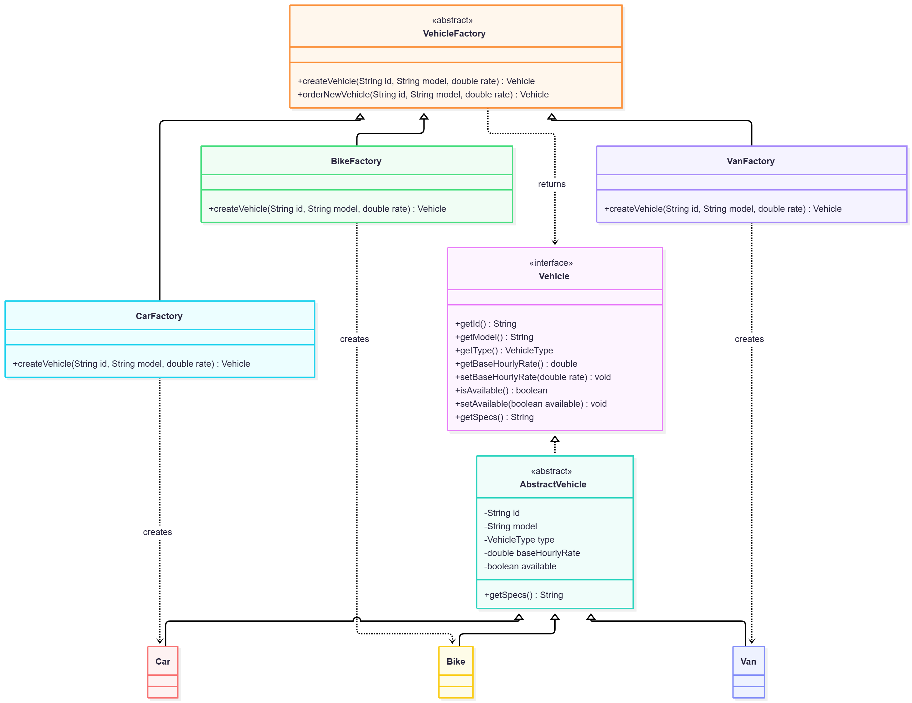

### Key Java code
```java
package com.vehiclerental.factory;

import com.vehiclerental.contract.Vehicle;

/**
 * Concrete creator whose factory method constructs Car products.
 */
public class CarFactory extends VehicleFactory {
    /**
     * Factory Method that creates the corresponding concrete Vehicle product.
     * @param id unique vehicle identifier
     * @param model vehicle model
     * @param baseHourlyRate finite positive hourly price in USD
     * @return new vehicle product
     */
    @Override
    public Vehicle createVehicle(String id, String model, double baseHourlyRate) {
        return new Car(id, model, baseHourlyRate);
    }
}
```
The subclass's overridden creation method is the Factory Method extension point. The facade's type switch selects a creator; it does not replace the creator hierarchy.

### Execution evidence
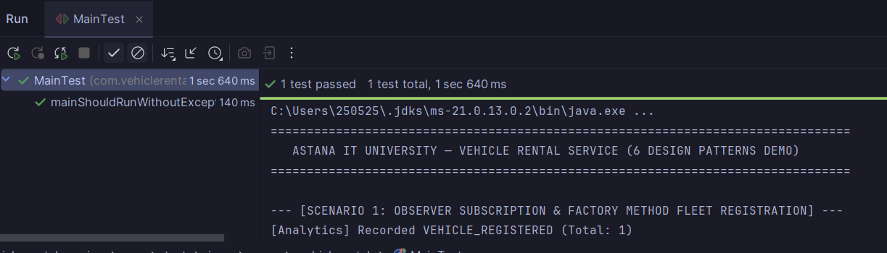
The screenshot shows the start of the console demo and its MainTest result. The current demo was also run during this review: it registers Toyota Camry 70, Xiaomi Pro E-Bike and Mercedes Sprinter with the corresponding product specifications. The screenshot alone does not display the complete registration output.

## 2.2 Builder Pattern

### Problem in context
A rental requires an identifier, customer, vehicle, positive duration and pricing strategy, with optional promotion and notes. A long positional constructor makes call sites difficult to understand and risks incomplete initialization.

### Solution and pattern roles
`RentalBuilder` is a fluent concrete builder. All seven `with...` methods return the same builder; `build()` validates the required values and constructs the product `BaseRental`, exposed through `Rental`. No separate abstract builder or director is necessary here; the facade performs the director role in the rental workflow.

Invalid required fields cause IllegalStateException in the builder. Text is trimmed; blank optional values become null. Product fields are final, so reusing the builder does not replace values stored in an earlier product. This is shallow immutability: retained Vehicle and PricingStrategy objects are shared. A later hourly-rate change can alter an existing rental's computed price.

### UML class diagram
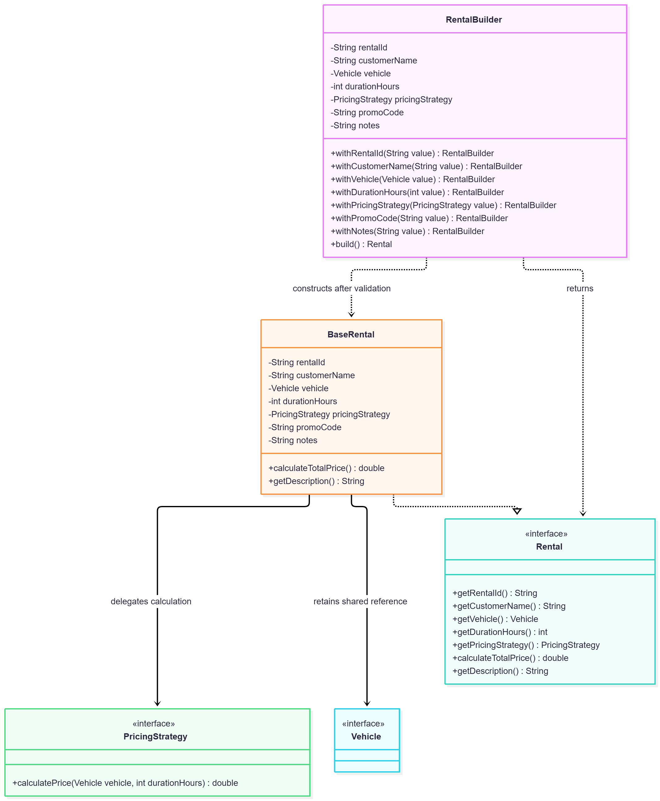

### Key Java usage
```java
Rental rental = new RentalBuilder()
        .withRentalId("R-EXAMPLE")
        .withCustomerName("Amir")
        .withVehicle(vehicle)
        .withDurationHours(5)
        .withPricingStrategy(new HourlyPricing())
        .withPromoCode("AITU10")
        .withNotes("Pickup at 10:00")
        .build();
// At $10/hour: 5 * 10 * 0.90 = $45, before extras.
```
`BaseRental.calculateTotalPrice()` delegates to PricingStrategy, then applies the case-insensitive AITU10 discount. Decorators are applied outside the builder, so optional extra charges are added after that discount.

### Rental creation sequence
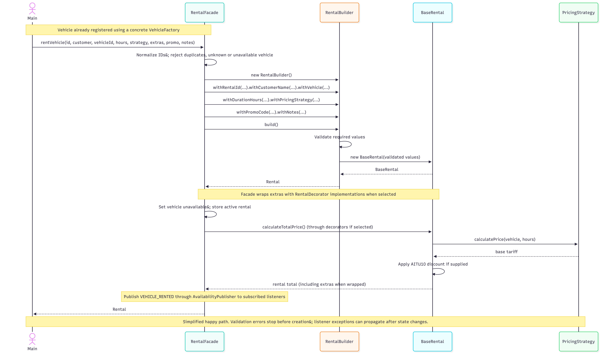
The sequence shows successful creation. With extras selected, calculateTotalPrice travels through the wrappers to BaseRental, then each wrapper adds its fee while the call returns. Observer notification occurs after the facade updates availability and the active-rental map.

### Execution evidence
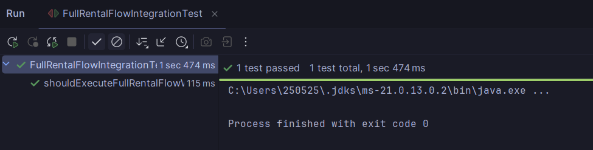
The supplied image is evidence of the displayed selected integration run. It is not proof that all tests in this source snapshot pass. Section 4 records the current review findings and remaining verification work.
## 2.3 Pricing Strategy Pattern

### Purpose & Problem Statement
The Vehicle Rental Service requires flexible pricing algorithms based on rental duration and promotions. Hardcoding rate calculations inside vehicle or rental classes leads to tight coupling, massive conditional logic, and violates the Open/Closed Principle (OCP).

### Solution Architecture
The `PricingStrategy` interface declares `calculatePrice(Vehicle, int durationHours)` and `getStrategyName()`. Three concrete strategies implement this contract:
1. `HourlyPricing`: Standard linear hourly rate.
2. `DailyPricing`: Flat 15% discount for rentals of 24 hours or longer.
3. `WeeklyNightPricing`: Loyalty tier offering 10% off for 12h+ and 30% off for weekly (168h+) rentals.

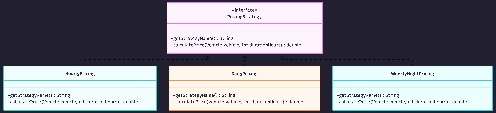

### Key Java calculation and evidence
```java
double base = vehicle.getBaseHourlyRate() * durationHours;
return durationHours >= 24 ? base * 0.85 : base;
```
This is the core DailyPricing rule, after validation. WeeklyNightPricing uses duration thresholds rather than the actual time of day.

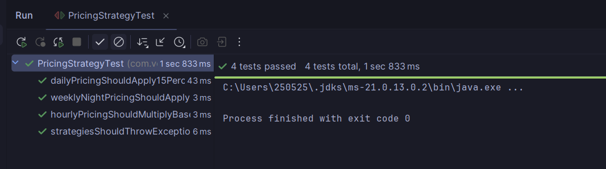

---

## 2.4 Rental Decorator Pattern

### Purpose & Problem Statement
Customers often add extra features (Full Insurance, GPS Navigation, Child Safety Seat) to their rental. Using class inheritance for every combination would lead to class explosion ($2^N$ classes).

### Solution Architecture
The `RentalDecorator` abstract class implements `Rental` and holds a reference to a wrapped `Rental` instance (`wrappedRental`). Concrete decorators add their own cost and extend the description transparently:
- `InsuranceDecorator`: +$15.00 per started 24-hour period, with a minimum of one period
- `GpsDecorator`: +$10.00 flat fee
- `ChildSeatDecorator`: +$12.00 flat fee

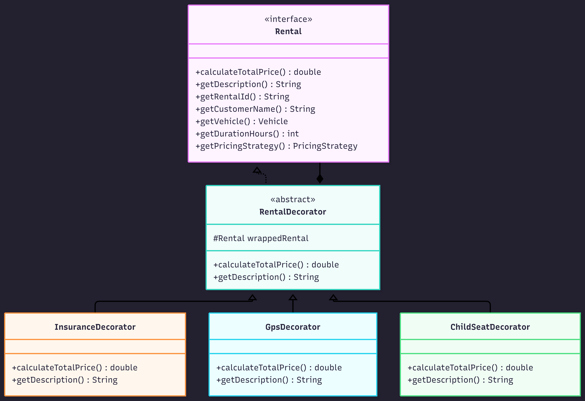

---

### Key Java calculation and evidence
```java
int days = (int) Math.ceil(getDurationHours() / 24.0);
if (days < 1) days = 1;
double price = super.calculateTotalPrice() + (days * 15.0);
return Math.round(price * 100.0) / 100.0;
```
The supplied decorator UML uses a composition symbol for its wrapped Rental. In Java, wrappedRental is a retained reference; exclusive ownership and destruction are not enforced. Insurance adds its fee to the wrapped price. GPS and child-seat fees are flat, and descriptions are extended at each layer. The facade processes the supplied list in order; it does not deduplicate repeated extras.

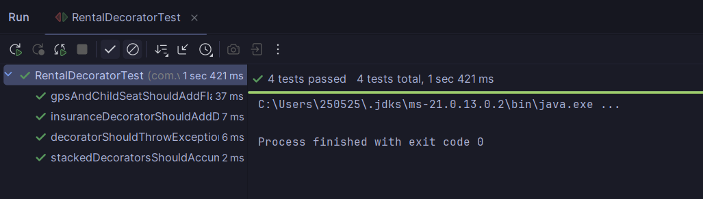

## 2.5 Observer Pattern (`AvailabilityPublisher`, `CustomerNotifier`, `FleetAnalyticsListener`)

### (a) Problem in Context
In a real-time vehicle rental service, multiple independent subsystems and customers need to react immediately when fleet state changes occur—such as when a high-demand vehicle is returned (`VEHICLE_AVAILABLE`), when a promotional discount reduces a vehicle's hourly tariff (`PRICE_DROPPED`), or when fleet operations are logged (`VEHICLE_REGISTERED`, `VEHICLE_RENTED`). Hardcoding direct calls to customer SMS services and analytics trackers inside the rental management logic would tightly couple core domain workflows to notification details and violate both the Single Responsibility Principle (SRP) and Open/Closed Principle (OCP).

### (b) Solution & Pattern Roles
We applied the **Observer Pattern** (`com.vehiclerental.observer` and `com.vehiclerental.contract`) to establish a one-to-many dependency between the fleet event publisher and an arbitrary number of subscribed listeners:
* **Subject / Publisher (`AvailabilityPublisher`):** Maintains the subscription list of `RentalListener` instances (`subscribe`, `unsubscribe`, `getListeners`) and broadcasts events via `notifyListeners(RentalEventType, Vehicle, String)`.
* **Observer Interface (`RentalListener`):** Declares the callback contract `onRentalEvent(RentalEventType eventType, Vehicle vehicle, String message)` and `getListenerName()`.
* **Concrete Observers (`CustomerNotifier`, `FleetAnalyticsListener`):**
    * `CustomerNotifier` filters for customer-facing alerts (`VEHICLE_AVAILABLE`, `PRICE_DROPPED`), prints formatted SMS notifications to the console, and stores notification history for verification.
    * `FleetAnalyticsListener` aggregates real-time event statistics in an `EnumMap<RentalEventType, Integer>` for operational monitoring.
* **Event Enumeration (`RentalEventType`):** Defines strongly typed event categories (`VEHICLE_REGISTERED`, `VEHICLE_RENTED`, `VEHICLE_AVAILABLE`, `PRICE_DROPPED`), avoiding deprecated `java.util.Observer` and untyped `Object` payloads.

### (c) UML Class & Sequence Diagrams


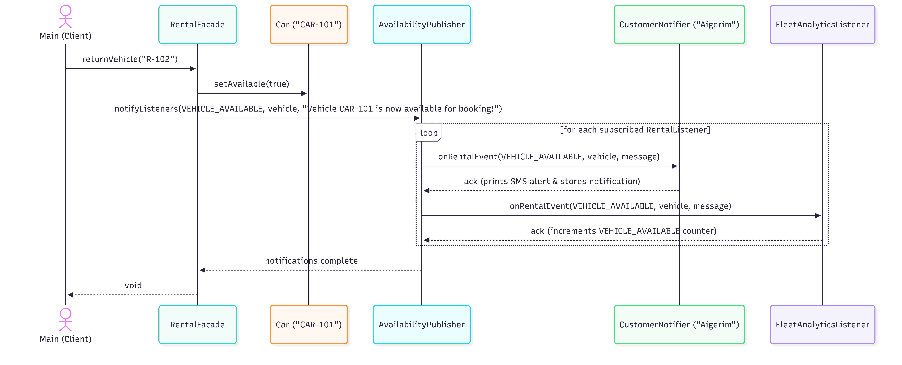

The supplied notification sequence is illustrative: the implementation iterates once over a snapshot of subscribers and invokes each subscriber once. The drawn customer and analytics callbacks represent different entries in that list, not two mandatory calls for every entry. The ack arrows indicate control returning from void callbacks.

### (d) Key Java Code Snippet
```java
public class AvailabilityPublisher {
    private final List<RentalListener> listeners = new ArrayList<>();

    public void subscribe(RentalListener listener) {
        if (listener == null) {
            throw new IllegalArgumentException("Listener cannot be null");
        }
        if (!listeners.contains(listener)) {
            listeners.add(listener);
        }
    }

    public void notifyListeners(RentalEventType eventType, Vehicle vehicle, String message) {
        if (eventType == null || vehicle == null) {
            throw new IllegalArgumentException("Event type and vehicle cannot be null");
        }
        for (RentalListener listener : new ArrayList<>(listeners)) {
            listener.onRentalEvent(eventType, vehicle, message);
        }
    }
}
```

### (e) Supplied demo screenshot and scope


The supplied screenshot shows the beginning of MainTest, not the return and price-drop lines. The current local demo output in Section 4 confirms those events.

---

## 2.6 Facade Pattern (`RentalFacade`)

### (a) Problem in Context
Our Vehicle Rental Service integrates five distinct creational, structural, and behavioral subsystems: `VehicleFactory` subclasses (Factory Method), `RentalBuilder` and `BaseRental` (Builder), `PricingStrategy` implementations (Strategy), `RentalDecorator` add-ons (Decorator), and `AvailabilityPublisher` (Observer). If client code (`Main`) had to interact with all of these classes directly, it would need to instantiate specific factories, manage fleet availability maps, chain builder calls, iterate over `ExtraType` enums to wrap decorators in sequence, and manually dispatch observer events—leading to high client coupling and duplicated orchestration logic.

### (b) Solution & Pattern Roles
We implemented the **Facade Pattern** in `com.vehiclerental.facade.RentalFacade` to provide a unified, simplified high-level interface over the entire subsystem ecosystem:
* **Facade (`RentalFacade`):** Owns the in-memory vehicle catalog (`fleet`), active reservations (`activeRentals`), and event dispatcher (`AvailabilityPublisher`). It exposes clean business operations:
    * `registerVehicle(...)`: Selects the appropriate `VehicleFactory` (`CarFactory`, `BikeFactory`, `VanFactory`), creates the vehicle, stores it in the fleet, and publishes `VEHICLE_REGISTERED`.
    * `rentVehicle(...)`: Validates vehicle availability and ID uniqueness, delegates reservation construction to `RentalBuilder` with the chosen `PricingStrategy`, dynamically wraps the resulting `Rental` with `InsuranceDecorator`, `GpsDecorator`, and `ChildSeatDecorator`, marks the vehicle unavailable, and fires `VEHICLE_RENTED`.
    * `returnVehicle(...)`: Restores vehicle availability, removes the active rental, and broadcasts `VEHICLE_AVAILABLE` to waiting customers.
    * `applyPriceDrop(...)`: Updates the vehicle's hourly tariff and broadcasts `PRICE_DROPPED`.
* **Subsystem Classes:** `VehicleFactory`, `RentalBuilder`, `PricingStrategy`, `RentalDecorator`, and `AvailabilityPublisher` handle their specialized work without knowing about the Facade.
* **Client (`Main`):** Invokes high-level business methods on `RentalFacade` without coupling to internal subsystem mechanics.

### (c) UML Class Diagram
Refer to `docs/uml/05_observer_and_facade.png` above and the Integrated Full System Class Diagram (`report/figures/06_integrated_full_class_diagram.png`).

### (d) Key Java Code Snippet
```java
public Rental rentVehicle(
        String rentalId, String customerName, String vehicleId, int durationHours,
        PricingStrategy strategy, List<ExtraType> extras, String promoCode, String notes) {
    // 1. Validate availability & build BaseRental via Builder + Strategy
    Rental rental = new RentalBuilder()
            .withRentalId(normalizedRentalId)
            .withCustomerName(customerName)
            .withVehicle(vehicle)
            .withDurationHours(durationHours)
            .withPricingStrategy(strategy)
            .withPromoCode(promoCode)
            .withNotes(notes)
            .build();

    // 2. Dynamically wrap add-on extras via Decorator
    if (extras != null) {
        for (ExtraType extra : extras) {
            if (extra != null) {
                rental = switch (extra) {
                    case INSURANCE -> new InsuranceDecorator(rental);
                    case GPS -> new GpsDecorator(rental);
                    case CHILD_SEAT -> new ChildSeatDecorator(rental);
                };
            }
        }
    }

    // 3. Update fleet state & notify subscribers via Observer
    vehicle.setAvailable(false);
    activeRentals.put(normalizedRentalId, rental);
    publisher.notifyListeners(RentalEventType.VEHICLE_RENTED, vehicle,
            "Rented by " + customerName + " for $" + String.format(Locale.US, "%.2f", rental.calculateTotalPrice()));
    return rental;
}
```

### (e) Supplied demo screenshot and scope


---

## 2.7 Integrated System Class Diagram

The following supplied integration diagram focuses on Rental, BaseRental, pricing and decorators. It is a subsystem view rather than a full map of all six patterns.

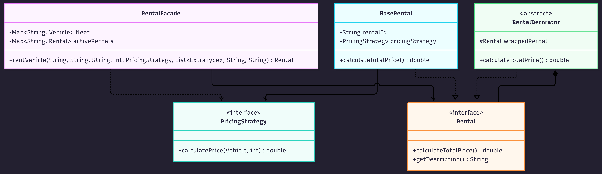

The assembly overview below adds the factory, builder and observer boundaries to show how the complete system collaborates. Editable Mermaid source is included beside the figure.


---

## 3. SOLID Principles Analysis

1. **Single Responsibility Principle (SRP):**
   - Each pricing strategy class (`HourlyPricing`, `DailyPricing`, `WeeklyNightPricing`) is solely responsible for calculating its specific tariff rate.
   - Each decorator (`InsuranceDecorator`, `GpsDecorator`, `ChildSeatDecorator`) manages only its specific extra fee calculation and description formatting.

2. **Open/Closed Principle (OCP):**
   - New pricing tariffs or add-on features can be introduced by adding new classes that implement `PricingStrategy` or extend `RentalDecorator` without changing BaseRental or existing decorators. The facade currently selects extras using an ExtraType switch, so a new enum-selected add-on also requires updating that switch.

3. **Liskov Substitution Principle (LSP):**
   - Any `RentalDecorator` instance can seamlessly substitute a standard `Rental` object throughout the codebase without altering expected program behavior.

4. **Interface Segregation Principle (ISP):**
   - The `PricingStrategy` and `Rental` contracts define minimal, highly focused interfaces, ensuring classes don't depend on unused methods.

5. **Dependency Inversion Principle (DIP):**
   - High-level orchestrators (`RentalFacade`) use abstractions (`PricingStrategy`, `Rental`) for rental operations. RentalFacade also directly constructs concrete factories and decorators at its composition points; this is a remaining coupling, not complete dependency inversion.

### Application across the complete system

| Principle | Concrete application | Trade-off or boundary |
| --- | --- | --- |
| SRP | VehicleFactory creates products; RentalBuilder validates construction; strategies compute tariffs; publisher dispatches events | RentalFacade coordinates several operations and should avoid absorbing each subsystem's rules |
| OCP | New PricingStrategy implementations work with BaseRental; new RentalListener implementations work with the publisher | New enum-selected products and extras still need facade switch changes |
| LSP | Car, Bike and Van satisfy Vehicle; decorators preserve the Rental API while augmenting price and description | Consistent input and exception contracts must be maintained; two tests currently disagree with facade exception types |
| ISP | Vehicle, Rental, PricingStrategy and RentalListener separate fleet, rental, tariff and event capabilities | Rental includes pricing-policy access, which wrappers must delegate consistently |
| DIP | BaseRental uses Vehicle and PricingStrategy; RentalDecorator wraps Rental; AvailabilityPublisher stores RentalListener | RentalFacade directly creates concrete factories/decorators; dependency injection could reduce this coupling |

These mappings show where abstractions are used. They do not establish that every future feature can be added without changing existing classes.


## 4. Conclusion and Verification Status

The latest supplied implementation integrates six design patterns through shared contracts. Factory Method isolates vehicle construction; Builder validates reservation creation; Strategy supplies interchangeable tariffs; Decorator combines optional fees; Observer distributes fleet events; Facade presents a small workflow API to the console client. This separation makes individual rules easier to inspect and test. The facade remains coupled to concrete factory and extra selection, so extensibility is localized rather than unlimited.

### 4.1 Current review evidence
The snapshot contains 29 production Java files and nine test files, with 43 @Test methods. The provided screenshots show selected strategy, decorator, integration and MainTest runs. They do not demonstrate a clean run of all 43 tests against this exact snapshot.

During the review of the latest uploaded snapshot, all production sources compiled with the available Java 17 compiler using --release 17, and Main completed successfully. The project itself targets Java 21. Maven and JUnit artifacts were unavailable in this review environment, so this compatibility check is not a Java 21 Maven/JUnit validation.

A separate direct Java probe reproduced two test/implementation inconsistencies:

| Test | Expected by test | Actual facade behavior |
| --- | --- | --- |
| FactoryBuilderIntegrationTest.shouldRejectAlreadyRentedOrUnknownVehicleWithoutChangingRecords | IllegalStateException for unknown vehicle MISSING | IllegalArgumentException |
| RentalFacadeUnitTest.shouldRejectInvalidRentalIdsWithoutChangingFleetOrRecords | IllegalStateException for null or blank rental ID | IllegalArgumentException |

Both branches reject the invalid request before changing fleet or active-rental records. The problem is the inconsistent exception contract. Agree the intended exception types, update either the tests or facade consistently, then run the full suite. No Java file was modified for steps 6A/7A. A 100% passing test result cannot be claimed for this snapshot.

### 4.2 Observed current demo results
The completed demo produced three registrations, three rentals, one availability event and one price-drop event. The sample rental totals were $25.00 for the five-hour bike with GPS, $335.76 for the 48-hour car with DailyPricing, AITU10, insurance and child seat, and $1761.40 for the 168-hour van with WeeklyNightPricing, insurance and GPS. Customer notification lines were console simulations.

### Current demo console output
```text
================================================================================
   ASTANA IT UNIVERSITY — VEHICLE RENTAL SERVICE (6 DESIGN PATTERNS DEMO)
================================================================================

--- [SCENARIO 1: OBSERVER SUBSCRIPTION & FACTORY METHOD FLEET REGISTRATION] ---
[Analytics] Recorded VEHICLE_REGISTERED (Total: 1)
Registered via CarFactory:  CAR-101 | Toyota Camry 70 | $8.00/h | Car [5 seats, Automatic]
[Analytics] Recorded VEHICLE_REGISTERED (Total: 2)
Registered via BikeFactory: BIKE-202 | Xiaomi Pro E-Bike | $3.00/h | Bike [Electric, Helmet Included]
[Analytics] Recorded VEHICLE_REGISTERED (Total: 3)
Registered via VanFactory:  VAN-303 | Mercedes Sprinter | $14.00/h | Van [12.5 m3 cargo]

--- [SCENARIO 2: BUILDER + HOURLY STRATEGY + GPS DECORATOR] ---
[Analytics] Recorded VEHICLE_RENTED (Total: 1)
Rental Created: Rental R-101 | Customer: Sanzhar | Vehicle: Xiaomi Pro E-Bike | Duration: 5 hours | Pricing: Hourly Standard Pricing + GPS Navigation ($10.00)
Total Price: $25.00

--- [SCENARIO 3: BUILDER (PROMO 'AITU10') + DAILY STRATEGY + INSURANCE & CHILD SEAT DECORATORS] ---
[Analytics] Recorded VEHICLE_RENTED (Total: 2)
Rental Created: Rental R-102 | Customer: Dana | Vehicle: Toyota Camry 70 | Duration: 48 hours | Pricing: Daily Flat-Discount Pricing (15% off per 24h block) | Promo: AITU10 | Notes: Airport Terminal 1 + Full Insurance + Child Safety Seat ($12.00)
Total Price: $335.76

--- [SCENARIO 4: BUILDER + WEEKLY/NIGHT STRATEGY + VAN RENTAL] ---
[Analytics] Recorded VEHICLE_RENTED (Total: 3)
Rental Created: Rental R-103 | Customer: Timur | Vehicle: Mercedes Sprinter | Duration: 168 hours | Pricing: Weekly / Long-Term Loyalty Pricing (30% off 7+ days, 10% off 12h+) + Full Insurance + GPS Navigation ($10.00)
Total Price: $1761.40

--- [SCENARIO 5: OBSERVER REAL-TIME NOTIFICATIONS (VEHICLE RETURN & PRICE DROP)] ---
>> Returning rental R-102 (Toyota Camry 70)...
[SMS to Aigerim] Event VEHICLE_AVAILABLE for Toyota Camry 70: Vehicle CAR-101 is now available for booking!
[SMS to Nurlan] Event VEHICLE_AVAILABLE for Toyota Camry 70: Vehicle CAR-101 is now available for booking!
[Analytics] Recorded VEHICLE_AVAILABLE (Total: 1)

>> Applying special weekend price drop on VAN-303 ($14.00/h -> $11.50/h)...
[SMS to Aigerim] Event PRICE_DROPPED for Mercedes Sprinter: Hourly rate dropped to $11.50/h!
[SMS to Nurlan] Event PRICE_DROPPED for Mercedes Sprinter: Hourly rate dropped to $11.50/h!
[Analytics] Recorded PRICE_DROPPED (Total: 1)

--- [FLEET ANALYTICS SUMMARY] ---
VEHICLE_REGISTERED : 3
VEHICLE_RENTED     : 3
VEHICLE_AVAILABLE  : 1
PRICE_DROPPED      : 1
================================================================================
```

### 4.3 Reproduction on the project machine
Use JDK 21 and Maven (or IntelliJ's Maven tool window) from the project root:
```bash
mvn clean test-compile surefire:3.2.5:test
mvn org.codehaus.mojo:exec-maven-plugin:3.1.0:java -Dexec.mainClass="com.vehiclerental.Main"
```
The supplied pom.xml does not pin a modern Surefire version. The explicit Surefire 3.2.5 goal above ensures JUnit 5 discovery rather than relying on the Maven default. Record the final full-suite output after resolving the two exception mismatches. If PowerShell reports that mvn is unrecognized, use IntelliJ's Maven runner or install/configure Maven first. A Maven wrapper is not included in this snapshot.

### 4.4 Current limitations
The service stores data in memory and has no real payments, authentication or external SMS integration. It uses double for money. Existing rentals retain a mutable Vehicle reference, so changing its rate can change their computed totals. Listener callbacks are synchronous and exceptions are not isolated; a failing callback can propagate after the facade changes state. Fleet operations are not protected for concurrent callers. applyPriceDrop validates a positive rate but does not enforce that the new rate is lower than the previous one.

## 5. Future Work

A State hierarchy could model maintenance and retirement in addition to availability; this would require planned changes to the current boolean lifecycle. Visitor could support fleet tax or maintenance reports, with an accept method added to the Vehicle contract and products. Database repositories and a REST API could replace in-memory storage and expose the workflows, with transaction and concurrency rules defined explicitly.

Before those extensions, priorities are consistent exception contracts, a clean Java 21 test run, a fixed price snapshot or documented repricing policy, decimal money handling and listener failure isolation. New factories or decorators can reuse current abstractions, but facade enum mappings must still be extended. Future enhancements are proposals, not implemented features.


## 6. Appendix: Full Java Source Code

All 38 Java source files from the supplied snapshot are reproduced below, including nine test files. No production or test file was changed in the documentation patch.

### src/main/java/com/vehiclerental/Main.java

```java
package com.vehiclerental;

import com.vehiclerental.contract.ExtraType;
import com.vehiclerental.contract.Rental;
import com.vehiclerental.contract.RentalEventType;
import com.vehiclerental.contract.Vehicle;
import com.vehiclerental.contract.VehicleType;
import com.vehiclerental.facade.RentalFacade;
import com.vehiclerental.observer.CustomerNotifier;
import com.vehiclerental.observer.FleetAnalyticsListener;
import com.vehiclerental.strategy.DailyPricing;
import com.vehiclerental.strategy.HourlyPricing;
import com.vehiclerental.strategy.WeeklyNightPricing;

import java.util.List;
import java.util.Locale;

public class Main {
    public static void main(String[] args) {
        System.out.println("================================================================================");
        System.out.println("   ASTANA IT UNIVERSITY — VEHICLE RENTAL SERVICE (6 DESIGN PATTERNS DEMO)");
        System.out.println("================================================================================");

        RentalFacade facade = new RentalFacade();

        CustomerNotifier aigerim = new CustomerNotifier("Aigerim");
        CustomerNotifier nurlan = new CustomerNotifier("Nurlan");
        FleetAnalyticsListener analytics = new FleetAnalyticsListener();

        facade.addListener(aigerim);
        facade.addListener(nurlan);
        facade.addListener(analytics);

        System.out.println("\n--- [SCENARIO 1: OBSERVER SUBSCRIPTION & FACTORY METHOD FLEET REGISTRATION] ---");
        Vehicle car = facade.registerVehicle(VehicleType.CAR, "CAR-101", "Toyota Camry 70", 8.0);
        System.out.printf(Locale.US, "Registered via CarFactory:  %s | %s | $%.2f/h | %s%n",
                car.getId(), car.getModel(), car.getBaseHourlyRate(), car.getSpecs());

        Vehicle bike = facade.registerVehicle(VehicleType.BIKE, "BIKE-202", "Xiaomi Pro E-Bike", 3.0);
        System.out.printf(Locale.US, "Registered via BikeFactory: %s | %s | $%.2f/h | %s%n",
                bike.getId(), bike.getModel(), bike.getBaseHourlyRate(), bike.getSpecs());

        Vehicle van = facade.registerVehicle(VehicleType.VAN, "VAN-303", "Mercedes Sprinter", 14.0);
        System.out.printf(Locale.US, "Registered via VanFactory:  %s | %s | $%.2f/h | %s%n",
                van.getId(), van.getModel(), van.getBaseHourlyRate(), van.getSpecs());

        System.out.println("\n--- [SCENARIO 2: BUILDER + HOURLY STRATEGY + GPS DECORATOR] ---");
        Rental rental1 = facade.rentVehicle(
                "R-101", "Sanzhar", "BIKE-202", 5,
                new HourlyPricing(), List.of(ExtraType.GPS), null, null
        );
        System.out.println("Rental Created: " + rental1.getDescription());
        System.out.printf(Locale.US, "Total Price: $%.2f%n", rental1.calculateTotalPrice());

        System.out.println("\n--- [SCENARIO 3: BUILDER (PROMO 'AITU10') + DAILY STRATEGY + INSURANCE & CHILD SEAT DECORATORS] ---");
        Rental rental2 = facade.rentVehicle(
                "R-102", "Dana", "CAR-101", 48,
                new DailyPricing(), List.of(ExtraType.INSURANCE, ExtraType.CHILD_SEAT),
                "AITU10", "Airport Terminal 1"
        );
        System.out.println("Rental Created: " + rental2.getDescription());
        System.out.printf(Locale.US, "Total Price: $%.2f%n", rental2.calculateTotalPrice());

        System.out.println("\n--- [SCENARIO 4: BUILDER + WEEKLY/NIGHT STRATEGY + VAN RENTAL] ---");
        Rental rental3 = facade.rentVehicle(
                "R-103", "Timur", "VAN-303", 168,
                new WeeklyNightPricing(), List.of(ExtraType.INSURANCE, ExtraType.GPS),
                null, null
        );
        System.out.println("Rental Created: " + rental3.getDescription());
        System.out.printf(Locale.US, "Total Price: $%.2f%n", rental3.calculateTotalPrice());

        System.out.println("\n--- [SCENARIO 5: OBSERVER REAL-TIME NOTIFICATIONS (VEHICLE RETURN & PRICE DROP)] ---");
        System.out.println(">> Returning rental R-102 (Toyota Camry 70)...");
        facade.returnVehicle("R-102");

        System.out.println("\n>> Applying special weekend price drop on VAN-303 ($14.00/h -> $11.50/h)...");
        facade.applyPriceDrop("VAN-303", 11.5);

        System.out.println("\n--- [FLEET ANALYTICS SUMMARY] ---");
        System.out.println("VEHICLE_REGISTERED : " + analytics.getEventCount(RentalEventType.VEHICLE_REGISTERED));
        System.out.println("VEHICLE_RENTED     : " + analytics.getEventCount(RentalEventType.VEHICLE_RENTED));
        System.out.println("VEHICLE_AVAILABLE  : " + analytics.getEventCount(RentalEventType.VEHICLE_AVAILABLE));
        System.out.println("PRICE_DROPPED      : " + analytics.getEventCount(RentalEventType.PRICE_DROPPED));
        System.out.println("================================================================================");
    }
}
```

### src/main/java/com/vehiclerental/builder/BaseRental.java

```java
package com.vehiclerental.builder;

import com.vehiclerental.contract.PricingStrategy;
import com.vehiclerental.contract.Rental;
import com.vehiclerental.contract.Vehicle;
import java.util.Locale;

/**
 * RentalBuilder product and concrete component for rental decorators. Price calculation delegates to the selected strategy.
 */
public class BaseRental implements Rental {
    private final String rentalId;
    private final String customerName;
    private final Vehicle vehicle;
    private final int durationHours;
    private final PricingStrategy pricingStrategy;
    private final String promoCode;
    private final String notes;

    /**
     * Stores values validated by RentalBuilder. Package access keeps construction within the builder package.
     * @param rentalId rental identifier
     * @param customerName customer name
     * @param vehicle vehicle to rent
     * @param durationHours positive duration in hours
     * @param pricingStrategy selected pricing calculation policy
     * @param promoCode optional promotional code; AITU10 applies a 10 percent discount
     * @param notes optional customer notes
     */
    BaseRental(String rentalId, String customerName, Vehicle vehicle,
               int durationHours, PricingStrategy pricingStrategy,
               String promoCode, String notes) {
        this.rentalId = rentalId;
        this.customerName = customerName;
        this.vehicle = vehicle;
        this.durationHours = durationHours;
        this.pricingStrategy = pricingStrategy;
        this.promoCode = promoCode;
        this.notes = notes;
    }

    /**
     * Returns the rental identifier.
     * @return rental identifier
     */
    @Override
    public String getRentalId() {
        return rentalId;
    }

    /**
     * Returns the customer name.
     * @return customer name
     */
    @Override
    public String getCustomerName() {
        return customerName;
    }

    /**
     * Returns the referenced vehicle, whose rate and availability remain mutable.
     * @return referenced vehicle
     */
    @Override
    public Vehicle getVehicle() {
        return vehicle;
    }

    /**
     * Returns the planned rental duration.
     * @return duration in hours
     */
    @Override
    public int getDurationHours() {
        return durationHours;
    }

    /**
     * Returns the selected pricing policy.
     * @return referenced pricing policy
     */
    @Override
    public PricingStrategy getPricingStrategy() {
        return pricingStrategy;
    }

    /**
     * Calculates the current strategy price and applies AITU10 when selected. Changes in the referenced vehicle rate or strategy may affect later calculations.
     * @return total price in USD before external decorators
     */
    @Override
    public double calculateTotalPrice() {
        double price = pricingStrategy.calculatePrice(vehicle, durationHours);
        if ("AITU10".equalsIgnoreCase(promoCode)) {
            price = price * 0.90;
        }
        return price;
    }

    /**
     * Describes the rental and any nonblank promotional code or notes.
     * @return human-readable rental summary
     */
    @Override
    public String getDescription() {
        String description = String.format(Locale.ROOT,
                "Rental %s | Customer: %s | Vehicle: %s | Duration: %d hours | Pricing: %s",
                rentalId, customerName, vehicle.getModel(), durationHours,
                pricingStrategy.getStrategyName());
        if (promoCode != null && !promoCode.isBlank()) {
            description += " | Promo: " + promoCode;
        }
        if (notes != null && !notes.isBlank()) {
            description += " | Notes: " + notes;
        }
        return description;
    }
}
```

### src/main/java/com/vehiclerental/builder/RentalBuilder.java

```java
package com.vehiclerental.builder;

import com.vehiclerental.contract.PricingStrategy;
import com.vehiclerental.contract.Rental;
import com.vehiclerental.contract.Vehicle;

/**
 * Fluent builder that validates required rental fields and constructs BaseRental products.
 */
public class RentalBuilder {
    private String rentalId;
    private String customerName;
    private Vehicle vehicle;
    private int durationHours;
    private PricingStrategy pricingStrategy;
    private String promoCode;
    private String notes;

    /**
     * Sets rentalId for the next rental construction. Validation occurs in build.
     * @param rentalId rental identifier
     * @return this builder for fluent chaining
     */
    public RentalBuilder withRentalId(String rentalId) {
        this.rentalId = rentalId;
        return this;
    }

    /**
     * Sets customerName for the next rental construction. Validation occurs in build.
     * @param customerName customer name
     * @return this builder for fluent chaining
     */
    public RentalBuilder withCustomerName(String customerName) {
        this.customerName = customerName;
        return this;
    }

    /**
     * Sets vehicle for the next rental construction. Validation occurs in build.
     * @param vehicle vehicle to rent
     * @return this builder for fluent chaining
     */
    public RentalBuilder withVehicle(Vehicle vehicle) {
        this.vehicle = vehicle;
        return this;
    }

    /**
     * Sets durationHours for the next rental construction. Validation occurs in build.
     * @param durationHours positive duration in hours
     * @return this builder for fluent chaining
     */
    public RentalBuilder withDurationHours(int durationHours) {
        this.durationHours = durationHours;
        return this;
    }

    /**
     * Sets pricingStrategy for the next rental construction. Validation occurs in build.
     * @param pricingStrategy selected pricing calculation policy
     * @return this builder for fluent chaining
     */
    public RentalBuilder withPricingStrategy(PricingStrategy pricingStrategy) {
        this.pricingStrategy = pricingStrategy;
        return this;
    }

    /**
     * Sets promoCode for the next rental construction. Validation occurs in build.
     * @param promoCode optional promotional code; AITU10 applies a 10 percent discount
     * @return this builder for fluent chaining
     */
    public RentalBuilder withPromoCode(String promoCode) {
        this.promoCode = promoCode;
        return this;
    }

    /**
     * Sets notes for the next rental construction. Validation occurs in build.
     * @param notes optional customer notes
     * @return this builder for fluent chaining
     */
    public RentalBuilder withNotes(String notes) {
        this.notes = notes;
        return this;
    }

    /**
     * Validates all required fields and creates a rental product. Builder reuse does not change the stored field values of previously built rentals. Vehicle and strategy references remain shared.
     * @return constructed rental
     * @throws IllegalStateException if required text is blank, an object is missing or duration is not positive
     */
    public Rental build() {
        if (rentalId == null || rentalId.isBlank()) {
            throw new IllegalStateException("Rental ID is required.");
        }
        if (customerName == null || customerName.isBlank()) {
            throw new IllegalStateException("Customer name is required.");
        }
        if (vehicle == null) {
            throw new IllegalStateException("Vehicle is required.");
        }
        if (durationHours <= 0) {
            throw new IllegalStateException("Duration must be greater than zero.");
        }
        if (pricingStrategy == null) {
            throw new IllegalStateException("Pricing strategy is required.");
        }
        return new BaseRental(rentalId.trim(), customerName.trim(), vehicle,
                durationHours, pricingStrategy, normalizeOptional(promoCode),
                normalizeOptional(notes));
    }

    private String normalizeOptional(String value) {
        if (value == null || value.isBlank()) {
            return null;
        }
        return value.trim();
    }
}
```

### src/main/java/com/vehiclerental/contract/ExtraType.java

```java
package com.vehiclerental.contract;

public enum ExtraType {
    INSURANCE,
    GPS,
    CHILD_SEAT
}
```

### src/main/java/com/vehiclerental/contract/PricingStrategy.java

```java
package com.vehiclerental.contract;

public interface PricingStrategy {
    String getStrategyName();
    double calculatePrice(Vehicle vehicle, int durationHours);
}
```

### src/main/java/com/vehiclerental/contract/Rental.java

```java
package com.vehiclerental.contract;

public interface Rental {
    String getRentalId();
    String getCustomerName();
    Vehicle getVehicle();
    int getDurationHours();
    PricingStrategy getPricingStrategy();
    double calculateTotalPrice();
    String getDescription();
}
```

### src/main/java/com/vehiclerental/contract/RentalEventType.java

```java
package com.vehiclerental.contract;

public enum RentalEventType {
    VEHICLE_REGISTERED,
    VEHICLE_RENTED,
    VEHICLE_AVAILABLE,
    PRICE_DROPPED
}
```

### src/main/java/com/vehiclerental/contract/RentalListener.java

```java
package com.vehiclerental.contract;

public interface RentalListener {
    String getListenerName();
    void onRentalEvent(RentalEventType eventType, Vehicle vehicle, String message);
}
```

### src/main/java/com/vehiclerental/contract/Vehicle.java

```java
package com.vehiclerental.contract;

public interface Vehicle {
    String getId();
    String getModel();
    VehicleType getType();
    double getBaseHourlyRate();
    void setBaseHourlyRate(double newRate);
    boolean isAvailable();
    void setAvailable(boolean available);
    String getSpecs();
}
```

### src/main/java/com/vehiclerental/contract/VehicleType.java

```java
package com.vehiclerental.contract;

public enum VehicleType {
    CAR,
    BIKE,
    VAN
}
```

### src/main/java/com/vehiclerental/decorator/ChildSeatDecorator.java

```java
package com.vehiclerental.decorator;

import com.vehiclerental.contract.Rental;

public class ChildSeatDecorator extends RentalDecorator {

    public ChildSeatDecorator(Rental wrappedRental) {
        super(wrappedRental);
    }

    @Override
    public double calculateTotalPrice() {
        double price = super.calculateTotalPrice() + 12.0;
        return Math.round(price * 100.0) / 100.0;
    }

    @Override
    public String getDescription() {
        return super.getDescription() + " + Child Safety Seat ($12.00)";
    }
}
```

### src/main/java/com/vehiclerental/decorator/GpsDecorator.java

```java
package com.vehiclerental.decorator;

import com.vehiclerental.contract.Rental;

public class GpsDecorator extends RentalDecorator {

    public GpsDecorator(Rental wrappedRental) {
        super(wrappedRental);
    }

    @Override
    public double calculateTotalPrice() {
        double price = super.calculateTotalPrice() + 10.0;
        return Math.round(price * 100.0) / 100.0;
    }

    @Override
    public String getDescription() {
        return super.getDescription() + " + GPS Navigation ($10.00)";
    }
}
```

### src/main/java/com/vehiclerental/decorator/InsuranceDecorator.java

```java
package com.vehiclerental.decorator;

import com.vehiclerental.contract.Rental;

public class InsuranceDecorator extends RentalDecorator {

    public InsuranceDecorator(Rental wrappedRental) {
        super(wrappedRental);
    }

    @Override
    public double calculateTotalPrice() {
        int days = (int) Math.ceil(getDurationHours() / 24.0);
        if (days < 1) days = 1;
        double price = super.calculateTotalPrice() + (days * 15.0);
        return Math.round(price * 100.0) / 100.0;
    }

    @Override
    public String getDescription() {
        return super.getDescription() + " + Full Insurance";
    }
}
```

### src/main/java/com/vehiclerental/decorator/RentalDecorator.java

```java
package com.vehiclerental.decorator;

import com.vehiclerental.contract.PricingStrategy;
import com.vehiclerental.contract.Rental;
import com.vehiclerental.contract.Vehicle;

public abstract class RentalDecorator implements Rental {
    protected final Rental wrappedRental;

    protected RentalDecorator(Rental wrappedRental) {
        if (wrappedRental == null) {
            throw new IllegalArgumentException("Wrapped rental cannot be null");
        }
        this.wrappedRental = wrappedRental;
    }

    @Override public String getRentalId() { return wrappedRental.getRentalId(); }
    @Override public String getCustomerName() { return wrappedRental.getCustomerName(); }
    @Override public Vehicle getVehicle() { return wrappedRental.getVehicle(); }
    @Override public int getDurationHours() { return wrappedRental.getDurationHours(); }
    @Override public PricingStrategy getPricingStrategy() { return wrappedRental.getPricingStrategy(); }
    @Override public double calculateTotalPrice() { return wrappedRental.calculateTotalPrice(); }
    @Override public String getDescription() { return wrappedRental.getDescription(); }
}
```

### src/main/java/com/vehiclerental/facade/RentalFacade.java

```java
package com.vehiclerental.facade;

import com.vehiclerental.builder.RentalBuilder;
import com.vehiclerental.contract.ExtraType;
import com.vehiclerental.contract.PricingStrategy;
import com.vehiclerental.contract.Rental;
import com.vehiclerental.contract.RentalEventType;
import com.vehiclerental.contract.RentalListener;
import com.vehiclerental.contract.Vehicle;
import com.vehiclerental.contract.VehicleType;
import com.vehiclerental.decorator.ChildSeatDecorator;
import com.vehiclerental.decorator.GpsDecorator;
import com.vehiclerental.decorator.InsuranceDecorator;
import com.vehiclerental.factory.BikeFactory;
import com.vehiclerental.factory.CarFactory;
import com.vehiclerental.factory.VanFactory;
import com.vehiclerental.factory.VehicleFactory;
import com.vehiclerental.observer.AvailabilityPublisher;

import java.util.Collection;
import java.util.Collections;
import java.util.LinkedHashMap;
import java.util.List;
import java.util.Locale;
import java.util.Map;

/**
 * Facade pattern implementation providing a unified high-level interface
 * over VehicleFactory, RentalBuilder, PricingStrategy, RentalDecorator, and AvailabilityPublisher.
 */
public class RentalFacade {
    private final Map<String, Vehicle> fleet = new LinkedHashMap<>();
    private final Map<String, Rental> activeRentals = new LinkedHashMap<>();
    private final AvailabilityPublisher publisher = new AvailabilityPublisher();

    public void addListener(RentalListener listener) {
        publisher.subscribe(listener);
    }

    public void removeListener(RentalListener listener) {
        publisher.unsubscribe(listener);
    }

    public void registerVehicleInstance(Vehicle vehicle) {
        if (vehicle == null) {
            throw new IllegalArgumentException("Vehicle cannot be null");
        }
        String normalizedId = (vehicle.getId() != null) ? vehicle.getId().trim() : "";
        if (normalizedId.isEmpty()) {
            throw new IllegalArgumentException("Vehicle ID cannot be null or blank");
        }
        if (fleet.containsKey(normalizedId)) {
            throw new IllegalArgumentException("Vehicle with ID already exists in fleet: " + normalizedId);
        }
        fleet.put(normalizedId, vehicle);
        publisher.notifyListeners(
                RentalEventType.VEHICLE_REGISTERED,
                vehicle,
                "Registered vehicle " + normalizedId + " (" + vehicle.getModel() + ")"
        );
    }

    public Vehicle registerVehicle(VehicleType type, String id, String model, double baseHourlyRate) {
        if (type == null) {
            throw new IllegalArgumentException("VehicleType cannot be null");
        }
        String normalizedId = (id != null) ? id.trim() : "";
        if (fleet.containsKey(normalizedId)) {
            throw new IllegalArgumentException("Vehicle with ID already exists in fleet: " + normalizedId);
        }
        VehicleFactory factory = switch (type) {
            case CAR -> new CarFactory();
            case BIKE -> new BikeFactory();
            case VAN -> new VanFactory();
        };
        Vehicle vehicle = factory.orderNewVehicle(normalizedId, model, baseHourlyRate);
        registerVehicleInstance(vehicle);
        return vehicle;
    }

    public Rental rentVehicle(
            String rentalId,
            String customerName,
            String vehicleId,
            int durationHours,
            PricingStrategy strategy,
            List<ExtraType> extras,
            String promoCode,
            String notes
    ) {
        String normalizedRentalId = (rentalId != null) ? rentalId.trim() : "";
        if (normalizedRentalId.isEmpty()) {
            throw new IllegalArgumentException("Rental ID cannot be null or blank");
        }
        if (activeRentals.containsKey(normalizedRentalId)) {
            throw new IllegalArgumentException("Active rental with ID already exists: " + normalizedRentalId);
        }

        String normalizedVehicleId = (vehicleId != null) ? vehicleId.trim() : "";
        Vehicle vehicle = fleet.get(normalizedVehicleId);
        if (vehicle == null) {
            throw new IllegalArgumentException("Vehicle not found: " + normalizedVehicleId);
        }
        if (!vehicle.isAvailable()) {
            throw new IllegalStateException("Vehicle is currently unavailable: " + normalizedVehicleId);
        }

        Rental rental = new RentalBuilder()
                .withRentalId(normalizedRentalId)
                .withCustomerName(customerName)
                .withVehicle(vehicle)
                .withDurationHours(durationHours)
                .withPricingStrategy(strategy)
                .withPromoCode(promoCode)
                .withNotes(notes)
                .build();

        if (extras != null) {
            for (ExtraType extra : extras) {
                if (extra != null) {
                    rental = switch (extra) {
                        case INSURANCE -> new InsuranceDecorator(rental);
                        case GPS -> new GpsDecorator(rental);
                        case CHILD_SEAT -> new ChildSeatDecorator(rental);
                    };
                }
            }
        }

        vehicle.setAvailable(false);
        activeRentals.put(normalizedRentalId, rental);

        publisher.notifyListeners(
                RentalEventType.VEHICLE_RENTED,
                vehicle,
                "Rented by " + customerName + " for $"
                        + String.format(Locale.US, "%.2f", rental.calculateTotalPrice())
        );

        return rental;
    }

    public void returnVehicle(String rentalId) {
        String normalizedRentalId = (rentalId != null) ? rentalId.trim() : "";
        Rental rental = activeRentals.remove(normalizedRentalId);
        if (rental == null) {
            throw new IllegalArgumentException("Active rental not found: " + normalizedRentalId);
        }
        Vehicle vehicle = rental.getVehicle();
        vehicle.setAvailable(true);
        publisher.notifyListeners(
                RentalEventType.VEHICLE_AVAILABLE,
                vehicle,
                "Vehicle " + vehicle.getId() + " is now available for booking!"
        );
    }

    public void applyPriceDrop(String vehicleId, double newHourlyRate) {
        String normalizedVehicleId = (vehicleId != null) ? vehicleId.trim() : "";
        Vehicle vehicle = fleet.get(normalizedVehicleId);
        if (vehicle == null) {
            throw new IllegalArgumentException("Vehicle not found: " + normalizedVehicleId);
        }
        if (newHourlyRate <= 0) {
            throw new IllegalArgumentException("New hourly rate must be positive");
        }
        vehicle.setBaseHourlyRate(newHourlyRate);
        publisher.notifyListeners(
                RentalEventType.PRICE_DROPPED,
                vehicle,
                "Hourly rate dropped to $" + String.format(Locale.US, "%.2f", newHourlyRate) + "/h!"
        );
    }

    public List<Vehicle> getAvailableVehicles() {
        return fleet.values().stream()
                .filter(Vehicle::isAvailable)
                .toList();
    }

    public Collection<Rental> getActiveRentals() {
        return Collections.unmodifiableCollection(activeRentals.values());
    }
}
```

### src/main/java/com/vehiclerental/factory/AbstractVehicle.java

```java
package com.vehiclerental.factory;

import com.vehiclerental.contract.Vehicle;
import com.vehiclerental.contract.VehicleType;

/**
 * Stores common vehicle identity, hourly rate and availability. Concrete vehicles supply their specifications.
 */
public abstract class AbstractVehicle implements Vehicle {
    private final String id;
    private final String model;
    private final VehicleType type;
    private double baseHourlyRate;
    private boolean available = true;

    /**
     * Constructs AbstractVehicle with the supplied values.
     * @param id unique vehicle identifier
     * @param model vehicle model
     * @param type vehicle category
     * @param baseHourlyRate finite positive hourly price in USD
     * @throws IllegalArgumentException if vehicle identity, type or hourly rate is invalid
     */
    protected AbstractVehicle(String id, String model, VehicleType type,
                              double baseHourlyRate) {
        if (id == null || id.isBlank()) {
            throw new IllegalArgumentException("Vehicle ID must not be blank.");
        }
        if (model == null || model.isBlank()) {
            throw new IllegalArgumentException("Vehicle model must not be blank.");
        }
        if (type == null) {
            throw new IllegalArgumentException("Vehicle type must not be null.");
        }
        this.id = id.trim();
        this.model = model.trim();
        this.type = type;
        setBaseHourlyRate(baseHourlyRate);
    }

    /**
     * Returns the vehicle identifier.
     * @return vehicle identifier
     */
    @Override
    public String getId() {
        return id;
    }

    /**
     * Returns the vehicle model.
     * @return vehicle model
     */
    @Override
    public String getModel() {
        return model;
    }

    /**
     * Returns the vehicle category.
     * @return vehicle category
     */
    @Override
    public VehicleType getType() {
        return type;
    }

    /**
     * Returns the current hourly price in USD.
     * @return current hourly price
     */
    @Override
    public double getBaseHourlyRate() {
        return baseHourlyRate;
    }

    /**
     * Updates the hourly price after validating that it is finite and positive.
     * @param newRate new finite positive hourly price in USD
     * @throws IllegalArgumentException if the rate is not finite and positive
     */
    @Override
    public void setBaseHourlyRate(double newRate) {
        if (!Double.isFinite(newRate) || newRate <= 0) {
            throw new IllegalArgumentException("Hourly rate must be a finite positive number.");
        }
        this.baseHourlyRate = newRate;
    }

    /**
     * Reports whether the vehicle is available for rental.
     * @return true when available
     */
    @Override
    public boolean isAvailable() {
        return available;
    }

    /**
     * Updates availability; rental lifecycle decisions belong to the facade.
     * @param available whether the vehicle can be rented
     */
    @Override
    public void setAvailable(boolean available) {
        this.available = available;
    }

    /**
     * Returns the concrete vehicle specifications.
     * @return human-readable vehicle specifications
     */
    @Override
    public abstract String getSpecs();
}
```

### src/main/java/com/vehiclerental/factory/Bike.java

```java
package com.vehiclerental.factory;

import com.vehiclerental.contract.VehicleType;

/**
 * Concrete Vehicle product representing an electric bike with an included helmet.
 */
public class Bike extends AbstractVehicle {
    private final boolean electric = true;
    private final boolean helmetIncluded = true;

    /**
     * Constructs Bike with the supplied values.
     * @param id unique vehicle identifier
     * @param model vehicle model
     * @param baseHourlyRate finite positive hourly price in USD
     * @throws IllegalArgumentException if vehicle identity, type or hourly rate is invalid
     */
    public Bike(String id, String model, double baseHourlyRate) {
        super(id, model, VehicleType.BIKE, baseHourlyRate);
    }

    /**
     * Returns the concrete vehicle specifications.
     * @return human-readable vehicle specifications
     */
    @Override
    public String getSpecs() {
        String bikeType = electric ? "Electric" : "Manual";
        String helmet = helmetIncluded ? "Helmet Included" : "Helmet Not Included";
        return "Bike [" + bikeType + ", " + helmet + "]";
    }
}
```

### src/main/java/com/vehiclerental/factory/BikeFactory.java

```java
package com.vehiclerental.factory;

import com.vehiclerental.contract.Vehicle;

/**
 * Concrete creator whose factory method constructs Bike products.
 */
public class BikeFactory extends VehicleFactory {
    /**
     * Factory Method that creates the corresponding concrete Vehicle product.
     * @param id unique vehicle identifier
     * @param model vehicle model
     * @param baseHourlyRate finite positive hourly price in USD
     * @return new vehicle product
     */
    @Override
    public Vehicle createVehicle(String id, String model, double baseHourlyRate) {
        return new Bike(id, model, baseHourlyRate);
    }
}
```

### src/main/java/com/vehiclerental/factory/Car.java

```java
package com.vehiclerental.factory;

import com.vehiclerental.contract.VehicleType;

/**
 * Concrete Vehicle product representing a five-seat automatic car.
 */
public class Car extends AbstractVehicle {
    private final int seats = 5;
    private final String transmission = "Automatic";

    /**
     * Constructs Car with the supplied values.
     * @param id unique vehicle identifier
     * @param model vehicle model
     * @param baseHourlyRate finite positive hourly price in USD
     * @throws IllegalArgumentException if vehicle identity, type or hourly rate is invalid
     */
    public Car(String id, String model, double baseHourlyRate) {
        super(id, model, VehicleType.CAR, baseHourlyRate);
    }

    /**
     * Returns the concrete vehicle specifications.
     * @return human-readable vehicle specifications
     */
    @Override
    public String getSpecs() {
        return "Car [" + seats + " seats, " + transmission + "]";
    }
}
```

### src/main/java/com/vehiclerental/factory/CarFactory.java

```java
package com.vehiclerental.factory;

import com.vehiclerental.contract.Vehicle;

/**
 * Concrete creator whose factory method constructs Car products.
 */
public class CarFactory extends VehicleFactory {
    /**
     * Factory Method that creates the corresponding concrete Vehicle product.
     * @param id unique vehicle identifier
     * @param model vehicle model
     * @param baseHourlyRate finite positive hourly price in USD
     * @return new vehicle product
     */
    @Override
    public Vehicle createVehicle(String id, String model, double baseHourlyRate) {
        return new Car(id, model, baseHourlyRate);
    }
}
```

### src/main/java/com/vehiclerental/factory/Van.java

```java
package com.vehiclerental.factory;

import com.vehiclerental.contract.VehicleType;

/**
 * Concrete Vehicle product representing a van with 12.5 cubic metres of cargo space.
 */
public class Van extends AbstractVehicle {
    private final double cargoCapacityCubicMeters = 12.5;

    /**
     * Constructs Van with the supplied values.
     * @param id unique vehicle identifier
     * @param model vehicle model
     * @param baseHourlyRate finite positive hourly price in USD
     * @throws IllegalArgumentException if vehicle identity, type or hourly rate is invalid
     */
    public Van(String id, String model, double baseHourlyRate) {
        super(id, model, VehicleType.VAN, baseHourlyRate);
    }

    /**
     * Returns the concrete vehicle specifications.
     * @return human-readable vehicle specifications
     */
    @Override
    public String getSpecs() {
        return "Van [" + cargoCapacityCubicMeters + " m3 cargo]";
    }
}
```

### src/main/java/com/vehiclerental/factory/VanFactory.java

```java
package com.vehiclerental.factory;

import com.vehiclerental.contract.Vehicle;

/**
 * Concrete creator whose factory method constructs Van products.
 */
public class VanFactory extends VehicleFactory {
    /**
     * Factory Method that creates the corresponding concrete Vehicle product.
     * @param id unique vehicle identifier
     * @param model vehicle model
     * @param baseHourlyRate finite positive hourly price in USD
     * @return new vehicle product
     */
    @Override
    public Vehicle createVehicle(String id, String model, double baseHourlyRate) {
        return new Van(id, model, baseHourlyRate);
    }
}
```

### src/main/java/com/vehiclerental/factory/VehicleFactory.java

```java
package com.vehiclerental.factory;

import com.vehiclerental.contract.Vehicle;

/**
 * Factory Method creator. Subclasses choose the concrete product through createVehicle.
 */
public abstract class VehicleFactory {
    // Factory Method: each subclass chooses the concrete vehicle.
    /**
     * Factory Method that creates the corresponding concrete Vehicle product.
     * @param id unique vehicle identifier
     * @param model vehicle model
     * @param baseHourlyRate finite positive hourly price in USD
     * @return new vehicle product
     */
    public abstract Vehicle createVehicle(String id, String model, double baseHourlyRate);

    // Common operation shared by every concrete factory.
    /**
     * Creates a vehicle through the factory method and initializes its availability.
     * @param id unique vehicle identifier
     * @param model vehicle model
     * @param baseHourlyRate finite positive hourly price in USD
     * @return new available vehicle
     */
    public Vehicle orderNewVehicle(String id, String model, double baseHourlyRate) {
        Vehicle vehicle = createVehicle(id, model, baseHourlyRate);
        vehicle.setAvailable(true);
        return vehicle;
    }
}
```

### src/main/java/com/vehiclerental/observer/AvailabilityPublisher.java

```java
package com.vehiclerental.observer;

import com.vehiclerental.contract.RentalEventType;
import com.vehiclerental.contract.RentalListener;
import com.vehiclerental.contract.Vehicle;

import java.util.ArrayList;
import java.util.Collections;
import java.util.List;

/**
 * Subject/Publisher in the Observer pattern.
 * Manages RentalListener subscriptions and broadcasts fleet events.
 */
public class AvailabilityPublisher {
    private final List<RentalListener> listeners = new ArrayList<>();

    public void subscribe(RentalListener listener) {
        if (listener == null) {
            throw new IllegalArgumentException("Listener cannot be null");
        }
        if (!listeners.contains(listener)) {
            listeners.add(listener);
        }
    }

    public void unsubscribe(RentalListener listener) {
        listeners.remove(listener);
    }

    public List<RentalListener> getListeners() {
        return Collections.unmodifiableList(listeners);
    }

    public void notifyListeners(RentalEventType eventType, Vehicle vehicle, String message) {
        if (eventType == null || vehicle == null) {
            throw new IllegalArgumentException("Event type and vehicle cannot be null");
        }
        for (RentalListener listener : new ArrayList<>(listeners)) {
            listener.onRentalEvent(eventType, vehicle, message);
        }
    }
}
```

### src/main/java/com/vehiclerental/observer/CustomerNotifier.java

```java
package com.vehiclerental.observer;

import com.vehiclerental.contract.RentalEventType;
import com.vehiclerental.contract.RentalListener;
import com.vehiclerental.contract.Vehicle;

import java.util.ArrayList;
import java.util.Collections;
import java.util.List;

/**
 * Concrete Observer that sends SMS notifications to subscribed customers
 * when vehicles become available or receive a price drop.
 */
public class CustomerNotifier implements RentalListener {
    private final String customerName;
    private final List<String> receivedNotifications = new ArrayList<>();

    public CustomerNotifier(String customerName) {
        if (customerName == null || customerName.isBlank()) {
            throw new IllegalArgumentException("Customer name cannot be null or blank");
        }
        this.customerName = customerName.trim();
    }

    @Override
    public String getListenerName() {
        return "CustomerNotifier[" + customerName + "]";
    }

    @Override
    public void onRentalEvent(RentalEventType eventType, Vehicle vehicle, String message) {
        if (eventType == RentalEventType.VEHICLE_AVAILABLE || eventType == RentalEventType.PRICE_DROPPED) {
            String formatted = "[SMS to " + customerName + "] Event " + eventType
                    + " for " + vehicle.getModel() + ": " + message;
            System.out.println(formatted);
            receivedNotifications.add(formatted);
        }
    }

    public String getCustomerName() {
        return customerName;
    }

    public List<String> getReceivedNotifications() {
        return Collections.unmodifiableList(receivedNotifications);
    }
}
```

### src/main/java/com/vehiclerental/observer/FleetAnalyticsListener.java

```java
package com.vehiclerental.observer;

import com.vehiclerental.contract.RentalEventType;
import com.vehiclerental.contract.RentalListener;
import com.vehiclerental.contract.Vehicle;

import java.util.EnumMap;
import java.util.Map;

/**
 * Concrete Observer that tracks real-time counts of all RentalEventType occurrences.
 */
public class FleetAnalyticsListener implements RentalListener {
    private final Map<RentalEventType, Integer> eventCounts = new EnumMap<>(RentalEventType.class);

    @Override
    public String getListenerName() {
        return "FleetAnalyticsListener";
    }

    @Override
    public void onRentalEvent(RentalEventType eventType, Vehicle vehicle, String message) {
        int newCount = eventCounts.getOrDefault(eventType, 0) + 1;
        eventCounts.put(eventType, newCount);
        System.out.println("[Analytics] Recorded " + eventType + " (Total: " + newCount + ")");
    }

    public int getEventCount(RentalEventType type) {
        return eventCounts.getOrDefault(type, 0);
    }
}
```

### src/main/java/com/vehiclerental/strategy/DailyPricing.java

```java
package com.vehiclerental.strategy;

import com.vehiclerental.contract.PricingStrategy;
import com.vehiclerental.contract.Vehicle;

public class DailyPricing implements PricingStrategy {

    @Override
    public String getStrategyName() {
        return "Daily Flat-Discount Pricing (15% off per 24h block)";
    }

    @Override
    public double calculatePrice(Vehicle vehicle, int durationHours) {
        if (vehicle == null || durationHours <= 0) {
            throw new IllegalArgumentException("Vehicle cannot be null and duration must be positive");
        }
        double basePrice = vehicle.getBaseHourlyRate() * durationHours;
        double price = (durationHours >= 24) ? basePrice * 0.85 : basePrice;
        return Math.round(price * 100.0) / 100.0;
    }
}
```

### src/main/java/com/vehiclerental/strategy/HourlyPricing.java

```java
package com.vehiclerental.strategy;

import com.vehiclerental.contract.PricingStrategy;
import com.vehiclerental.contract.Vehicle;

public class HourlyPricing implements PricingStrategy {

    @Override
    public String getStrategyName() {
        return "Hourly Standard Pricing";
    }

    @Override
    public double calculatePrice(Vehicle vehicle, int durationHours) {
        if (vehicle == null || durationHours <= 0) {
            throw new IllegalArgumentException("Vehicle cannot be null and duration must be positive");
        }
        double price = vehicle.getBaseHourlyRate() * durationHours;
        return Math.round(price * 100.0) / 100.0;
    }
}
```

### src/main/java/com/vehiclerental/strategy/WeeklyNightPricing.java

```java
package com.vehiclerental.strategy;

import com.vehiclerental.contract.PricingStrategy;
import com.vehiclerental.contract.Vehicle;

public class WeeklyNightPricing implements PricingStrategy {

    @Override
    public String getStrategyName() {
        return "Weekly / Long-Term Loyalty Pricing (30% off 7+ days, 10% off 12h+)";
    }

    @Override
    public double calculatePrice(Vehicle vehicle, int durationHours) {
        if (vehicle == null || durationHours <= 0) {
            throw new IllegalArgumentException("Vehicle cannot be null and duration must be positive");
        }
        double basePrice = vehicle.getBaseHourlyRate() * durationHours;
        double price;
        if (durationHours >= 168) {
            price = basePrice * 0.70;
        } else if (durationHours >= 12) {
            price = basePrice * 0.90;
        } else {
            price = basePrice;
        }
        return Math.round(price * 100.0) / 100.0;
    }
}
```

### src/test/java/com/vehiclerental/MainTest.java

```java
package com.vehiclerental;

import org.junit.jupiter.api.Test;

import static org.junit.jupiter.api.Assertions.assertDoesNotThrow;

class MainTest {

    @Test
    void mainShouldRunWithoutExceptions() {
        assertDoesNotThrow(() -> Main.main(new String[]{}));
    }
}
```

### src/test/java/com/vehiclerental/builder/RentalBuilderTest.java

```java
package com.vehiclerental.builder;

import com.vehiclerental.contract.PricingStrategy;
import com.vehiclerental.contract.Rental;
import com.vehiclerental.contract.Vehicle;
import com.vehiclerental.factory.Car;
import org.junit.jupiter.api.Test;
import static org.junit.jupiter.api.Assertions.*;

class RentalBuilderTest {
    private static final double DELTA = 0.000001;

    // A unit-test fixture, not Tangharyk's production pricing implementation.
    private static class TestHourlyPricing implements PricingStrategy {
        @Override
        public String getStrategyName() {
            return "Test Hourly Pricing";
        }

        @Override
        public double calculatePrice(Vehicle vehicle, int durationHours) {
            return vehicle.getBaseHourlyRate() * durationHours;
        }
    }

    private RentalBuilder validBuilder() {
        return new RentalBuilder()
                .withRentalId("RENT-101")
                .withCustomerName("Amir")
                .withVehicle(new Car("CAR-101", "Toyota Camry", 10.0))
                .withDurationHours(5)
                .withPricingStrategy(new TestHourlyPricing());
    }

    @Test
    void shouldBuildValidRentalWithRequiredFieldsOnly() {
        Rental rental = validBuilder().build();
        assertInstanceOf(BaseRental.class, rental);
        assertEquals("RENT-101", rental.getRentalId());
        assertEquals("Amir", rental.getCustomerName());
        assertEquals("CAR-101", rental.getVehicle().getId());
        assertEquals(5, rental.getDurationHours());
        assertEquals("Test Hourly Pricing", rental.getPricingStrategy().getStrategyName());
        assertEquals(50.0, rental.calculateTotalPrice(), DELTA);
        assertFalse(rental.getDescription().contains("Promo:"));
        assertFalse(rental.getDescription().contains("Notes:"));
    }

    @Test
    void shouldBuildRentalWithOptionalPromoCodeAndNotes() {
        Rental rental = validBuilder().withPromoCode("AITU10").withNotes("Need pickup at 10:00").build();
        String description = rental.getDescription();
        assertTrue(description.contains("RENT-101"));
        assertTrue(description.contains("Amir"));
        assertTrue(description.contains("Toyota Camry"));
        assertTrue(description.contains("5 hours"));
        assertTrue(description.contains("Test Hourly Pricing"));
        assertTrue(description.contains("Promo: AITU10"));
        assertTrue(description.contains("Notes: Need pickup at 10:00"));
    }

    @Test
    void shouldApplyAitu10PromoCodeDiscountCorrectly() {
        assertEquals(45.0, validBuilder().withPromoCode("AITU10").build().calculateTotalPrice(), DELTA);
        assertEquals(45.0, validBuilder().withPromoCode("aitu10").build().calculateTotalPrice(), DELTA);
    }

    @Test
    void shouldThrowIllegalStateExceptionWhenRequiredFieldMissingOrInvalidDuration() {
        assertThrows(IllegalStateException.class, () -> new RentalBuilder().build());
        assertThrows(IllegalStateException.class, () -> validBuilder().withRentalId(null).build());
        assertThrows(IllegalStateException.class, () -> validBuilder().withRentalId("  ").build());
        assertThrows(IllegalStateException.class, () -> validBuilder().withCustomerName(null).build());
        assertThrows(IllegalStateException.class, () -> validBuilder().withCustomerName("  ").build());
        assertThrows(IllegalStateException.class, () -> validBuilder().withVehicle(null).build());
        assertThrows(IllegalStateException.class, () -> validBuilder().withPricingStrategy(null).build());
        assertThrows(IllegalStateException.class, () -> validBuilder().withDurationHours(0).build());
        assertThrows(IllegalStateException.class, () -> validBuilder().withDurationHours(-5).build());
    }

    @Test
    void shouldNotDiscountUnknownOrBlankPromoCodes() {
        assertEquals(50.0, validBuilder().withPromoCode("OTHER").build().calculateTotalPrice(), DELTA);
        Rental blank = validBuilder().withPromoCode(" ").withNotes(" ").build();
        assertEquals(50.0, blank.calculateTotalPrice(), DELTA);
        assertFalse(blank.getDescription().contains("Promo:"));
        assertFalse(blank.getDescription().contains("Notes:"));
    }

    @Test
    void shouldKeepBuiltValuesWhenBuilderIsReused() {
        RentalBuilder builder = validBuilder().withNotes("First request");
        Rental first = builder.build();
        Rental second = builder.withRentalId("RENT-102").withCustomerName("Second customer")
                .withDurationHours(10).withNotes("Second request").build();
        assertEquals("RENT-101", first.getRentalId());
        assertEquals("Amir", first.getCustomerName());
        assertEquals(5, first.getDurationHours());
        assertTrue(first.getDescription().contains("First request"));
        assertEquals("RENT-102", second.getRentalId());
        assertEquals(10, second.getDurationHours());
    }

    @Test
    void shouldDelegateCalculationToTheSelectedStrategy() {
        PricingStrategy fixed = new PricingStrategy() {
            @Override
            public String getStrategyName() {
                return "Fixed test price";
            }

            @Override
            public double calculatePrice(Vehicle vehicle, int hours) {
                assertEquals("CAR-101", vehicle.getId());
                assertEquals(5, hours);
                return 200.0;
            }
        };
        Rental rental = validBuilder().withPricingStrategy(fixed).withPromoCode("AITU10").build();
        assertSame(fixed, rental.getPricingStrategy());
        assertEquals(180.0, rental.calculateTotalPrice(), DELTA);
    }

    @Test
    void shouldReportTheMissingFieldClearly() {
        IllegalStateException error = assertThrows(IllegalStateException.class,
                () -> validBuilder().withVehicle(null).build());
        assertTrue(error.getMessage().contains("Vehicle"));
    }
}
```

### src/test/java/com/vehiclerental/decorator/RentalDecoratorTest.java

```java
package com.vehiclerental.decorator;

import com.vehiclerental.contract.PricingStrategy;
import com.vehiclerental.contract.Rental;
import com.vehiclerental.contract.Vehicle;
import org.junit.jupiter.api.Test;

import static org.junit.jupiter.api.Assertions.*;

class RentalDecoratorTest {

    private static class DummyRental implements Rental {
        @Override public String getRentalId() { return "R-1"; }
        @Override public String getCustomerName() { return "Tangharyk"; }
        @Override public Vehicle getVehicle() { return null; }
        @Override public int getDurationHours() { return 24; }
        @Override public PricingStrategy getPricingStrategy() { return null; }
        @Override public double calculateTotalPrice() { return 100.0; }
        @Override public String getDescription() { return "Base Rental"; }
    }

    @Test
    void insuranceDecoratorShouldAddDailyFee() {
        Rental base = new DummyRental();
        Rental insured = new InsuranceDecorator(base);
        assertEquals(115.0, insured.calculateTotalPrice(), 0.001);
        assertTrue(insured.getDescription().contains("Full Insurance"));
    }

    @Test
    void gpsAndChildSeatShouldAddFlatFees() {
        Rental base = new DummyRental();
        Rental withGps = new GpsDecorator(base);
        Rental withSeat = new ChildSeatDecorator(base);

        assertEquals(110.0, withGps.calculateTotalPrice(), 0.001);
        assertEquals(112.0, withSeat.calculateTotalPrice(), 0.001);
    }

    @Test
    void stackedDecoratorsShouldAccumulatePricesAndDescriptions() {
        Rental rental = new DummyRental();
        rental = new InsuranceDecorator(rental);
        rental = new GpsDecorator(rental);
        rental = new ChildSeatDecorator(rental);

        assertEquals(137.0, rental.calculateTotalPrice(), 0.001);
        assertEquals("Base Rental + Full Insurance + GPS Navigation ($10.00) + Child Safety Seat ($12.00)", rental.getDescription());
    }

    @Test
    void decoratorShouldThrowExceptionWhenWrappingNull() {
        assertThrows(IllegalArgumentException.class, () -> new InsuranceDecorator(null));
    }
}
```

### src/test/java/com/vehiclerental/facade/RentalFacadeUnitTest.java

```java
package com.vehiclerental.facade;

import com.vehiclerental.contract.ExtraType;
import com.vehiclerental.contract.PricingStrategy;
import com.vehiclerental.contract.Rental;
import com.vehiclerental.contract.RentalEventType;
import com.vehiclerental.contract.Vehicle;
import com.vehiclerental.contract.VehicleType;
import com.vehiclerental.observer.CustomerNotifier;
import com.vehiclerental.observer.FleetAnalyticsListener;
import com.vehiclerental.strategy.HourlyPricing;
import org.junit.jupiter.api.BeforeEach;
import org.junit.jupiter.api.Test;

import java.util.List;

import static org.junit.jupiter.api.Assertions.*;

class RentalFacadeUnitTest {

    private RentalFacade facade;
    private CustomerNotifier customerNotifier;
    private FleetAnalyticsListener analyticsListener;

    @BeforeEach
    void setUp() {
        facade = new RentalFacade();
        customerNotifier = new CustomerNotifier("Aigerim");
        analyticsListener = new FleetAnalyticsListener();
        facade.addListener(customerNotifier);
        facade.addListener(analyticsListener);
    }

    @Test
    void shouldRegisterVehicleAndNotifyAnalyticsListener() {
        Vehicle car = facade.registerVehicle(VehicleType.CAR, "CAR-101", "Toyota Camry 70", 8.0);

        assertNotNull(car);
        assertEquals("CAR-101", car.getId());
        assertTrue(car.isAvailable());
        assertEquals(1, facade.getAvailableVehicles().size());
        assertEquals(1, analyticsListener.getEventCount(RentalEventType.VEHICLE_REGISTERED));
    }

    @Test
    void shouldApplyPriceDropAndNotifySubscribedCustomers() {
        facade.registerVehicle(VehicleType.VAN, "VAN-303", "Mercedes Sprinter", 14.0);

        facade.applyPriceDrop("VAN-303", 11.5);

        assertEquals(1, analyticsListener.getEventCount(RentalEventType.PRICE_DROPPED));
        assertEquals(1, customerNotifier.getReceivedNotifications().size());
        assertTrue(customerNotifier.getReceivedNotifications().get(0).contains("11.50"));
    }

    @Test
    void shouldRentAndReturnVehicleUpdatingAvailabilityAndFiringEvents() {
        facade.registerVehicle(VehicleType.BIKE, "BIKE-202", "Xiaomi Pro E-Bike", 3.0);
        PricingStrategy hourly = new HourlyPricing();

        Rental rental = facade.rentVehicle(
                "R-101",
                "Sanzhar",
                "BIKE-202",
                5,
                hourly,
                List.of(ExtraType.GPS),
                null,
                null
        );

        assertNotNull(rental);
        assertEquals(0, facade.getAvailableVehicles().size());
        assertEquals(1, facade.getActiveRentals().size());
        assertEquals(1, analyticsListener.getEventCount(RentalEventType.VEHICLE_RENTED));

        facade.returnVehicle("R-101");

        assertEquals(1, facade.getAvailableVehicles().size());
        assertEquals(0, facade.getActiveRentals().size());
        assertEquals(1, analyticsListener.getEventCount(RentalEventType.VEHICLE_AVAILABLE));
        assertEquals(1, customerNotifier.getReceivedNotifications().size());
    }

    @Test
    void shouldReturnPaddedRentalUsingItsReportedId() {
        Vehicle car = facade.registerVehicle(VehicleType.CAR, "C-1", "Camry", 10.0);
        Rental rental = facade.rentVehicle(" R-101 ", "Amir", "C-1", 5,
                new HourlyPricing(), List.of(ExtraType.GPS), null, null);

        assertEquals("R-101", rental.getRentalId());
        facade.returnVehicle(rental.getRentalId());

        assertTrue(car.isAvailable());
        assertTrue(facade.getActiveRentals().isEmpty());
        assertEquals(1, analyticsListener.getEventCount(RentalEventType.VEHICLE_AVAILABLE));
    }

    @Test
    void shouldRejectCanonicalDuplicateOfPaddedRentalId() {
        Vehicle first = facade.registerVehicle(VehicleType.CAR, "C-1", "First", 10.0);
        Vehicle second = facade.registerVehicle(VehicleType.CAR, "C-2", "Second", 10.0);
        Rental original = facade.rentVehicle(" R-101 ", "Amir", "C-1", 5,
                new HourlyPricing(), List.of(), null, null);

        assertThrows(IllegalArgumentException.class, () -> facade.rentVehicle(
                "R-101", "Other", "C-2", 5, new HourlyPricing(), List.of(), null, null));

        assertEquals(1, facade.getActiveRentals().size());
        assertSame(original, facade.getActiveRentals().iterator().next());
        assertFalse(first.isAvailable());
        assertTrue(second.isAvailable());
        assertEquals(1, analyticsListener.getEventCount(RentalEventType.VEHICLE_RENTED));
    }

    @Test
    void shouldRejectWhitespaceVariantsOfExistingRentalId() {
        facade.registerVehicle(VehicleType.CAR, "C-1", "First", 10.0);
        Vehicle second = facade.registerVehicle(VehicleType.CAR, "C-2", "Second", 10.0);
        facade.rentVehicle("R-101", "Amir", "C-1", 5,
                new HourlyPricing(), List.of(), null, null);

        for (String id : new String[]{"R-101", " R-101 ", "  R-101"}) {
            assertThrows(IllegalArgumentException.class, () -> facade.rentVehicle(
                    id, "Other", "C-2", 5, new HourlyPricing(), List.of(), null, null));
        }
        assertEquals(1, facade.getActiveRentals().size());
        assertTrue(second.isAvailable());
    }

    @Test
    void shouldTrimRentalIdSuppliedForReturn() {
        Vehicle car = facade.registerVehicle(VehicleType.CAR, "C-1", "Camry", 10.0);
        facade.rentVehicle("R-101", "Amir", "C-1", 5,
                new HourlyPricing(), List.of(), null, null);

        facade.returnVehicle(" R-101 ");

        assertTrue(car.isAvailable());
        assertTrue(facade.getActiveRentals().isEmpty());
    }

    @Test
    void shouldRejectInvalidRentalIdsWithoutChangingFleetOrRecords() {
        Vehicle car = facade.registerVehicle(VehicleType.CAR, "C-1", "Camry", 10.0);
        for (String id : new String[]{null, "", "   "}) {
            assertThrows(IllegalStateException.class, () -> facade.rentVehicle(
                    id, "Amir", "C-1", 5, new HourlyPricing(), List.of(), null, null));
            assertThrows(IllegalArgumentException.class, () -> facade.returnVehicle(id));
        }
        assertTrue(car.isAvailable());
        assertTrue(facade.getActiveRentals().isEmpty());
        assertEquals(0, analyticsListener.getEventCount(RentalEventType.VEHICLE_RENTED));
    }

    @Test
    void shouldRejectDuplicateVehicleIdWithoutReplacingRentedVehicle() {
        Vehicle car = facade.registerVehicle(VehicleType.CAR, "C-1", "Original", 10.0);
        Rental rental = facade.rentVehicle("R-101", "Amir", "C-1", 5,
                new HourlyPricing(), List.of(), null, null);

        assertThrows(IllegalArgumentException.class, () ->
                facade.registerVehicle(VehicleType.CAR, " C-1 ", "Replacement", 20.0));
        assertSame(car, rental.getVehicle());
        assertEquals(0, facade.getAvailableVehicles().size());
        assertEquals(1, analyticsListener.getEventCount(RentalEventType.VEHICLE_REGISTERED));

        facade.returnVehicle("R-101");
        assertSame(car, facade.getAvailableVehicles().get(0));
    }
}
```

### src/test/java/com/vehiclerental/factory/VehicleFactoryTest.java

```java
package com.vehiclerental.factory;

import com.vehiclerental.contract.Vehicle;
import com.vehiclerental.contract.VehicleType;
import org.junit.jupiter.api.Test;
import static org.junit.jupiter.api.Assertions.*;

class VehicleFactoryTest {
    private static final double DELTA = 0.000001;

    @Test
    void shouldCreateCarWithExpectedSpecsAndAvailability() {
        Vehicle vehicle = new CarFactory().orderNewVehicle("CAR-101", "Toyota Camry", 8.0);
        assertInstanceOf(Car.class, vehicle);
        assertEquals("CAR-101", vehicle.getId());
        assertEquals("Toyota Camry", vehicle.getModel());
        assertEquals(VehicleType.CAR, vehicle.getType());
        assertEquals(8.0, vehicle.getBaseHourlyRate(), DELTA);
        assertEquals("Car [5 seats, Automatic]", vehicle.getSpecs());
        assertTrue(vehicle.isAvailable());
    }

    @Test
    void shouldCreateBikeAndVanThroughRespectiveFactories() {
        Vehicle bike = new BikeFactory().orderNewVehicle("BIKE-101", "City Bike", 3.0);
        Vehicle van = new VanFactory().orderNewVehicle("VAN-101", "Ford Transit", 15.0);
        assertInstanceOf(Bike.class, bike);
        assertEquals(VehicleType.BIKE, bike.getType());
        assertEquals("Bike [Electric, Helmet Included]", bike.getSpecs());
        assertTrue(bike.isAvailable());
        assertInstanceOf(Van.class, van);
        assertEquals(VehicleType.VAN, van.getType());
        assertEquals("Van [12.5 m3 cargo]", van.getSpecs());
        assertTrue(van.isAvailable());
    }

    @Test
    void shouldAllowUpdatingHourlyRateAndAvailability() {
        Vehicle vehicle = new CarFactory().createVehicle("CAR-101", "Toyota Camry", 8.0);
        vehicle.setBaseHourlyRate(10.0);
        assertEquals(10.0, vehicle.getBaseHourlyRate(), DELTA);
        vehicle.setAvailable(false);
        assertFalse(vehicle.isAvailable());
        vehicle.setAvailable(true);
        assertTrue(vehicle.isAvailable());
    }

    @Test
    void shouldThrowExceptionWhenCreatingVehicleWithInvalidRateOrBlankId() {
        VehicleFactory factory = new CarFactory();
        assertThrows(IllegalArgumentException.class, () -> factory.createVehicle("", "Camry", 8.0));
        assertThrows(IllegalArgumentException.class, () -> factory.createVehicle("   ", "Camry", 8.0));
        assertThrows(IllegalArgumentException.class, () -> factory.createVehicle(null, "Camry", 8.0));
        assertThrows(IllegalArgumentException.class, () -> factory.createVehicle("CAR-1", "Camry", 0));
        assertThrows(IllegalArgumentException.class, () -> factory.createVehicle("CAR-1", "Camry", -1));
    }

    @Test
    void shouldRejectMissingModel() {
        assertThrows(IllegalArgumentException.class, () -> new BikeFactory().createVehicle("B-1", null, 3));
        assertThrows(IllegalArgumentException.class, () -> new VanFactory().createVehicle("V-1", "  ", 15));
    }

    @Test
    void shouldRejectNonFiniteRatesWithoutChangingExistingRate() {
        VehicleFactory factory = new CarFactory();
        Vehicle vehicle = factory.createVehicle("C-1", "Camry", 8);
        for (double rate : new double[]{Double.NaN, Double.POSITIVE_INFINITY, Double.NEGATIVE_INFINITY}) {
            assertThrows(IllegalArgumentException.class, () -> factory.createVehicle("C-2", "Camry", rate));
            assertThrows(IllegalArgumentException.class, () -> vehicle.setBaseHourlyRate(rate));
            assertEquals(8.0, vehicle.getBaseHourlyRate(), DELTA);
        }
        assertThrows(IllegalArgumentException.class, () -> vehicle.setBaseHourlyRate(0));
        assertThrows(IllegalArgumentException.class, () -> vehicle.setBaseHourlyRate(-2));
        assertEquals(8.0, vehicle.getBaseHourlyRate(), DELTA);
    }

    @Test
    void shouldUseOverriddenFactoryMethodInOrderOperation() {
        Vehicle existing = new Bike("B-1", "City Bike", 3);
        existing.setAvailable(false);
        VehicleFactory factory = new VehicleFactory() {
            @Override
            public Vehicle createVehicle(String id, String model, double rate) {
                return existing;
            }
        };
        Vehicle ordered = factory.orderNewVehicle("B-1", "City Bike", 3);
        assertSame(existing, ordered);
        assertTrue(ordered.isAvailable());
    }

    @Test
    void shouldCreateIndependentVehicles() {
        VehicleFactory factory = new CarFactory();
        Vehicle first = factory.createVehicle("C-1", "Camry", 8);
        Vehicle second = factory.createVehicle("C-2", "Camry", 8);
        assertNotSame(first, second);
        first.setAvailable(false);
        assertTrue(second.isAvailable());
    }
}
```

### src/test/java/com/vehiclerental/integration/FactoryBuilderIntegrationTest.java

```java
package com.vehiclerental.integration;

import com.vehiclerental.builder.BaseRental;
import com.vehiclerental.contract.Rental;
import com.vehiclerental.contract.Vehicle;
import com.vehiclerental.contract.VehicleType;
import com.vehiclerental.facade.RentalFacade;
import com.vehiclerental.factory.Bike;
import com.vehiclerental.factory.Car;
import com.vehiclerental.factory.Van;
import com.vehiclerental.strategy.HourlyPricing;
import org.junit.jupiter.api.Test;

import java.util.List;

import static org.junit.jupiter.api.Assertions.*;

class FactoryBuilderIntegrationTest {
    private static final double DELTA = 0.000001;

    @Test
    void shouldCreateAllVehicleTypesThroughFacadeAndFactories() {
        RentalFacade facade = new RentalFacade();

        Vehicle car = facade.registerVehicle(
                VehicleType.CAR, "CAR-101", "Toyota Camry", 10.0);
        Vehicle bike = facade.registerVehicle(
                VehicleType.BIKE, "BIKE-101", "City Bike", 3.0);
        Vehicle van = facade.registerVehicle(
                VehicleType.VAN, "VAN-101", "Ford Transit", 15.0);

        assertInstanceOf(Car.class, car);
        assertInstanceOf(Bike.class, bike);
        assertInstanceOf(Van.class, van);
        assertEquals(VehicleType.CAR, car.getType());
        assertEquals(VehicleType.BIKE, bike.getType());
        assertEquals(VehicleType.VAN, van.getType());
        assertEquals("Car [5 seats, Automatic]", car.getSpecs());
        assertEquals("Bike [Electric, Helmet Included]", bike.getSpecs());
        assertEquals("Van [12.5 m3 cargo]", van.getSpecs());
        assertEquals(3, facade.getAvailableVehicles().size());
        assertTrue(car.isAvailable());
        assertTrue(bike.isAvailable());
        assertTrue(van.isAvailable());
    }

    @Test
    void shouldBuildRentalThroughFacadeWithPromoCodeAndNotes() {
        RentalFacade facade = new RentalFacade();
        Vehicle car = facade.registerVehicle(
                VehicleType.CAR, "CAR-101", "Toyota Camry", 10.0);
        HourlyPricing strategy = new HourlyPricing();

        Rental rental = facade.rentVehicle(
                "RENT-101", "Amir", "CAR-101", 5, strategy,
                List.of(), "AITU10", "Pickup at 10:00");

        assertInstanceOf(BaseRental.class, rental);
        assertEquals("RENT-101", rental.getRentalId());
        assertEquals("Amir", rental.getCustomerName());
        assertSame(car, rental.getVehicle());
        assertEquals(5, rental.getDurationHours());
        assertSame(strategy, rental.getPricingStrategy());
        assertEquals(45.0, rental.calculateTotalPrice(), DELTA);
        assertTrue(rental.getDescription().contains("Promo: AITU10"));
        assertTrue(rental.getDescription().contains("Notes: Pickup at 10:00"));
        assertFalse(car.isAvailable());
        assertEquals(1, facade.getActiveRentals().size());
        assertSame(rental, facade.getActiveRentals().iterator().next());
    }

    @Test
    void shouldRejectAlreadyRentedOrUnknownVehicleWithoutChangingRecords() {
        RentalFacade facade = new RentalFacade();
        Vehicle car = facade.registerVehicle(
                VehicleType.CAR, "CAR-101", "Toyota Camry", 10.0);
        HourlyPricing strategy = new HourlyPricing();
        Rental original = facade.rentVehicle(
                "RENT-101", "Amir", "CAR-101", 5, strategy,
                List.of(), null, null);

        assertThrows(IllegalStateException.class, () -> facade.rentVehicle(
                "RENT-102", "Other customer", "CAR-101", 2, strategy,
                List.of(), null, null));
        assertThrows(IllegalStateException.class, () -> facade.rentVehicle(
                "RENT-103", "Other customer", "MISSING", 2, strategy,
                List.of(), null, null));

        assertFalse(car.isAvailable());
        assertEquals(1, facade.getActiveRentals().size());
        assertSame(original, facade.getActiveRentals().iterator().next());
        assertEquals(50.0, original.calculateTotalPrice(), DELTA);

        facade.returnVehicle(original.getRentalId());
        assertTrue(car.isAvailable());
        assertTrue(facade.getActiveRentals().isEmpty());
    }
}
```

### src/test/java/com/vehiclerental/integration/FullRentalFlowIntegrationTest.java

```java
package com.vehiclerental.integration;

import com.vehiclerental.contract.*;
import com.vehiclerental.facade.RentalFacade;
import com.vehiclerental.strategy.DailyPricing;
import org.junit.jupiter.api.Test;

import java.util.List;

import static org.junit.jupiter.api.Assertions.*;

class FullRentalFlowIntegrationTest {

    @Test
    void shouldExecuteFullRentalFlowWithDecoratorsAndStrategy() {
        RentalFacade facade = new RentalFacade();

        // 1. Регистрация авто через Фабрику
        Vehicle car = facade.registerVehicle(VehicleType.CAR, "CAR-999", "Toyota Camry", 10.0);
        assertNotNull(car);
        assertTrue(car.isAvailable());

        // 2. Создание аренды через Builder + Strategy + Decorators
        Rental rental = facade.rentVehicle(
                "R-999",
                "Tangharyk",
                "CAR-999",
                24,
                new DailyPricing(),
                List.of(ExtraType.INSURANCE, ExtraType.GPS),
                "AITU10",
                "Integration Test"
        );

        assertNotNull(rental);
        assertFalse(car.isAvailable());
        assertTrue(rental.getDescription().contains("Full Insurance"));
        assertTrue(rental.getDescription().contains("GPS Navigation"));

        // 3. Возврат авто
        facade.returnVehicle("R-999");
        assertTrue(car.isAvailable());
    }
}
```

### src/test/java/com/vehiclerental/observer/ObserverPatternTest.java

```java
package com.vehiclerental.observer;

import com.vehiclerental.contract.RentalEventType;
import com.vehiclerental.contract.Vehicle;
import com.vehiclerental.contract.VehicleType;
import org.junit.jupiter.api.BeforeEach;
import org.junit.jupiter.api.Test;

import static org.junit.jupiter.api.Assertions.*;

class ObserverPatternTest {

    private AvailabilityPublisher publisher;
    private Vehicle stubVehicle;

    @BeforeEach
    void setUp() {
        publisher = new AvailabilityPublisher();
        stubVehicle = new TestVehicleStub("CAR-101", "Toyota Camry 70", VehicleType.CAR, 8.0);
    }

    @Test
    void publisherShouldNotifyAllSubscribedListenersOnVehicleAvailable() {
        CustomerNotifier aigerim = new CustomerNotifier("Aigerim");
        CustomerNotifier nurlan = new CustomerNotifier("Nurlan");
        FleetAnalyticsListener analytics = new FleetAnalyticsListener();

        publisher.subscribe(aigerim);
        publisher.subscribe(nurlan);
        publisher.subscribe(analytics);

        publisher.notifyListeners(
                RentalEventType.VEHICLE_AVAILABLE,
                stubVehicle,
                "Vehicle CAR-101 is now available for booking!"
        );

        assertEquals(1, aigerim.getReceivedNotifications().size());
        assertEquals(1, nurlan.getReceivedNotifications().size());
        assertEquals(1, analytics.getEventCount(RentalEventType.VEHICLE_AVAILABLE));
    }

    @Test
    void unsubscribedListenerShouldStopReceivingNotifications() {
        CustomerNotifier aigerim = new CustomerNotifier("Aigerim");
        publisher.subscribe(aigerim);

        publisher.notifyListeners(RentalEventType.PRICE_DROPPED, stubVehicle, "Rate dropped to $6.50/h");
        assertEquals(1, aigerim.getReceivedNotifications().size());

        publisher.unsubscribe(aigerim);
        publisher.notifyListeners(RentalEventType.VEHICLE_AVAILABLE, stubVehicle, "Now available!");

        assertEquals(1, aigerim.getReceivedNotifications().size());
    }

    @Test
    void customerNotifierShouldRecordFormattedMessages() {
        CustomerNotifier aigerim = new CustomerNotifier("Aigerim");
        publisher.subscribe(aigerim);

        publisher.notifyListeners(
                RentalEventType.PRICE_DROPPED,
                stubVehicle,
                "Hourly rate dropped to $6.50/h!"
        );

        String expected = "[SMS to Aigerim] Event PRICE_DROPPED for Toyota Camry 70: Hourly rate dropped to $6.50/h!";
        assertEquals(expected, aigerim.getReceivedNotifications().get(0));
    }

    @Test
    void fleetAnalyticsListenerShouldAccuratelyCountEventsByType() {
        FleetAnalyticsListener analytics = new FleetAnalyticsListener();
        publisher.subscribe(analytics);

        publisher.notifyListeners(RentalEventType.VEHICLE_REGISTERED, stubVehicle, "Registered");
        publisher.notifyListeners(RentalEventType.VEHICLE_REGISTERED, stubVehicle, "Registered 2");
        publisher.notifyListeners(RentalEventType.VEHICLE_RENTED, stubVehicle, "Rented");

        assertEquals(2, analytics.getEventCount(RentalEventType.VEHICLE_REGISTERED));
        assertEquals(1, analytics.getEventCount(RentalEventType.VEHICLE_RENTED));
        assertEquals(0, analytics.getEventCount(RentalEventType.VEHICLE_AVAILABLE));
        assertEquals(0, analytics.getEventCount(RentalEventType.PRICE_DROPPED));
    }

    @Test
    void publisherShouldIgnoreDuplicateListenerSubscriptions() {
        CustomerNotifier aigerim = new CustomerNotifier("Aigerim");
        publisher.subscribe(aigerim);
        publisher.subscribe(aigerim); // duplicate subscription attempt

        publisher.notifyListeners(RentalEventType.VEHICLE_AVAILABLE, stubVehicle, "Available!");

        assertEquals(1, publisher.getListeners().size());
        assertEquals(1, aigerim.getReceivedNotifications().size());
    }

    private static class TestVehicleStub implements Vehicle {
        private final String id;
        private final String model;
        private final VehicleType type;
        private double baseHourlyRate;
        private boolean available = true;

        TestVehicleStub(String id, String model, VehicleType type, double baseHourlyRate) {
            this.id = id;
            this.model = model;
            this.type = type;
            this.baseHourlyRate = baseHourlyRate;
        }

        @Override public String getId() { return id; }
        @Override public String getModel() { return model; }
        @Override public VehicleType getType() { return type; }
        @Override public double getBaseHourlyRate() { return baseHourlyRate; }
        @Override public void setBaseHourlyRate(double newRate) { this.baseHourlyRate = newRate; }
        @Override public boolean isAvailable() { return available; }
        @Override public void setAvailable(boolean available) { this.available = available; }
        @Override public String getSpecs() { return "StubSpecs"; }
    }
}
```

### src/test/java/com/vehiclerental/strategy/PricingStrategyTest.java

```java
package com.vehiclerental.strategy;

import com.vehiclerental.contract.PricingStrategy;
import com.vehiclerental.contract.Vehicle;
import com.vehiclerental.contract.VehicleType;
import org.junit.jupiter.api.Test;

import static org.junit.jupiter.api.Assertions.*;

class PricingStrategyTest {

    private static class TestVehicle implements Vehicle {
        private final double rate;
        TestVehicle(double rate) { this.rate = rate; }
        @Override public String getId() { return "TEST-1"; }
        @Override public String getModel() { return "Test Model"; }
        @Override public VehicleType getType() { return VehicleType.CAR; }
        @Override public double getBaseHourlyRate() { return rate; }
        @Override public void setBaseHourlyRate(double newRate) {}
        @Override public boolean isAvailable() { return true; }
        @Override public void setAvailable(boolean available) {}
        @Override public String getSpecs() { return "Test Specs"; }
    }

    @Test
    void hourlyPricingShouldMultiplyBaseRateByHours() {
        PricingStrategy strategy = new HourlyPricing();
        Vehicle vehicle = new TestVehicle(10.0);
        assertEquals(50.0, strategy.calculatePrice(vehicle, 5), 0.001);
    }

    @Test
    void dailyPricingShouldApply15PercentDiscountFor24OrMoreHours() {
        PricingStrategy strategy = new DailyPricing();
        Vehicle vehicle = new TestVehicle(10.0);
        assertEquals(204.0, strategy.calculatePrice(vehicle, 24), 0.001);
    }

    @Test
    void weeklyNightPricingShouldApplyDiscountsCorrectly() {
        PricingStrategy strategy = new WeeklyNightPricing();
        Vehicle vehicle = new TestVehicle(10.0);
        assertEquals(108.0, strategy.calculatePrice(vehicle, 12), 0.001);
        assertEquals(1176.0, strategy.calculatePrice(vehicle, 168), 0.001);
    }

    @Test
    void strategiesShouldThrowExceptionForZeroOrNegativeDuration() {
        PricingStrategy strategy = new HourlyPricing();
        Vehicle vehicle = new TestVehicle(10.0);
        assertThrows(IllegalArgumentException.class, () -> strategy.calculatePrice(vehicle, 0));
        assertThrows(IllegalArgumentException.class, () -> strategy.calculatePrice(null, 5));
    }
}
```

