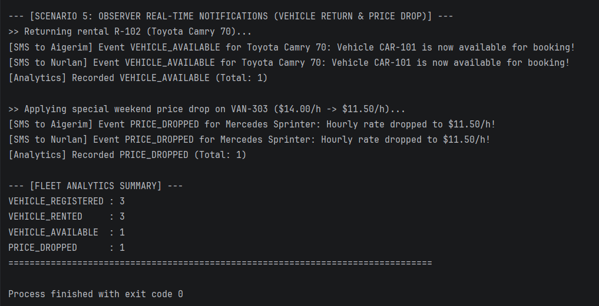
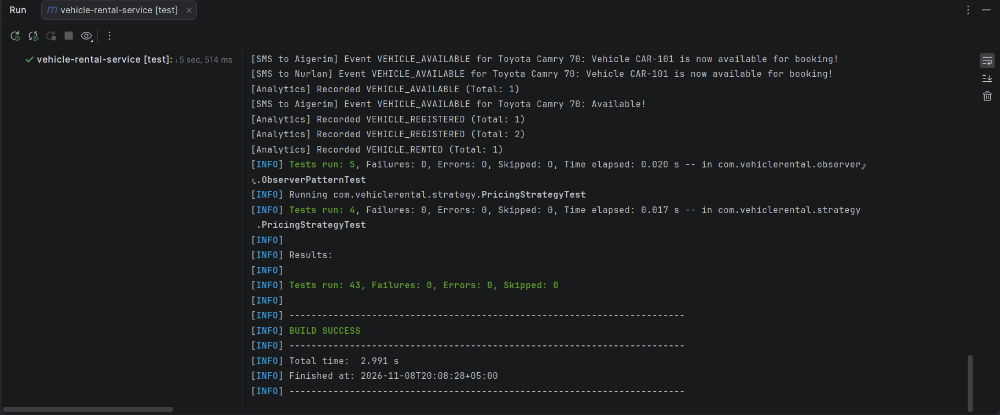
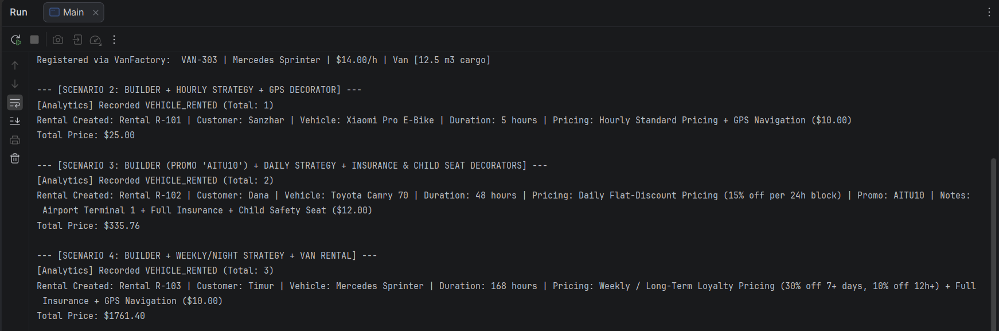

FINAL PROJECT REPORT

# Vehicle Rental Service

Team: Amir, Tangharyk, Madiyar | 12 November 2026

## 1. Project overview

Vehicle Rental Service is a Java application with a Swing desktop interface and a separate console demonstration for managing cars, bikes and vans. It supports vehicle registration, rental creation, flexible pricing, optional extras, returns, rate changes and event notifications. Six design patterns separate these responsibilities into small collaborating components.

## Objectives

- Create different vehicle types through a common product contract.

- Build validated rentals with a selected pricing policy, promotion and optional extras.

- Track availability and active rentals, then notify customers and analytics listeners when events occur.

| Pattern | Main responsibility | Owner |
| --- | --- | --- |
| Factory Method | Create Car, Bike and Van products. | Amir |
| Builder | Validate rental details and construct BaseRental. | Amir |
| Strategy | Select the tariff calculation algorithm. | Tangharyk |
| Decorator | Combine insurance, GPS and child-seat fees. | Tangharyk |
| Observer | Distribute fleet events to subscribed listeners. | Madiyar |
| Facade | Coordinate the complete rental workflow. | Madiyar |

## Technology and architecture

The project targets Java 21 with Maven and JUnit Jupiter 5.10.2. RentalApplication starts the Swing interface; Main remains the console demo. MainWindow delegates to RentalDesktopModel, which coordinates the existing RentalFacade. Swing is included in the JDK and needs no additional library. Fleet and rental data remain in memory.

# 2. Swing interface and user workflow

The desktop workspace provides Fleet overview, Create rental, Active rentals and Activity & alerts. The fleet table supports search and availability filters. Users register vehicles, preview prices, confirm rentals, return vehicles and reduce hourly rates through forms and buttons.

These images are off-screen renders of the actual updated Swing components, not captures of a native OS window. The view starts with six sample vehicles unless --empty is supplied. Data resets when the application closes.

# 3. Architecture and class connections

The project separates presentation, desktop coordination and domain logic. RentalApplication creates the JFrame on the Swing event-dispatch thread. MainWindow contains the panels and forms. RentalDesktopModel adapts UI requests to the existing rental subsystem; Main remains an alternative console client.

| Package | Key classes or interfaces | Responsibility |
| --- | --- | --- |
| ui | RentalApplication, MainWindow, RentalDesktopModel. | Launch the window, manage forms and connect UI actions to the domain. |
| contract | Vehicle, Rental, PricingStrategy, RentalListener and three enums. | Define the types used across package boundaries. |
| factory | VehicleFactory, concrete creators and vehicle products. | Create cars, bikes and vans with common identity and rate validation. |
| builder | RentalBuilder and BaseRental. | Collect validated reservation values and create the base rental. |
| strategy | HourlyPricing, DailyPricing, WeeklyNightPricing. | Calculate the selected time-based tariff. |
| decorator | RentalDecorator and its three concrete wrappers. | Add independent extra fees while preserving Rental. |
| observer | AvailabilityPublisher, CustomerNotifier, FleetAnalyticsListener. | Manage subscriptions, deliver events and process callbacks. |
| facade | RentalFacade. | Own fleet and active-rental maps and coordinate workflows. |

## Important retained references

MainWindow retains its RentalDesktopModel. The desktop model owns a RentalFacade and implements RentalListener to track fleet references, event counts and the latest 200 events. BaseRental retains Vehicle and PricingStrategy; a RentalDecorator retains another Rental; the facade owns fleet and active-rental maps.

## Why the shared contracts matter

Confirm rental calls the desktop model and then RentalFacade. Quote preview uses the same builder, strategies and decorators without storing an active rental. Facade events reach the model through RentalListener; its change callback queues the view refresh on the event-dispatch thread. The facade still selects concrete factories and decorators at composition points.

# 4. Factory Method

**Problem:** Fleet registration must create several vehicle types without repeating concrete constructor logic throughout the client.

**Solution:** VehicleFactory declares createVehicle(...). CarFactory, BikeFactory and VanFactory override it. The common orderNewVehicle(...) operation calls that factory method and returns an available Vehicle.

| Role | Implementation |
| --- | --- |
| Product contract | Vehicle |
| Shared product state | AbstractVehicle |
| Concrete products | Car, Bike and Van |
| Creators | VehicleFactory and its three subclasses |

AbstractVehicle validates identity, model and a finite positive hourly rate. RentalFacade selects the creator using VehicleType and checks duplicate IDs. New products can reuse the creator hierarchy, although facade selection must also be extended.

# 5. Builder

**Problem:** Rental creation requires an ID, customer, vehicle, duration and pricing strategy, plus optional promotion and notes. A long positional constructor would be difficult to read and validate.

**Solution:** RentalBuilder provides seven fluent with... methods. build() checks the required values, trims text and constructs BaseRental through the Rental interface.

Missing required values or a non-positive duration cause IllegalStateException. Blank optional values become null. Product fields are final, but the referenced Vehicle remains mutable; later rate changes can affect future price calculations.

# 6. Strategy: rental pricing

**Problem:** Different rental durations need different tariffs. Keeping every tariff inside the rental class would make pricing changes harder to isolate.

**Solution:** BaseRental delegates calculation to PricingStrategy. HourlyPricing, DailyPricing and WeeklyNightPricing implement the same contract and can be selected when the rental is built.

| Strategy | Implemented rule |
| --- | --- |
| HourlyPricing | Hourly rate × duration in hours. |
| DailyPricing | 15% discount on the hourly total when duration is at least 24 hours; otherwise the hourly total. |
| WeeklyNightPricing | 30% discount at 168 hours or more; otherwise 10% at 12 hours or more; otherwise the hourly total. |

## Promotion and calculation order

The strategies round their results to two decimal places. BaseRental then applies a 10% discount when the optional code AITU10 is supplied, ignoring letter case. Extra fees are added afterwards by decorators.

## Worked example

For a car at $8 per hour rented for 48 hours, DailyPricing gives $384.00 × 0.85 = $326.40. The AITU10 promotion reduces the base rental to $293.76 before extras.

The updated GUI requests hours for Hourly, days for Daily and weeks for Weekly / long-term. It converts days × 24 and weeks × 168 into service hours. Selecting a policy resets the duration to 5 hours, 1 day or 1 week. The backend still has its 12-hour discount tier, but the weekly GUI input uses whole weeks.

# 7. Decorator: optional extras

**Problem:** Customers can select different combinations of extras. A separate rental subclass for every combination would duplicate behavior.

**Solution:** RentalDecorator implements Rental and retains a wrapped Rental. Each concrete decorator delegates the existing behavior, adds its fee and extends the description. Wrappers can be stacked.

| Extra | Fee |
| --- | --- |
| InsuranceDecorator | $15 per started 24-hour period, with at least one period. |
| GpsDecorator | $10 flat fee. |
| ChildSeatDecorator | $12 flat fee. |

In the 48-hour car example, insurance adds $30 and a child seat adds $12, producing **$335.76**. The facade applies extras in list order; repeated extras are not automatically removed. The GUI checkboxes select each extra at most once.

The supplied UML uses a composition symbol for the wrapped rental. Java retains a reference here and does not enforce exclusive ownership.

# 8. Observer and Facade

**Observer:** AvailabilityPublisher manages RentalListener subscriptions and synchronously notifies a snapshot of that list. CustomerNotifier records and prints availability/price-drop messages; FleetAnalyticsListener counts every supported event.

**Facade:** RentalFacade exposes registration, rent, return and rate-change operations. It owns fleet and active-rental maps, selects factories, configures the builder, applies decorators and publishes lifecycle events.

The four event types are registration, rental, availability and price drop. RentalDesktopModel also implements RentalListener, so the GUI activity panel receives these events. It tracks counts and stores at most 200 messages. CustomerNotifier remains a console notification implementation; there is no external SMS provider.

# 9. Rental creation sequence

The supplied UML shows the console client named Main. The desktop version reaches the same facade through MainWindow and RentalDesktopModel. A quote preview is side-effect free; only Confirm rental follows the reservation sequence below.

- MainWindow converts the selected duration to hours and sends a request through RentalDesktopModel. The facade checks IDs, vehicle existence and availability.

- RentalBuilder validates the values and creates BaseRental with the chosen Vehicle and PricingStrategy.

- The facade wraps any selected extras, marks the vehicle unavailable and stores the active rental.

- Price calculation passes through the wrappers to BaseRental and its strategy. The promotion applies before extra fees.

- The facade publishes VEHICLE_RENTED and returns the Rental. The desktop refreshes the tables and opens Active rentals.

# 10. Return and notification sequence

The GUI asks for confirmation before returning the selected rental. RentalDesktopModel delegates to returnVehicle(...), which removes the active rental, restores availability and publishes VEHICLE_AVAILABLE. The activity panel refreshes through its listener callback. Console listeners continue to work in Main.

The console demonstration finishes with **3 registrations, 3 rentals, 1 availability event and 1 price-drop event**; the separate GUI starts with six vehicles. The supplied sequence simplifies the callback loop; its return arrows represent control returning from void callbacks.

# 11. Pricing examples and boundaries

The table compares backend tariff rules at $10 per hour before promotions or extras. The GUI sends hours directly for Hourly, converts whole days into hours for Daily, and converts whole weeks into hours for Weekly / long-term. For example, 2 Daily days is 48 hours and 1 Weekly week is 168 hours.

| Hours | HourlyPricing | DailyPricing | WeeklyNightPricing |
| --- | --- | --- | --- |
| 1 | $10.00 | $10.00 | $10.00 |
| 12 | $120.00 | $120.00 | $108.00 |
| 23 | $230.00 | $230.00 | $207.00 |
| 24 | $240.00 | $204.00 | $216.00 |
| 25 | $250.00 | $212.50 | $225.00 |
| 168 | $1,680.00 | $1,428.00 | $1,176.00 |

At a discount threshold, a longer rental can cost less than a slightly shorter one: DailyPricing charges $230 for 23 hours but $204 for 24 hours at this rate. This follows the current percentage-discount policy; it is not daily-block rounding.

## Complete 48-hour car calculation

| Stage | Amount |
| --- | --- |
| 48 hours at $8 per hour | $384.00 |
| Apply the 15% DailyPricing discount | $326.40 |
| Apply AITU10 to the discounted base rental | $293.76 |
| Add insurance: two started days at $15 | $323.76 |
| Add the $12 child seat | $335.76 |

## Insurance periods and later rate changes

Insurance costs $15 at both 1 hour and 24 hours, $30 at 25 hours, and $105 at 168 hours. GPS and child-seat charges stay flat regardless of duration.

BaseRental does not store a fixed price snapshot. If the same referenced vehicle later receives a different hourly rate, another calculateTotalPrice() call uses that updated rate. A production system should define whether active bookings keep their original price.

# 12. Validation and rental state

Validation is split between product creation, rental construction and facade workflows. Invalid requests are rejected at the layer that owns the relevant rule. The core tests distinguish invalid arguments from an unavailable vehicle or incomplete builder state. The GUI converts numeric inputs, displays validation dialogs and requires a selected available vehicle.

| Condition | Checking layer | Expected exception |
| --- | --- | --- |
| Blank vehicle ID/model, null type, or non-positive/non-finite rate. | AbstractVehicle / vehicle creation. | IllegalArgumentException |
| Duplicate fleet ID, including a whitespace-normalized duplicate. | RentalFacade registration. | IllegalArgumentException |
| Blank rental ID, duplicate active rental ID, or unknown vehicle. | RentalFacade rental request. | IllegalArgumentException |
| Vehicle is already unavailable. | RentalFacade rental request. | IllegalStateException |
| Missing builder values or non-positive duration. | RentalBuilder.build(). | IllegalStateException |
| Unknown active rental on return. | RentalFacade return operation. | IllegalArgumentException |
| Rate is not a finite positive reduction. | RentalDesktopModel.reduceRate(). | IllegalArgumentException |

## Successful lifecycle transitions

| Operation | Vehicle availability | Active-rental collection |
| --- | --- | --- |
| Register a new vehicle | Available. | No rental added. |
| Rent an available vehicle | Unavailable. | New rental stored. |
| Return an active rental | Available again. | Returned rental removed. |

IDs and required customer text are trimmed. Blank optional promo codes and notes become null. Null extra entries are ignored; repeated non-null extras are applied repeatedly. These behaviors are part of the current implementation.

State changes occur before observer notification. Listener exceptions are not isolated and can propagate after state has changed, so the workflow is not transactional. Concurrent rentals are also not protected by locking.

# 13. Integration and SOLID principles

All six patterns collaborate through shared contracts. Factory Method produces Vehicle objects; Builder produces a Rental; Strategy computes its base price; Decorator adds extras; Observer distributes events; and Facade coordinates the workflow.

| Principle | Concrete application |
| --- | --- |
| SRP | Factories create products, the builder validates construction, strategies calculate tariffs and the publisher dispatches events. |
| OCP | New strategies, decorators and listeners can reuse existing abstractions. Facade enum switches still need updates for newly selected vehicle types or extras. |
| LSP | Vehicle products share the Vehicle contract; BaseRental and its wrappers share Rental and preserve the common API. |
| ISP | Vehicle, Rental, PricingStrategy and RentalListener separate fleet, reservation, pricing and notification capabilities. |
| DIP | BaseRental uses Vehicle and PricingStrategy; decorators wrap Rental; the publisher uses RentalListener. The facade still constructs concrete factories and decorators. |

The supplied integrated UML focuses on the pricing/decorator subsystem. The class diagrams on earlier pages show the factory, builder and observer boundaries. The design localizes changes but does not eliminate every dependency on concrete classes.

# 14. Testing and verification strategy

The updated archive contains nine JUnit classes and 43 core test methods. It does not include separate JUnit tests for the ui package. The table inventories the submitted source; it does not imply a measured coverage percentage.

| Test class | Tests | Main focus |
| --- | --- | --- |
| VehicleFactoryTest | 8 | Product types/specifications, rate validation, independent products and the overridden factory method. |
| RentalBuilderTest | 8 | Required values, optional text, promotion, builder reuse and pricing delegation. |
| PricingStrategyTest | 4 | Hourly multiplication, discount thresholds and invalid input. |
| RentalDecoratorTest | 4 | Insurance periods, flat extras, stacked wrappers and null wrapped rentals. |
| ObserverPatternTest | 5 | Subscription, unsubscription, notification history, event counts and duplicate subscriptions. |
| RentalFacadeUnitTest | 9 | Registration, rental/return, rate changes, canonical IDs and duplicate rejection. |
| FactoryBuilderIntegrationTest | 3 | Vehicle creation and validated rentals through the facade, plus invalid request state preservation. |
| FullRentalFlowIntegrationTest | 1 | End-to-end rental flow combining strategies and decorators. |
| MainTest | 1 | The console demonstration runs without an exception. |

## How to assess the evidence

The supplied Maven screenshot reports 43 passing core tests. During this update, production code compiled with Java 21 and Main ran successfully. Off-screen Swing checks confirmed Daily 2 days = 48 hours ($335.76 with the selected promotion/extras), Weekly 1 week = 168 hours, quote previews, booking, returns, rate validation and events. These additional review checks are not part of the 43-test JUnit count. Native windows/dialogs and the full Maven suite were not rerun here.

## Useful checks before release

- Run the full suite from a clean checkout using the configured JDK 21 and confirm that all 43 tests are discovered.

- Run Main and compare the three prices and four event totals with the reported examples.

- If implementation rules change, update the tests and report together so the submitted evidence describes the same version.

# 15. Results and conclusion

The submitted source contains **43 core test methods across nine test classes**. They cover factories, builder validation, tariffs, extras, notifications, facade state changes, integrated rental flows and the main demo. The supplied Maven screenshot reports **43 tests run, 0 failures, 0 errors, 0 skipped and BUILD SUCCESS**.

| Demo scenario | Result |
| --- | --- |
| Bike: 5 hours at $3/hour + GPS | $25.00 |
| Car: 48 hours at $8/hour, DailyPricing, AITU10, insurance + child seat | $335.76 |
| Van: 168 hours at $14/hour, WeeklyNightPricing, insurance + GPS | $1,761.40 |

Run RentalApplication for the GUI and Main for the console demonstration. The updated desktop forms connect to the same domain behavior; GUI data resets when the app closes. Rendered views were inspected off-screen because this review environment has a headless-only Java runtime.

## Conclusion and future work

The project combines a Swing desktop workflow with six cooperating patterns for validated rentals, configurable pricing, composable extras and event notifications. Future work can add persistent storage, fixed price snapshots with decimal money, maintenance states, concurrency control and isolated listener failures. The current version stores data in memory, retains mutable vehicle references and does not provide real payments or external SMS delivery.
