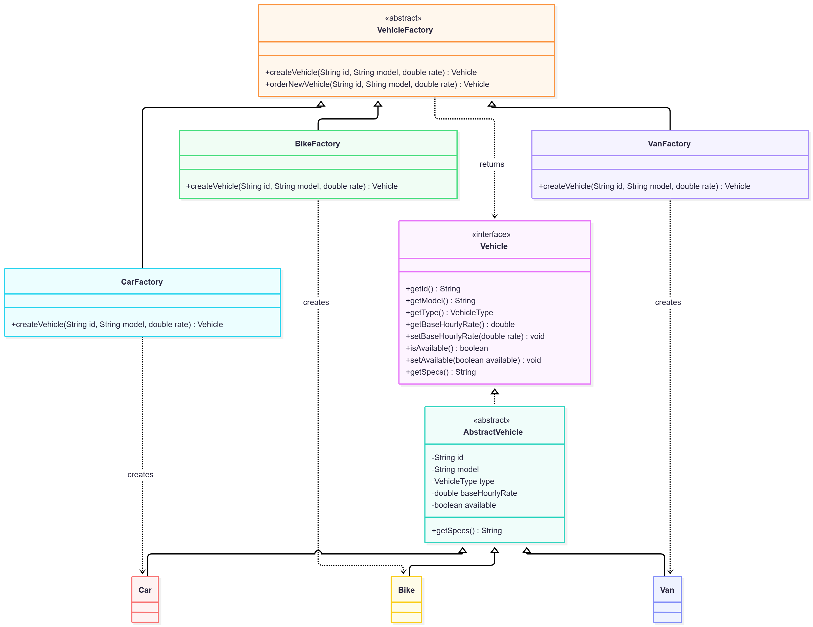
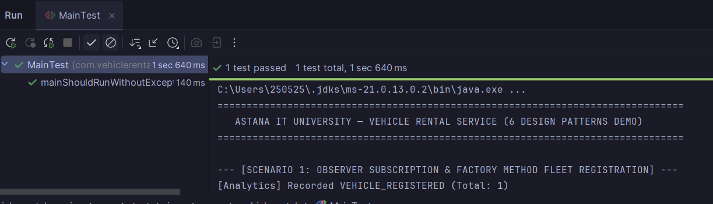
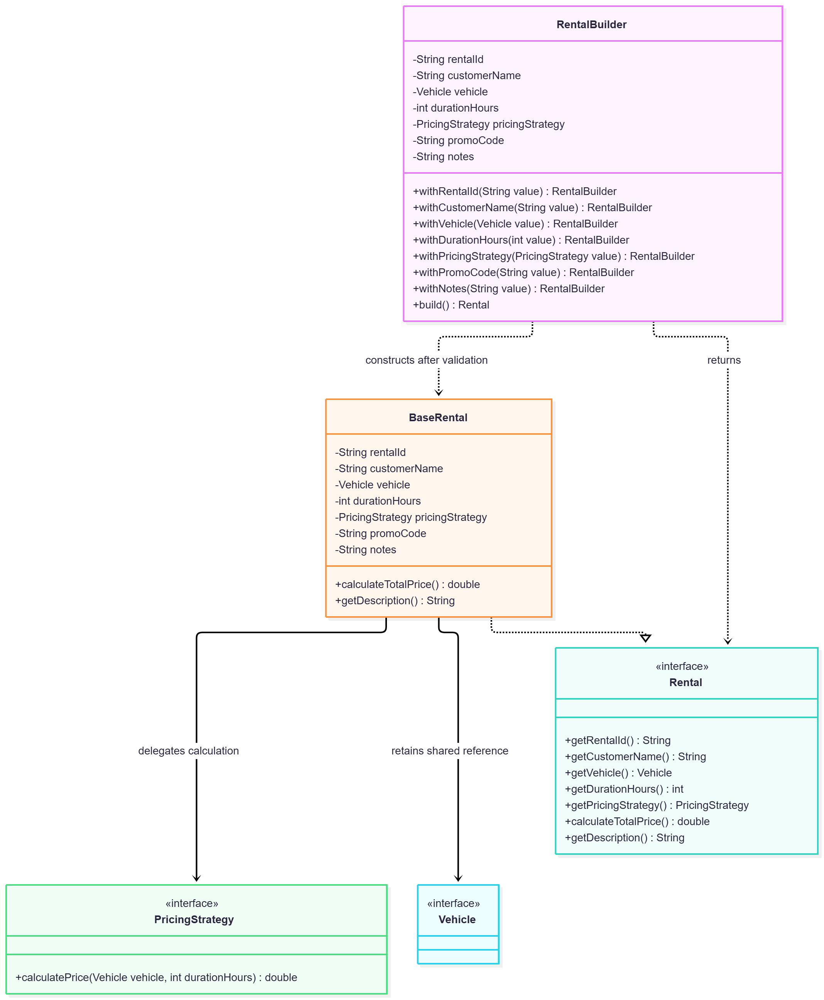
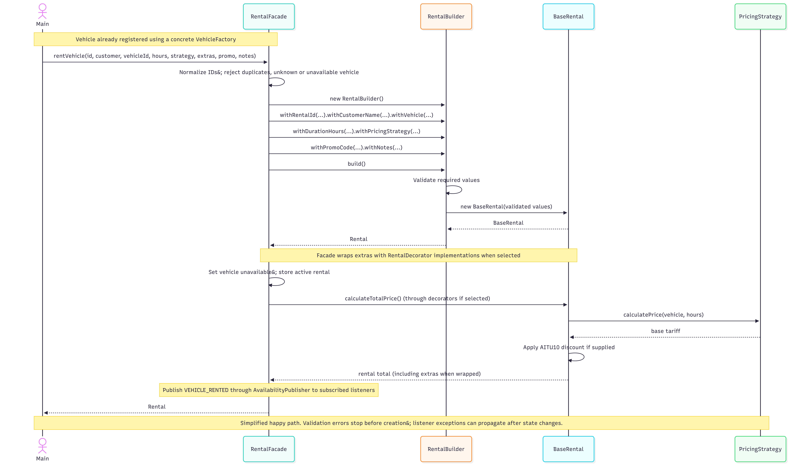
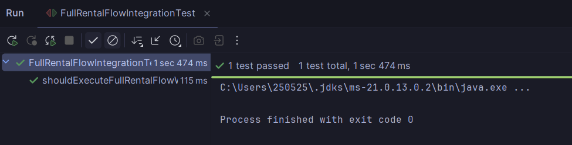

# Part 1 - Introduction, Factory Method and Builder
Author: Amir

## 1. Introduction and System Architecture

### 1.1 Problem domain and motivation
A vehicle rental service must handle different vehicle categories, duration-based prices, optional equipment and changing fleet availability. A single class responsible for creation, pricing, booking and alerts would be difficult to extend or test. This project separates those responsibilities using shared Java contracts and six design patterns.

The console application registers cars, bikes and vans, creates rentals with selected pricing strategies and optional extras, returns vehicles, applies rate changes and publishes events. Data is held in memory for the lifetime of the process. Customer SMS output is a console simulation, not an external messaging service.

### 1.2 Objectives and technology
The implementation uses a Maven project configured for Java 21 and JUnit Jupiter 5.10.2. Its objectives are to demonstrate six cooperating patterns, validate requests, keep tariffs interchangeable, combine extras dynamically and notify independent listeners. This report describes the supplied source snapshot, not a deployed commercial rental system.

| Pattern | Main role | Team owner |
| --- | --- | --- |
| Factory Method | VehicleFactory with CarFactory, BikeFactory and VanFactory creates Vehicle products | Amir |
| Builder | RentalBuilder validates fields and constructs BaseRental | Amir |
| Strategy | HourlyPricing, DailyPricing and WeeklyNightPricing supply tariffs | Tangharyk |
| Decorator | Insurance, GPS and child-seat wrappers add fees and descriptions | Tangharyk |
| Observer | AvailabilityPublisher notifies RentalListener implementations | Madiyar |
| Facade | RentalFacade coordinates registration, rental, return and rate changes | Madiyar |

### 1.3 Architecture and interaction
`Main` calls `RentalFacade`. The facade stores the fleet and active rentals in maps. Registration selects a concrete factory. Renting validates IDs and availability, uses the builder, wraps selected extras, changes fleet state and publishes a rental event. Returning makes a vehicle available and publishes another event. `BaseRental` retains the selected `Vehicle` and `PricingStrategy` interfaces; decorators retain `Rental`, and the publisher retains `RentalListener`.

The important dependency direction is toward the contracts package. The facade is also the composition point: its enum switches explicitly select concrete factories and decorators. Adding a new tariff does not require changing BaseRental; integrating a new enum-selected vehicle or extra still requires changing the facade's selection code.

## 2.1 Factory Method Pattern

### Problem in context
Registration supports vehicles with different specifications. Repeating concrete constructor calls throughout client code would couple registration to all vehicle classes. Creation needs a common contract and a dedicated extension point.

### Solution and pattern roles
`Vehicle` is the product interface. `AbstractVehicle` shares identity, type, hourly rate and availability. `Car`, `Bike` and `Van` provide specifications. The abstract creator `VehicleFactory` declares the public factory method `createVehicle(String id, String model, double baseHourlyRate)`. `CarFactory`, `BikeFactory` and `VanFactory` override it. The common `orderNewVehicle(...)` operation calls that virtual method, sets availability and returns a `Vehicle`.

`AbstractVehicle` rejects blank identity/model, null vehicle type and non-finite or non-positive rates. The facade checks duplicate fleet IDs. Adding a product needs a concrete vehicle and creator; using it through the facade also needs its VehicleType and switch mapping.

### UML class diagram


### Key Java code
```java
package com.vehiclerental.factory;

import com.vehiclerental.contract.Vehicle;

/**
 * Concrete creator whose factory method constructs Car products.
 */
public class CarFactory extends VehicleFactory {
    /**
     * Factory Method that creates the corresponding concrete Vehicle product.
     * @param id unique vehicle identifier
     * @param model vehicle model
     * @param baseHourlyRate finite positive hourly price in USD
     * @return new vehicle product
     */
    @Override
    public Vehicle createVehicle(String id, String model, double baseHourlyRate) {
        return new Car(id, model, baseHourlyRate);
    }
}
```
The subclass's overridden creation method is the Factory Method extension point. The facade's type switch selects a creator; it does not replace the creator hierarchy.

### Execution evidence

The screenshot shows the start of the console demo and its MainTest result. The current demo was also run during this review: it registers Toyota Camry 70, Xiaomi Pro E-Bike and Mercedes Sprinter with the corresponding product specifications. The screenshot alone does not display the complete registration output.

## 2.2 Builder Pattern

### Problem in context
A rental requires an identifier, customer, vehicle, positive duration and pricing strategy, with optional promotion and notes. A long positional constructor makes call sites difficult to understand and risks incomplete initialization.

### Solution and pattern roles
`RentalBuilder` is a fluent concrete builder. All seven `with...` methods return the same builder; `build()` validates the required values and constructs the product `BaseRental`, exposed through `Rental`. No separate abstract builder or director is necessary here; the facade performs the director role in the rental workflow.

Invalid required fields cause IllegalStateException in the builder. Text is trimmed; blank optional values become null. Product fields are final, so reusing the builder does not replace values stored in an earlier product. This is shallow immutability: retained Vehicle and PricingStrategy objects are shared. A later hourly-rate change can alter an existing rental's computed price.

### UML class diagram


### Key Java usage
```java
Rental rental = new RentalBuilder()
        .withRentalId("R-EXAMPLE")
        .withCustomerName("Amir")
        .withVehicle(vehicle)
        .withDurationHours(5)
        .withPricingStrategy(new HourlyPricing())
        .withPromoCode("AITU10")
        .withNotes("Pickup at 10:00")
        .build();
// At $10/hour: 5 * 10 * 0.90 = $45, before extras.
```
`BaseRental.calculateTotalPrice()` delegates to PricingStrategy, then applies the case-insensitive AITU10 discount. Decorators are applied outside the builder, so optional extra charges are added after that discount.

### Rental creation sequence

The sequence shows successful creation. With extras selected, calculateTotalPrice travels through the wrappers to BaseRental, then each wrapper adds its fee while the call returns. Observer notification occurs after the facade updates availability and the active-rental map.

### Execution evidence

The supplied image is evidence of the displayed selected integration run. It is not proof that all tests in this source snapshot pass. Section 4 records the current review findings and remaining verification work.
