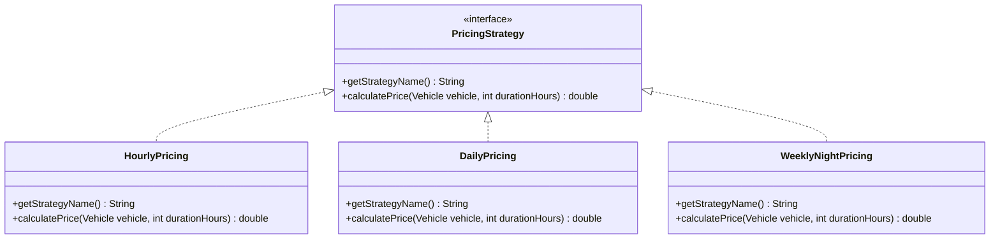
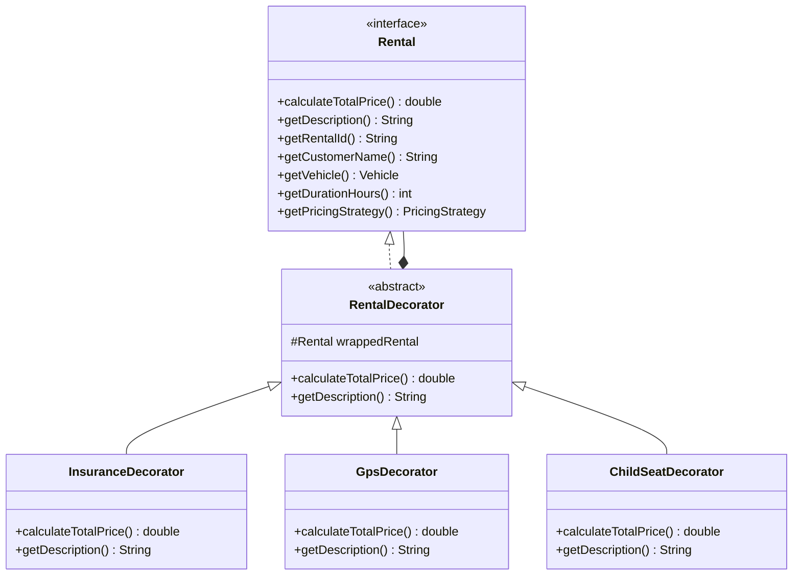
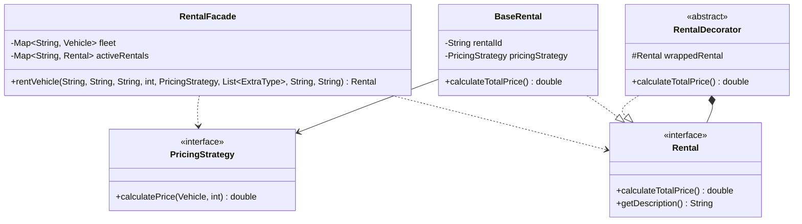

# Part 2.3 & 2.4: Strategy & Decorator Design Patterns
**Author:** Tangharyk (takos-404)

---

## 2.3 Pricing Strategy Pattern

### Purpose & Problem Statement
The Vehicle Rental Service requires flexible pricing algorithms based on rental duration and promotions. Hardcoding rate calculations inside vehicle or rental classes leads to tight coupling, massive conditional logic, and violates the Open/Closed Principle (OCP).

### Solution Architecture
The `PricingStrategy` interface declares `calculatePrice(Vehicle, int durationHours)` and `getStrategyName()`. Three concrete strategies implement this contract:
1. `HourlyPricing`: Standard linear hourly rate.
2. `DailyPricing`: Flat 15% discount for rentals of 24 hours or longer.
3. `WeeklyNightPricing`: Loyalty tier offering 10% off for 12h+ and 30% off for weekly (168h+) rentals.

---

## 2.4 Rental Decorator Pattern

### Purpose & Problem Statement
Customers often add extra features (Full Insurance, GPS Navigation, Child Safety Seat) to their rental. Using class inheritance for every combination would lead to class explosion ($2^N$ classes).

### Solution Architecture
The `RentalDecorator` abstract class implements `Rental` and holds a reference to a wrapped `Rental` instance (`wrappedRental`). Concrete decorators add their own cost and extend the description transparently:
- `InsuranceDecorator`: +$15.00/day
- `GpsDecorator`: +$10.00 flat fee
- `ChildSeatDecorator`: +$12.00 flat fee

---

## 2.5 Integrated Class Diagram (Strategy & Decorator Integration)

---

## 3. SOLID Principles Verification (Strategy & Decorator)

1. **Single Responsibility Principle (SRP):**
   - Each pricing strategy class (`HourlyPricing`, `DailyPricing`, `WeeklyNightPricing`) is solely responsible for calculating its specific tariff rate.
   - Each decorator (`InsuranceDecorator`, `GpsDecorator`, `ChildSeatDecorator`) manages only its specific extra fee calculation and description formatting.

2. **Open/Closed Principle (OCP):**
   - New pricing tariffs or add-on features can be introduced by adding new classes that implement `PricingStrategy` or extend `RentalDecorator` without modifying any existing business logic or `RentalFacade`.

3. **Liskov Substitution Principle (LSP):**
   - Any `RentalDecorator` instance can seamlessly substitute a standard `Rental` object throughout the codebase without altering expected program behavior.

4. **Interface Segregation Principle (ISP):**
   - The `PricingStrategy` and `Rental` contracts define minimal, highly focused interfaces, ensuring classes don't depend on unused methods.

5. **Dependency Inversion Principle (DIP):**
   - High-level orchestrators (`RentalFacade`) depend strictly on abstractions (`PricingStrategy`, `Rental`), remaining decoupled from concrete implementations.