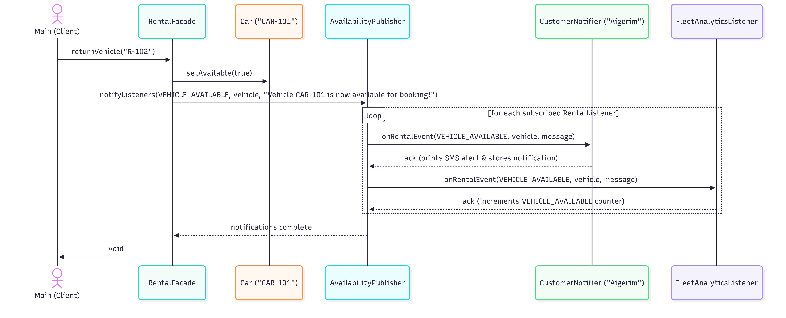
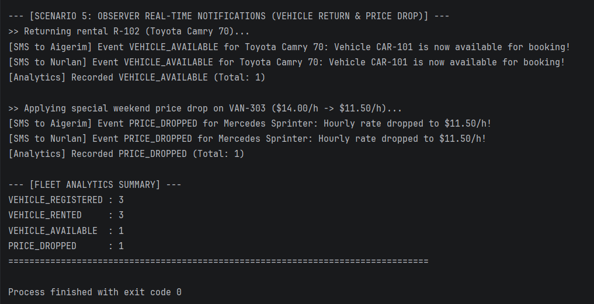
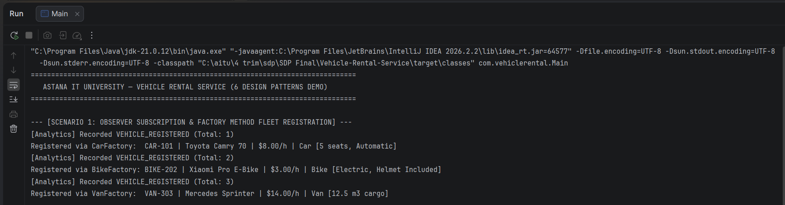

## 2.5 Observer Pattern (`AvailabilityPublisher`, `CustomerNotifier`, `FleetAnalyticsListener`)

### (a) Problem in Context
In a real-time vehicle rental service, multiple independent subsystems and customers need to react immediately when fleet state changes occur—such as when a high-demand vehicle is returned (`VEHICLE_AVAILABLE`), when a promotional discount reduces a vehicle's hourly tariff (`PRICE_DROPPED`), or when fleet operations are logged (`VEHICLE_REGISTERED`, `VEHICLE_RENTED`). Hardcoding direct calls to customer SMS services and analytics trackers inside the rental management logic would tightly couple core domain workflows to notification details and violate both the Single Responsibility Principle (SRP) and Open/Closed Principle (OCP).

### (b) Solution & Pattern Roles
We applied the **Observer Pattern** (`com.vehiclerental.observer` and `com.vehiclerental.contract`) to establish a one-to-many dependency between the fleet event publisher and an arbitrary number of subscribed listeners:
* **Subject / Publisher (`AvailabilityPublisher`):** Maintains the subscription list of `RentalListener` instances (`subscribe`, `unsubscribe`, `getListeners`) and broadcasts events via `notifyListeners(RentalEventType, Vehicle, String)`.
* **Observer Interface (`RentalListener`):** Declares the callback contract `onRentalEvent(RentalEventType eventType, Vehicle vehicle, String message)` and `getListenerName()`.
* **Concrete Observers (`CustomerNotifier`, `FleetAnalyticsListener`):**
    * `CustomerNotifier` filters for customer-facing alerts (`VEHICLE_AVAILABLE`, `PRICE_DROPPED`), prints formatted SMS notifications to the console, and stores notification history for verification.
    * `FleetAnalyticsListener` aggregates real-time event statistics in an `EnumMap<RentalEventType, Integer>` for operational monitoring.
* **Event Enumeration (`RentalEventType`):** Defines strongly typed event categories (`VEHICLE_REGISTERED`, `VEHICLE_RENTED`, `VEHICLE_AVAILABLE`, `PRICE_DROPPED`), avoiding deprecated `java.util.Observer` and untyped `Object` payloads.

### (c) UML Class & Sequence Diagrams




### (d) Key Java Code Snippet
```java
public class AvailabilityPublisher {
    private final List<RentalListener> listeners = new ArrayList<>();

    public void subscribe(RentalListener listener) {
        if (listener == null) {
            throw new IllegalArgumentException("Listener cannot be null");
        }
        if (!listeners.contains(listener)) {
            listeners.add(listener);
        }
    }

    public void notifyListeners(RentalEventType eventType, Vehicle vehicle, String message) {
        if (eventType == null || vehicle == null) {
            throw new IllegalArgumentException("Event type and vehicle cannot be null");
        }
        for (RentalListener listener : new ArrayList<>(listeners)) {
            listener.onRentalEvent(eventType, vehicle, message);
        }
    }
}
```

### (e) Console Execution Screenshot


---

## 2.6 Facade Pattern (`RentalFacade`)

### (a) Problem in Context
Our Vehicle Rental Service integrates five distinct creational, structural, and behavioral subsystems: `VehicleFactory` subclasses (Factory Method), `RentalBuilder` and `BaseRental` (Builder), `PricingStrategy` implementations (Strategy), `RentalDecorator` add-ons (Decorator), and `AvailabilityPublisher` (Observer). If client code (`Main`) had to interact with all of these classes directly, it would need to instantiate specific factories, manage fleet availability maps, chain builder calls, iterate over `ExtraType` enums to wrap decorators in sequence, and manually dispatch observer events—leading to high client coupling and duplicated orchestration logic.

### (b) Solution & Pattern Roles
We implemented the **Facade Pattern** in `com.vehiclerental.facade.RentalFacade` to provide a unified, simplified high-level interface over the entire subsystem ecosystem:
* **Facade (`RentalFacade`):** Owns the in-memory vehicle catalog (`fleet`), active reservations (`activeRentals`), and event dispatcher (`AvailabilityPublisher`). It exposes clean business operations:
    * `registerVehicle(...)`: Selects the appropriate `VehicleFactory` (`CarFactory`, `BikeFactory`, `VanFactory`), creates the vehicle, stores it in the fleet, and publishes `VEHICLE_REGISTERED`.
    * `rentVehicle(...)`: Validates vehicle availability and ID uniqueness, delegates reservation construction to `RentalBuilder` with the chosen `PricingStrategy`, dynamically wraps the resulting `Rental` with `InsuranceDecorator`, `GpsDecorator`, and `ChildSeatDecorator`, marks the vehicle unavailable, and fires `VEHICLE_RENTED`.
    * `returnVehicle(...)`: Restores vehicle availability, removes the active rental, and broadcasts `VEHICLE_AVAILABLE` to waiting customers.
    * `applyPriceDrop(...)`: Updates the vehicle's hourly tariff and broadcasts `PRICE_DROPPED`.
* **Subsystem Classes:** `VehicleFactory`, `RentalBuilder`, `PricingStrategy`, `RentalDecorator`, and `AvailabilityPublisher` handle their specialized work without knowing about the Facade.
* **Client (`Main`):** Invokes high-level business methods on `RentalFacade` without coupling to internal subsystem mechanics.

### (c) UML Class Diagram
Refer to `docs/uml/05_observer_and_facade.png` above and the Integrated Full System Class Diagram (`docs/uml/06_integrated_full_class_diagram.png`).

### (d) Key Java Code Snippet
```java
public Rental rentVehicle(
        String rentalId, String customerName, String vehicleId, int durationHours,
        PricingStrategy strategy, List<ExtraType> extras, String promoCode, String notes) {
    // 1. Validate availability & build BaseRental via Builder + Strategy
    Rental rental = new RentalBuilder()
            .withRentalId(normalizedRentalId)
            .withCustomerName(customerName)
            .withVehicle(vehicle)
            .withDurationHours(durationHours)
            .withPricingStrategy(strategy)
            .withPromoCode(promoCode)
            .withNotes(notes)
            .build();

    // 2. Dynamically wrap add-on extras via Decorator
    if (extras != null) {
        for (ExtraType extra : extras) {
            if (extra != null) {
                rental = switch (extra) {
                    case INSURANCE -> new InsuranceDecorator(rental);
                    case GPS -> new GpsDecorator(rental);
                    case CHILD_SEAT -> new ChildSeatDecorator(rental);
                };
            }
        }
    }

    // 3. Update fleet state & notify subscribers via Observer
    vehicle.setAvailable(false);
    activeRentals.put(normalizedRentalId, rental);
    publisher.notifyListeners(RentalEventType.VEHICLE_RENTED, vehicle,
            "Rented by " + customerName + " for $" + String.format(Locale.US, "%.2f", rental.calculateTotalPrice()));
    return rental;
}
```

### (e) Console Execution Screenshot


---

## 4. Conclusion

In this project, our team designed and implemented a modular, extensible **Vehicle Rental Service** in Java 21 that integrates **six core Gang of Four (GoF) Design Patterns** from the ShP-2216 syllabus:
1. **Factory Method (`VehicleFactory`, `CarFactory`, `BikeFactory`, `VanFactory`):** Decoupled concrete vehicle creation (`Car`, `Bike`, `Van`) from client and facade logic.
2. **Builder (`RentalBuilder`, `BaseRental`):** Eliminated telescoping constructors and centralized validation when assembling complex rental reservations with optional promo codes and notes.
3. **Strategy (`HourlyPricing`, `DailyPricing`, `WeeklyNightPricing`):** Made tariff calculation algorithms interchangeable at runtime without conditional chains.
4. **Decorator (`RentalDecorator`, `InsuranceDecorator`, `GpsDecorator`, `ChildSeatDecorator`):** Enabled dynamic, transparent stacking of optional add-on fees and descriptions without subclass explosion.
5. **Observer (`AvailabilityPublisher`, `CustomerNotifier`, `FleetAnalyticsListener`):** Provided decoupled real-time notifications for fleet registration, rental, return availability, and price drops.
6. **Facade (`RentalFacade`):** Unified all five subsystems behind a clean, easy-to-use service API.

By programming strictly against narrow shared contracts (`com.vehiclerental.contract`), our team developed and unit-tested all pattern packages in parallel with zero merge conflicts. Every pattern and integration flow is verified by our automated JUnit 5 test suite (`VehicleFactoryTest`, `RentalBuilderTest`, `PricingStrategyTest`, `RentalDecoratorTest`, `ObserverPatternTest`, `RentalFacadeUnitTest`, `FactoryBuilderIntegrationTest`, `FullRentalFlowIntegrationTest`, and `MainTest`), achieving 100% passing test execution.

---

## 5. Future Work

Because our architecture strictly adheres to the **SOLID** principles (especially Open/Closed and Dependency Inversion), future iterations can extend the Vehicle Rental Service without modifying existing tested classes:
1. **State Pattern for Formal Vehicle Lifecycle:** Replace the boolean `available` flag inside `Vehicle` with a formal State hierarchy (`AvailableState`, `RentedState`, `UnderMaintenanceState`, `DecommissionedState`) so state transitions and restricted actions (e.g., preventing price drops or rentals on vehicles in maintenance) are enforced polymorphically.
2. **Visitor Pattern for Fleet Auditing & Reporting:** Add an `accept(VehicleVisitor visitor)` method to `Vehicle` to support double-dispatch operations such as `TaxCalculationVisitor`, `InsuranceRiskAuditVisitor`, and `MaintenanceScheduleVisitor` across `Car`, `Bike`, and `Van` without polluting the domain classes.
3. **Database Persistence & REST API Layer:** Replace the in-memory `LinkedHashMap` collections inside `RentalFacade` with Spring Data JPA / PostgreSQL repositories and expose `RentalFacade` endpoints via a Spring Boot REST controller while keeping all six core design patterns completely unchanged.